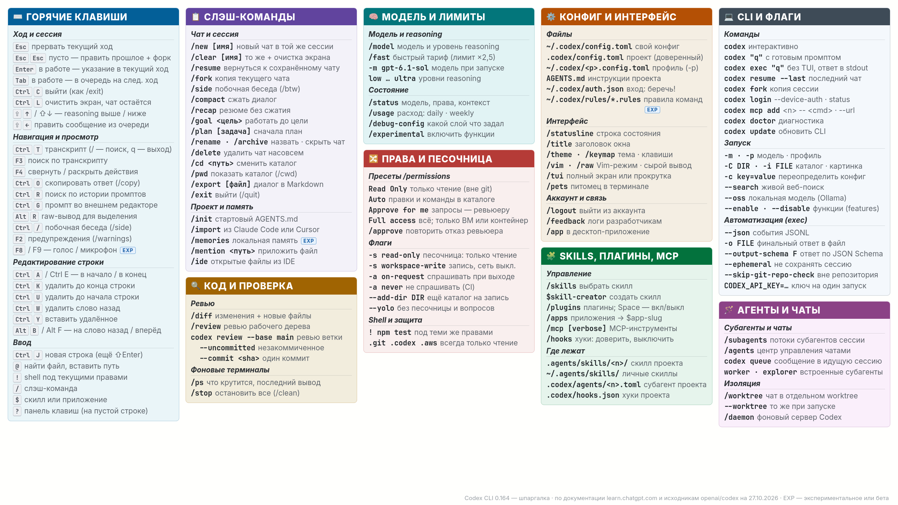

# ⌨️ Codex CLI — шпаргалка

Плотная выжимка по разделам: клавиши, команды, права, конфиги, флаги. Всё сверено 27.10.2026 с документацией learn.chatgpt.com и исходниками релиза **0.164.0**.

Полный разбор — в [гайде](Codex%20CLI%20%E2%80%94%20%D0%B3%D0%B0%D0%B9%D0%B4.md). Установка, тарифы и песочница — в [обзоре](Codex%20CLI%20%28OpenAI%29%20%E2%80%94%20%D1%82%D0%B5%D1%80%D0%BC%D0%B8%D0%BD%D0%B0%D0%BB%D1%8C%D0%BD%D1%8B%D0%B9%20%D0%B0%D0%B3%D0%B5%D0%BD%D1%82%20%D0%B4%D0%BB%D1%8F%20%D0%BF%D1%80%D0%BE%D0%B3%D1%80%D0%B0%D0%BC%D0%BC%D0%B8%D1%80%D0%BE%D0%B2%D0%B0%D0%BD%D0%B8%D1%8F.md). То же для Claude Code — [шпаргалка Claude Code](Claude%20Code%20%E2%80%94%20%D1%88%D0%BF%D0%B0%D1%80%D0%B3%D0%B0%D0%BB%D0%BA%D0%B0%20%D0%BA%D0%BE%D0%BC%D0%B0%D0%BD%D0%B4.md).

## 🖼️ Постер для второго монитора



Постер собран из этой же заметки под **2560×1440 (2K/QHD)**, около 870 КБ, по документации и исходникам на 27.10.2026. Файл: `Cache/Codex-CLI/codex-cli-cheatsheet-2560x1440.png`.

Оформление — как у [постера Claude Code](Claude%20Code%20%E2%80%94%20%D1%88%D0%BF%D0%B0%D1%80%D0%B3%D0%B0%D0%BB%D0%BA%D0%B0%20%D0%BA%D0%BE%D0%BC%D0%B0%D0%BD%D0%B4.md): цветные шапки блоков с иконками, светлая подложка того же оттенка, клавиши «кнопками», курсивные подзаголовки с линией, моноширинный жирный для команд. Шрифты — Inter и JetBrains Mono. Синий бейдж **EXP** отмечает экспериментальное или бету.

Собирается скриптом [`Tools/codex-cli-poster/poster.py`](../../Tools/codex-cli-poster/README.md): после правок шпаргалки обновите в нём `BLOCKS` и перезапустите.

---

> [!tip] Как искать команду
> `/` в начале строки открывает список команд, дальше он фильтруется по мере набора. `?` на пустой строке — панель горячих клавиш. Пока Codex работает, команду можно набрать и нажать `Tab`: она выполнится после текущего хода.

---

## 🔥 Горячие клавиши

**Ход и сессия**

| Клавиши | Действие |
| :--- | :--- |
| `Esc` | Прервать текущий ход |
| `Esc` `Esc` | На пустой строке — отредактировать прошлое сообщение и ответвить чат с этой точки |
| `Enter` | Отправить; пока Codex работает — добавить указание в текущий ход |
| `Tab` | Пока Codex работает — поставить сообщение, команду или `!` в очередь на следующий ход |
| `Ctrl+C` | Выйти (как `/exit`) |
| `Ctrl+L` | Очистить экран, чат остаётся (в отличие от `/clear`) |
| `Shift+↑` / `Shift+↓` | Reasoning выше / ниже (также `Alt+.` / `Alt+,`) |
| `Shift+←` / `Alt+↑` | Редактировать сообщение из очереди |
| `Ctrl+]` | Пропустить вопрос агента |

**Навигация и просмотр**

| Клавиши | Действие |
| :--- | :--- |
| `Ctrl+T` | Транскрипт; внутри `/` или `F3` — поиск, `q` — выход |
| `F3` | Поиск по транскрипту |
| `F4` | Свернуть или раскрыть группы действий в транскрипте |
| `Ctrl+O` | Скопировать последний ответ (как `/copy`) |
| `Ctrl+R` / `Ctrl+S` | Поиск по истории промптов назад / вперёд |
| `↑` / `↓` | История черновиков |
| `Ctrl+G` | Промпт во внешнем редакторе (`$VISUAL` или `$EDITOR`) |
| `Alt+R` | «Сырой» вывод для выделения мышью (как `/raw`) |
| `Ctrl+/` | Побочная беседа (как `/side`) |
| `F2` | Предупреждения (как `/warnings`) |
| `F8` / `F9` | Голос / выключить микрофон (экспериментально) |

**Редактирование строки** (в стиле readline)

| Клавиши | Действие |
| :--- | :--- |
| `Ctrl+A` / `Ctrl+E` | В начало / в конец строки (также `Home` / `End`) |
| `Ctrl+K` / `Ctrl+U` | Удалить до конца / до начала строки |
| `Ctrl+W` / `Alt+Backspace` | Удалить слово назад |
| `Alt+D` | Удалить слово вперёд |
| `Ctrl+Y` | Вставить удалённое |
| `Alt+B` / `Alt+F` | На слово назад / вперёд |
| `Ctrl+J`, `Shift+Enter`, `Alt+Enter` | Новая строка |

Свои сочетания — `/keymap`, они сохраняются в `tui.keymap` конфига. Режим Vim в поле ввода — `/vim`.

**Спецсимволы ввода**

| Символ | Что делает |
| :--- | :--- |
| `@` | Поиск файла в рабочем каталоге, подставляет путь |
| `!` | Shell-команда **под текущими правами и песочницей** |
| `/` | Слэш-команда |
| `$` | Скилл или приложение: `$skill-creator`, `$app-slug` |

---

## ⚡ Слэш-команды

**Чат и сессия**

| Команда | Что делает |
| :--- | :--- |
| `/new [имя]` | Новый чат в той же сессии CLI |
| `/clear [имя]` | Очистить экран и начать новый чат |
| `/resume` | Вернуться к сохранённому чату |
| `/fork` | Копия текущего чата с новым ID |
| `/side` | Эфемерная побочная беседа; алиас `/btw` |
| `/compact` | Заменить ранние ходы кратким пересказом |
| `/recap` | Резюме диалога без сжатия |
| `/goal <цель>` | Цель, к которой Codex идёт ход за ходом; `edit`, `pause`, `resume`, `clear` |
| `/plan [задача]` | Plan-режим: сначала план, потом правки |
| `/rename` / `/archive` / `/delete` | Назвать / скрыть / удалить чат насовсем |
| `/cd <путь>` / `/pwd` | Перенести чат в другой каталог / показать текущий (`/cwd`) |
| `/worktree` | Продолжить в отдельном git worktree |
| `/export [файл]` | Весь диалог в Markdown |
| `/copy` | Скопировать последний ответ |
| `/exit` | Выйти; алиас `/quit` |

**Проект и память**

| Команда | Что делает |
| :--- | :--- |
| `/init` | Стартовый `AGENTS.md` |
| `/import` | Настройки, проект и до 50 чатов за 30 дней из Claude Code или Cursor |
| `/memories` | Локальная память: использовать и пополнять (экспериментально) |
| `/mention <путь>` | Приложить файл к чату |
| `/ide` | Открытые в IDE файлы и выделение — в промпт |

**Модель и лимиты**

| Команда | Что делает |
| :--- | :--- |
| `/model` | Модель и уровень reasoning |
| `/fast` | Быстрый тариф модели (лимит расходуется в 2,5 раза быстрее) |
| `/status` | Модель, права, рабочие каталоги, занятость контекста |
| `/usage` | Расход: `daily` / `weekly` / `cumulative`; использовать заработанный сброс лимита |
| `/experimental` | Экспериментальные функции: прокси сети, запрет сна и др. |
| `/debug-config` | Какой слой конфига задал значение, политики администратора |

**Код и проверка**

| Команда | Что делает |
| :--- | :--- |
| `/diff` | Git-дифф, включая неотслеживаемые файлы |
| `/review` | Ревью рабочего дерева: поведение, недостающие тесты; файлы не меняются |
| `/ps` | Фоновые терминалы и их последние строки вывода |
| `/stop` | Остановить все фоновые терминалы; алиас `/clean` |

**Права и безопасность**

| Команда | Что делает |
| :--- | :--- |
| `/permissions` | Пресеты прав и свои профили |
| `/approve` | Один раз повторить действие, которое отклонил автоматический ревьюер |
| `/hooks` | Хуки: просмотреть, доверить, выключить |
| `/setup-default-sandbox` | Настроить усиленную песочницу (только Windows) |

**Агенты, плагины, MCP**

| Команда | Что делает |
| :--- | :--- |
| `/subagents` | Переключиться на поток субагента |
| `/agents` | Центр управления чатами на фоновом сервере |
| `/skills` | Выбрать скилл |
| `/plugins` | Плагины; `Space` включает и выключает установленный |
| `/apps` | Приложения (коннекторы) → `$app-slug` в промпт |
| `/mcp` | MCP-инструменты; `/mcp verbose`, `/mcp login <имя>` |
| `/presets` | Сохранить и запустить повторяющиеся промпты и команды (в исходниках 0.164, в справочнике пока нет) |

**Интерфейс и аккаунт**

| Команда | Что делает |
| :--- | :--- |
| `/statusline` / `/title` | Что показывать в строке состояния / в заголовке окна |
| `/theme` | Подсветка синтаксиса; свои темы — `~/.codex/themes/*.tmTheme` |
| `/keymap` / `/vim` | Свои сочетания клавиш / Vim-режим поля ввода |
| `/raw` | Сырой вывод: `/raw on`, `/raw off` |
| `/tui` | Полный экран или обычная прокрутка со следующего запуска |
| `/pets` | Питомец в терминале; `/pets off` |
| `/warnings` | Накопленные предупреждения |
| `/daemon` | Фоновый сервер Codex |
| `/app` | Продолжить в десктоп-приложении (macOS, Windows) |
| `/logout` / `/feedback` | Выйти из аккаунта / отправить логи разработчикам |

---

## 🔀 Права (`/permissions`)

| Пресет | Флаги | Без запроса выполняется |
| :--- | :--- | :--- |
| **Read Only** | `-s read-only -a on-request` | Только чтение; по умолчанию вне git |
| **Auto** | `-s workspace-write -a on-request` | Чтение, правки и команды в рабочем каталоге; по умолчанию в git |
| **Approve for me** | `--approve-for-me` | Как Auto, запросы за пределы песочницы оценивает агент-ревьюер |
| **CI, только чтение** | `-s read-only -a never` | Только чтение, вопросов нет |
| **Full access** | `--yolo` | Всё, без песочницы — только ВМ или контейнер |

Сеть в `workspace-write` выключена, пока не задано `sandbox_workspace_write.network_access = true`. Каталоги `.git`, `.agents`, `.codex` и `.aws` даже там только на чтение. Режима `untrusted` и флага `--full-auto` больше нет.

---

## 🐚 Shell-режим (`!`)

Префикс `!` выполняет команду **под текущими правами и песочницей**, а вывод попадает в контекст.

<details><summary>Пример</summary>

```bash
! npm test
! git status
```

</details>

Пока идёт ход, `!`-команду можно поставить в очередь клавишей `Tab`.

---

## 📁 Конфиги и файлы

| Путь | Назначение |
| :--- | :--- |
| `~/.codex/config.toml` | Пользовательский конфиг (`$CODEX_HOME` меняет `~/.codex`) |
| `.codex/config.toml` | Конфиг проекта — только для доверенных проектов |
| `~/.codex/<имя>.config.toml` | Профиль, выбирается `-p <имя>` |
| `/etc/codex/config.toml` | Системный конфиг |
| `AGENTS.md` / `AGENTS.override.md` | Инструкции: глобальные в `~/.codex/`, проекта — от корня до текущего каталога |
| `~/.codex/auth.json` | Сохранённый вход — беречь как пароль |
| `~/.codex/rules/*.rules` | Правила для команд вне песочницы (экспериментально) |
| `~/.codex/hooks.json`, `.codex/hooks.json` | Хуки |
| `.agents/skills/<имя>/SKILL.md` | Скиллы проекта; личные — `~/.agents/skills/` |
| `.codex/agents/<имя>.toml` | Свои субагенты проекта; личные — `~/.codex/agents/` |

> [!note] CLAUDE.md без дублирования
> `project_doc_fallback_filenames = ["CLAUDE.md"]` в конфиге — и Codex прочитает `CLAUDE.md` там, где нет `AGENTS.md`.

---

## 🚩 Флаги CLI

**Команды**

| Команда | Что делает |
| :--- | :--- |
| `codex` / `codex "q"` | Интерактивно / с готовым промптом |
| `codex exec "q"` (`codex e`) | Без интерфейса: прогресс в stderr, ответ в stdout |
| `codex review` | Ревью без TUI: `--uncommitted`, `--base <ветка>`, `--commit <sha>` |
| `codex resume` | Продолжить: выбор из списка, `--last`, `--all`, `<ID>` |
| `codex fork` | Копия сохранённой сессии |
| `codex archive` / `unarchive` / `delete` | Управление сохранёнными сессиями |
| `codex login` | Браузер; `--device-auth`, `--with-api-key`, `status` |
| `codex logout` | Удалить сохранённый вход |
| `codex mcp add` | `<имя> -- <команда>` или `<имя> --url <URL>`; ещё `list`, `get`, `remove`, `login` |
| `codex plugin` | `add`, `list`, `remove`, `marketplace` |
| `codex cloud` / `codex apply` | Задачи Codex Cloud / применить их дифф локально (`codex a`) |
| `codex sandbox linux <cmd>` | Запустить команду в песочнице Codex (`macos`, `windows`) |
| `codex agents` / `codex queue` | Центр управления чатами / сообщение в идущую сессию |
| `codex doctor` / `codex update` | Диагностика / обновление |
| `codex completion <shell>` | Автодополнение для bash, zsh, fish, PowerShell |
| `codex features` | Список и переключение функций |
| `codex debug models` | Модели, доступные аккаунту, в JSON |
| `codex app` | Открыть десктоп-приложение |

**Запуск**

| Флаг | Что делает |
| :--- | :--- |
| `-m`, `--model` | Модель |
| `-p`, `--profile` | Профиль `~/.codex/<имя>.config.toml` |
| `-C`, `--cd` | Рабочий каталог |
| `--add-dir` | Ещё каталог на запись |
| `-i`, `--image` | Картинки к первому промпту |
| `-c`, `--config key=value` | Переопределить ключ конфига (значение — TOML) |
| `--search` | Живой веб-поиск вместо кэша |
| `--oss`, `--local-provider` | Локальная модель через Ollama или LM Studio |
| `--worktree` | Сессия в новом git worktree |
| `--enable` / `--disable` | Включить / выключить функцию из `[features]` |
| `--no-alt-screen` | Без полноэкранного режима, с прокруткой терминала |
| `--strict-config` | Ошибка на неизвестных ключах конфига |
| `--remote ws://…` | Подключить TUI к удалённому `codex app-server` |

**Права**

| Флаг | Что делает |
| :--- | :--- |
| `-s`, `--sandbox` | `read-only` / `workspace-write` / `danger-full-access` |
| `-a`, `--ask-for-approval` | `on-request` / `never` |
| `--approve-for-me` | Запросы оценивает агент-ревьюер |
| `--dangerously-bypass-approvals-and-sandbox` | Без песочницы и вопросов; алиас `--yolo` |
| `--dangerously-bypass-hook-trust` | Запускать хуки без сохранённого доверия |

**Автоматизация (`codex exec`)**

| Флаг | Что делает |
| :--- | :--- |
| `--json` | Поток событий JSONL в stdout |
| `-o`, `--output-last-message` | Финальный ответ ещё и в файл |
| `--output-schema` | Ответ строго по JSON Schema |
| `--ephemeral` | Не сохранять сессию на диск |
| `--skip-git-repo-check` | Работать вне git-репозитория |
| `--ignore-user-config` / `--ignore-rules` | Не читать `config.toml` / `.rules` |
| `--color` | Цвет вывода: `auto`, `always`, `never` |
| `exec resume --last` / `exec fork <ID>` | Продолжить / скопировать сессию без интерфейса |
| `CODEX_API_KEY=…` | Ключ API только для этого запуска |

---

## 📌 Про источник

У этой шпаргалки нет исходного поста: она собрана по [справочнику команд](https://learn.chatgpt.com/docs/developer-commands?surface=cli) и сверена с исходниками [openai/codex](https://github.com/openai/codex) релиза 0.164.0. В справочнике **57 слэш-команд** (вместе с алиасами). В коде их чуть больше: есть ещё `/presets`, `/config` и экспериментальная `/voice`.

Флаги и клавиши взяты прямо из определений `clap` и `keymap.rs`, так что это поведение вышедшей версии, а не планы. Codex выходит почти каждую неделю; актуальный список всегда под рукой — `/` в начале строки или `codex --help`.

## 🔗 Ссылки

- Документация: [команды и флаги](https://learn.chatgpt.com/docs/developer-commands?surface=cli) · [настройка интерфейса](https://learn.chatgpt.com/docs/cli-customization) · [песочница и одобрения](https://learn.chatgpt.com/docs/agent-approvals-security) · [справочник конфига](https://learn.chatgpt.com/docs/config-file/config-reference)
- Связанные: [Codex CLI — обзор](Codex%20CLI%20%28OpenAI%29%20%E2%80%94%20%D1%82%D0%B5%D1%80%D0%BC%D0%B8%D0%BD%D0%B0%D0%BB%D1%8C%D0%BD%D1%8B%D0%B9%20%D0%B0%D0%B3%D0%B5%D0%BD%D1%82%20%D0%B4%D0%BB%D1%8F%20%D0%BF%D1%80%D0%BE%D0%B3%D1%80%D0%B0%D0%BC%D0%BC%D0%B8%D1%80%D0%BE%D0%B2%D0%B0%D0%BD%D0%B8%D1%8F.md) · [Codex CLI — гайд](Codex%20CLI%20%E2%80%94%20%D0%B3%D0%B0%D0%B9%D0%B4.md) · [Claude Code — шпаргалка команд](Claude%20Code%20%E2%80%94%20%D1%88%D0%BF%D0%B0%D1%80%D0%B3%D0%B0%D0%BB%D0%BA%D0%B0%20%D0%BA%D0%BE%D0%BC%D0%B0%D0%BD%D0%B4.md) · [Сводная таблица AI-агентов](%D0%A1%D0%B2%D0%BE%D0%B4%D0%BD%D0%B0%D1%8F%20%D1%82%D0%B0%D0%B1%D0%BB%D0%B8%D1%86%D0%B0%20AI-%D0%B0%D0%B3%D0%B5%D0%BD%D1%82%D0%BE%D0%B2%20%D0%B4%D0%BB%D1%8F%20%D0%BF%D1%80%D0%BE%D0%B3%D1%80%D0%B0%D0%BC%D0%BC%D0%B8%D1%80%D0%BE%D0%B2%D0%B0%D0%BD%D0%B8%D1%8F%20%28%D0%BE%D0%BA%D1%82%D1%8F%D0%B1%D1%80%D1%8C%202026%29.md)

#AI #Codex #CLI #Шпаргалка
