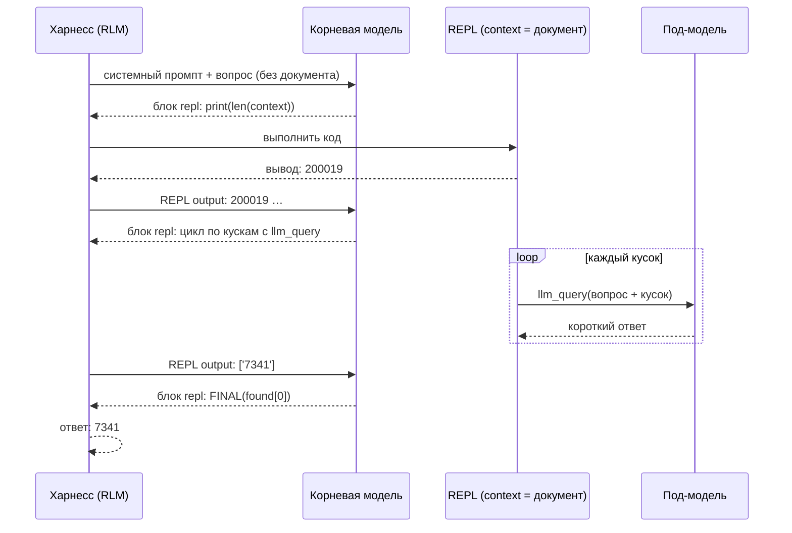

# 🔁 RLM на практике — свой Recursive Language Model на 6 языках

Продолжение раздела про RLM из заметки [«ИИ-агент vs харнесс»](../../../Education/Youtube/%D0%90%D1%80%D1%82%D1%91%D0%BC%20%D0%A8%D1%83%D0%BC%D0%B5%D0%B9%D0%BA%D0%BE/%D0%98%D0%98-%D0%B0%D0%B3%D0%B5%D0%BD%D1%82%20vs%20%D1%85%D0%B0%D1%80%D0%BD%D0%B5%D1%81%D1%81%20%E2%80%94%20%D0%B2%20%D1%87%D1%91%D0%BC%20%D1%80%D0%B0%D0%B7%D0%BD%D0%B8%D1%86%D0%B0%20%D0%B8%20%D1%81%D0%B2%D0%BE%D0%B9%20%D1%85%D0%B0%D1%80%D0%BD%D0%B5%D1%81%D1%81%20%D0%BD%D0%B0%206%20%D1%8F%D0%B7%D1%8B%D0%BA%D0%B0%D1%85%20%28LLM%2C%20tools%2C%20%D0%B0%D0%B3%D0%B5%D0%BD%D1%82%D0%BD%D1%8B%D0%B9%20%D1%86%D0%B8%D0%BA%D0%BB%3B%20Agentic%20OS%2C%20%D1%81%D0%B0%D0%BC%D0%BE%D0%BE%D0%B1%D1%83%D1%87%D0%B5%D0%BD%D0%B8%D0%B5%2C%20RLM%2C%20%D0%BF%D0%BE%D0%B4%D0%BF%D0%B8%D1%81%D0%BA%D0%B8%2C%20prompt%20injection%29.md). Там разобрано, что такое [Recursive Language Models](https://arxiv.org/abs/2512.24601) (Zhang, Kraska, Khattab, MIT CSAIL). Здесь — **рабочая мини-реализация** на Java, Python, JavaScript, Go, Rust и Bash: около 100–190 строк на язык, без фреймворков, все версии проверены на тестовом сервере.

**Идея в одной фразе:** огромный документ не кладут в контекст модели. Он лежит в переменной REPL, модель пишет код, который режет документ и по кускам спрашивает под-модель, а итог возвращает вызовом `FINAL(...)`.

## ⚙️ Как устроено



Протокол одинаковый во всех шести версиях:

1. Корневая модель получает **системный промпт и вопрос — но не документ**. В промпте сказано, что документ лежит в переменной `context` (в Bash — в файле `$CONTEXT_FILE`), и указан его размер.
2. Каждый ответ модели должен содержать **один блок ```` ```repl ````**. Харнесс выполняет код, а вывод (первые 5 000 символов) возвращает модели сообщением `REPL output: …`. Ошибки компиляции и исключения возвращаются туда же — модель может исправиться.
3. В REPL есть функция **`llm_query(prompt)`** — **рекурсивный вызов**: под-модель видит только переданный кусок (до 60 000 символов) и возвращает строку. Собственный контекст корневой модели при этом не растёт.
4. Ответ — вызов **`FINAL(answer)`** в коде. Харнесс печатает его и завершается.

Предохранители, как в обычном харнессе: **не больше 15 шагов** корневой модели, **не больше 50 вызовов** под-модели (каждый стоит денег или времени), длинный вывод обрезается, слишком длинный промпт под-модели отклоняется с ошибкой.

| | Обычный харнесс | RLM |
| :--- | :--- | :--- |
| Чем действует модель | вызовы инструментов (`tool_calls`) | **код** в REPL |
| Где данные | в контексте модели (результаты инструментов копятся) | в переменной среды; в контекст попадает только напечатанное |
| Рекурсия | субагенты, если харнесс их умеет | `llm_query()` прямо из кода, хоть в цикле по тысяче кусков |
| Предел размера | окно контекста | память машины; в статье — входы на два порядка больше окна |

## 🔧 Настройка

| Переменная | По умолчанию | Смысл |
| :--- | :--- | :--- |
| `LLM_BASE_URL` | `http://localhost:11434/v1` | OpenAI-совместимый API (Ollama, llama.cpp, DeepSeek, OpenRouter…) |
| `LLM_MODEL` | `qwen3:8b` | **корневая** модель: ей нужно хорошо писать код на языке REPL |
| `SUB_MODEL` | как `LLM_MODEL` | **под-модель** для `llm_query`: можно дешевле или локальную |
| `LLM_API_KEY` | `ollama` | ключ; локальные серверы его игнорируют |

Запуск у всех версий одинаковый: `<программа> ДОКУМЕНТ "ВОПРОС"`, ответ печатается в stdout, ход работы — в stderr.

Экономика RLM: корневая модель делает несколько шагов и видит немного текста, а основной объём читает под-модель. Разумная связка — сильная модель в корне и дешёвая (или локальная) в `SUB_MODEL`. Маленькой локальной модели в корне обычно не хватает: она путается в коде. Для документа, который и так влезает в контекст, обычный промпт проще и дешевле.

## 🧪 Где выполняется код модели — главное отличие версий

Код пишет модель, а значит, это **недоверенный код**. Каждая версия выполняет его своим способом, и изоляция у них очень разная:

| Язык | Чем выполняется код модели | Изоляция | Состояние между блоками |
| :--- | :--- | :--- | :--- |
| **Java** | JShell (`jdk.jshell`) — отдельная JVM; `llm_query` и `FINAL` объявлены в прелюдии внутри неё | отдельный процесс, но с полным доступом к файлам и сети | переменные и методы сохраняются |
| **Python** | `exec()` в общем словаре | **никакой**: тот же процесс, всё доступно | сохраняется |
| **JavaScript** | `node:vm`, свой глобальный контекст; код обёрнут в `async`-функцию | документация Node: vm — **не механизм безопасности** | только через `globalThis` |
| **Go** | [yaegi](https://github.com/traefik/yaegi) — интерпретатор Go | в процессе; с `stdlib.Symbols` доступны `os` и `net` (набор пакетов можно урезать) | сохраняется |
| **Rust** | [Rhai](https://rhai.rs/book/) — встраиваемый язык сценариев | **лучшая из шести**: без зарегистрированных функций нет ни файлов, ни сети, ни процессов; есть лимит операций | сохраняется (`Scope`) |
| **Bash** | отдельный `bash -c` с экспортированными функциями, `timeout 600` | **никакой** | только файлы в `$WORK` |

Нюансы: в Rust-версии модель пишет не на Rust, а на **Rhai** (похож на JavaScript), поэтому системный промпт перечисляет основные функции языка. В Go-версии yaegi последний раз выпускался в 2024 году (v0.16.1), но собирается и работает и на Go 1.27.

> [!warning] Запускать в песочнице
> Кроме Rhai, код модели может читать ваши файлы и ключи, ходить в сеть и запускать процессы. Минимум — bubblewrap: система доступна только на чтение, домашний каталог скрыт, запись разрешена только во временный `/tmp`. Сеть остаётся (нужна для запросов к модели), так что для недоверенных документов лучше отдельная ВМ или контейнер без лишних секретов.

<details><summary>🛡️ sandboxed.sh — запуск любой версии в bubblewrap (проверено)</summary>

```bash
#!/usr/bin/env bash
# sandboxed.sh CMD... — запустить команду в bubblewrap: система только на чтение, домашний каталог скрыт,
# запись только в /tmp песочницы, сеть оставлена (нужна для запросов к модели).
exec bwrap --ro-bind / / --tmpfs "$HOME" --tmpfs /tmp --dev /dev --proc /proc \
  --ro-bind "$PWD" "$PWD" --chdir "$PWD" \
  --unshare-all --share-net --die-with-parent -- "$@"
```

Пример: `./sandboxed.sh python3 rlm.py document.txt "Какой код доступа указан в документе?"`. Внутри песочницы `ls ~` пуст, запись в каталог проекта запрещена (`Read-only file system`), а Python-версия проходит тот же тест, что и без песочницы. Установка: Gentoo — `emerge sys-apps/bubblewrap`, Debian/Ubuntu — `apt install bubblewrap`, Arch — `pacman -S bubblewrap`. В Entware bubblewrap нет.

</details>

## 💻 Код

<details><summary>☕ Java 21+ — Rlm.java (JShell + Jackson 3)</summary>

Jackson нужен и хосту, и коду внутри JShell: программа добавляет свой classpath в JShell сама. Jar-файлы те же, что для харнесса из основной заметки:

```sh
mkdir -p lib
curl -L -o lib/jackson-databind-3.2.4.jar https://repo1.maven.org/maven2/tools/jackson/core/jackson-databind/3.2.4/jackson-databind-3.2.4.jar
curl -L -o lib/jackson-core-3.2.4.jar https://repo1.maven.org/maven2/tools/jackson/core/jackson-core/3.2.4/jackson-core-3.2.4.jar
curl -L -o lib/jackson-annotations-2.22.jar https://repo1.maven.org/maven2/com/fasterxml/jackson/core/jackson-annotations/2.22/jackson-annotations-2.22.jar
java -cp 'lib/*' Rlm.java document.txt "Какой код доступа указан в документе?"
```

```java
import jdk.jshell.JShell;
import jdk.jshell.Snippet;
import jdk.jshell.SnippetEvent;
import jdk.jshell.SourceCodeAnalysis;
import tools.jackson.databind.json.JsonMapper;
import tools.jackson.databind.node.ArrayNode;
import tools.jackson.databind.node.ObjectNode;

import java.io.ByteArrayOutputStream;
import java.io.File;
import java.io.PrintStream;
import java.net.URI;
import java.net.http.HttpClient;
import java.net.http.HttpRequest;
import java.net.http.HttpResponse;
import java.nio.charset.StandardCharsets;
import java.nio.file.Files;
import java.nio.file.Path;
import java.time.Duration;
import java.util.Locale;
import java.util.regex.Matcher;
import java.util.regex.Pattern;

/** Мини-RLM: документ лежит в переменной JShell, модель пишет Java-код и рекурсивно зовёт под-модель. */
public class Rlm {
    static final String BASE_URL = env("LLM_BASE_URL", "http://localhost:11434/v1");
    static final String MODEL = env("LLM_MODEL", "qwen3:8b");
    static final String SUB_MODEL = env("SUB_MODEL", MODEL);
    static final String API_KEY = env("LLM_API_KEY", "ollama");
    static final int MAX_STEPS = 15;       // шагов корневой модели
    static final int MAX_SUBCALLS = 50;    // бюджет вызовов под-модели
    static final int MAX_OUTPUT = 5_000;   // сколько символов вывода REPL увидит корневая модель
    static final int SUB_CHARS = 60_000;   // предел промпта для под-модели

    static final String SYSTEM = """
        You answer a question about a long document that is NOT in your context.
        The document is the String variable `context` (%d characters) inside a Java REPL (JShell).
        Reply with exactly one ```repl code block per turn. In it, inspect the document (substring, indexOf,
        splitting into chunks) and call `llm_query(prompt)` to ask a sub-model about a piece of text:
        it sees only the prompt you pass (under %d characters) and returns a String.
        Printed output (first %d characters) is shown to you on the next turn.
        Sub-model calls are limited to %d. When you know the answer, call `FINAL(answer)` in a repl block.
        Write JShell snippets: statements and declarations, no class wrapper. Variables persist between blocks;
        print with System.out.println.""";

    // Выполняется внутри JShell — в отдельной JVM, куда передаются только системные свойства rlm.*.
    static final String PRELUDE = """
        import java.net.URI;
        import java.net.http.*;
        import java.nio.file.*;
        import tools.jackson.databind.json.JsonMapper;
        String context = Files.readString(Path.of(System.getProperty("rlm.document")));
        int subcalls = 0;
        String llm_query(String prompt) {
            if (prompt.length() > %d) throw new IllegalArgumentException("prompt is " + prompt.length() + " chars, limit is %d");
            if (++subcalls > %d) throw new IllegalStateException("sub-call budget exhausted");
            var json = JsonMapper.builder().build();
            var body = json.createObjectNode().put("model", System.getProperty("rlm.subModel"));
            body.putArray("messages").addObject().put("role", "user").put("content", prompt);
            var request = HttpRequest.newBuilder(URI.create(System.getProperty("rlm.baseUrl") + "/chat/completions"))
                    .header("Content-Type", "application/json")
                    .header("Authorization", "Bearer " + System.getProperty("rlm.apiKey"))
                    .POST(HttpRequest.BodyPublishers.ofString(json.writeValueAsString(body))).build();
            try {
                var response = HttpClient.newHttpClient().send(request, HttpResponse.BodyHandlers.ofString());
                return json.readTree(response.body()).path("choices").path(0).path("message").path("content").asString("");
            } catch (Exception e) {
                throw new RuntimeException(e);
            }
        }
        void FINAL(Object value) { System.out.println("<<FINAL>>" + value); }
        """.formatted(SUB_CHARS, SUB_CHARS, MAX_SUBCALLS);

    static final Pattern BLOCK = Pattern.compile("```repl[ \\t]*\\n(.*?)```", Pattern.DOTALL);
    static final JsonMapper JSON = JsonMapper.builder().build();
    static final HttpClient HTTP = HttpClient.newHttpClient();

    static String env(String name, String def) {
        String value = System.getenv(name);
        return value == null || value.isEmpty() ? def : value;
    }

    static String chat(String model, ArrayNode messages) throws Exception {
        ObjectNode body = JSON.createObjectNode().put("model", model);
        body.set("messages", messages);
        HttpRequest request = HttpRequest.newBuilder(URI.create(BASE_URL + "/chat/completions"))
                .header("Content-Type", "application/json")
                .header("Authorization", "Bearer " + API_KEY)
                .timeout(Duration.ofMinutes(10))
                .POST(HttpRequest.BodyPublishers.ofString(JSON.writeValueAsString(body)))
                .build();
        HttpResponse<String> response = HTTP.send(request, HttpResponse.BodyHandlers.ofString());
        if (response.statusCode() != 200) {
            throw new IllegalStateException("HTTP " + response.statusCode() + ": " + response.body());
        }
        return JSON.readTree(response.body()).path("choices").path(0).path("message").path("content").asString("");
    }

    /** Разбивает код на фрагменты JShell и выполняет их; возвращает текст ошибок. */
    static String eval(JShell shell, String code) {
        StringBuilder errors = new StringBuilder();
        String remaining = code;
        while (!remaining.isBlank()) {
            SourceCodeAnalysis.CompletionInfo info = shell.sourceCodeAnalysis().analyzeCompletion(remaining);
            if (!info.completeness().isComplete()) {
                errors.append("error: incomplete code: ").append(remaining.strip()).append('\n');
                break;
            }
            for (SnippetEvent event : shell.eval(info.source())) {
                if (event.status() == Snippet.Status.REJECTED) {
                    shell.diagnostics(event.snippet()).forEach(d ->
                            errors.append("error: ").append(d.getMessage(Locale.ROOT)).append('\n'));
                }
                if (event.exception() != null) {
                    errors.append("exception: ").append(event.exception().getMessage()).append('\n');
                }
            }
            remaining = info.remaining();
        }
        return errors.toString();
    }

    static String truncate(String text) {
        if (text.length() <= MAX_OUTPUT) return text;
        return text.substring(0, MAX_OUTPUT) + "\n[...truncated " + (text.length() - MAX_OUTPUT) + " chars]";
    }

    public static void main(String[] args) throws Exception {
        if (args.length != 2) {
            System.err.println("usage: java -cp 'lib/*' Rlm.java DOCUMENT QUESTION");
            System.exit(2);
        }
        Path document = Path.of(args[0]).toAbsolutePath();
        ByteArrayOutputStream captured = new ByteArrayOutputStream();
        PrintStream out = new PrintStream(captured, true, StandardCharsets.UTF_8);
        try (JShell shell = JShell.builder().out(out).err(out)
                .remoteVMOptions("-Drlm.document=" + document, "-Drlm.baseUrl=" + BASE_URL,
                        "-Drlm.subModel=" + SUB_MODEL, "-Drlm.apiKey=" + API_KEY, "-Dfile.encoding=UTF-8",
                        "-Dstdout.encoding=UTF-8")
                .build()) {
            for (String jar : System.getProperty("java.class.path").split(File.pathSeparator)) {
                shell.addToClasspath(jar);  // Jackson нужен и внутри JShell
            }
            String preludeErrors = eval(shell, PRELUDE);
            if (!preludeErrors.isEmpty()) throw new IllegalStateException(preludeErrors);
            captured.reset();

            ArrayNode messages = JSON.createArrayNode();
            messages.addObject().put("role", "system")
                    .put("content", SYSTEM.formatted(Files.readString(document).length(), SUB_CHARS, MAX_OUTPUT, MAX_SUBCALLS));
            messages.addObject().put("role", "user").put("content", args[1]);  // сам документ модели не отправляется
            for (int step = 1; step <= MAX_STEPS; step++) {
                String reply = chat(MODEL, messages);
                messages.addObject().put("role", "assistant").put("content", reply);
                Matcher block = BLOCK.matcher(reply);
                if (!block.find()) {
                    messages.addObject().put("role", "user").put("content", "No ```repl block found. Write code in a ```repl block.");
                    continue;
                }
                String errors = eval(shell, block.group(1));
                out.flush();
                String output = captured.toString(StandardCharsets.UTF_8) + errors;
                captured.reset();
                System.err.printf("  [шаг %d] вывод %d симв.%n", step, output.length());
                for (String line : output.split("\n")) {
                    if (line.startsWith("<<FINAL>>")) {
                        System.out.println(line.substring("<<FINAL>>".length()));
                        return;
                    }
                }
                messages.addObject().put("role", "user").put("content", "REPL output:\n" + truncate(output));
            }
        }
        System.err.println("Нет ответа за " + MAX_STEPS + " шагов.");
        System.exit(1);
    }
}
```

</details>

<details><summary>🐍 Python 3.9+ — rlm.py (только стандартная библиотека)</summary>

```sh
python3 rlm.py document.txt "Какой код доступа указан в документе?"
```

```python
#!/usr/bin/env python3
"""Мини-RLM: документ лежит в переменной REPL, модель пишет код и рекурсивно зовёт под-модель."""
import contextlib
import io
import json
import os
import re
import sys
import traceback
import urllib.request

BASE_URL = os.environ.get("LLM_BASE_URL", "http://localhost:11434/v1")
MODEL = os.environ.get("LLM_MODEL", "qwen3:8b")
SUB_MODEL = os.environ.get("SUB_MODEL", MODEL)
API_KEY = os.environ.get("LLM_API_KEY", "ollama")
MAX_STEPS = 15       # шагов корневой модели
MAX_SUBCALLS = 50    # бюджет вызовов под-модели
MAX_OUTPUT = 5_000   # сколько символов вывода REPL увидит корневая модель
SUB_CHARS = 60_000   # предел промпта для под-модели

SYSTEM = f"""You answer a question about a long document that is NOT in your context.
The document is the string variable `context` ({{size}} characters) inside a Python REPL.
Reply with exactly one ```repl code block per turn. In it, inspect the document (slices, search,
splitting into chunks) and call `llm_query(prompt)` to ask a sub-model about a piece of text:
it sees only the prompt you pass (under {SUB_CHARS} characters) and returns a string.
Printed output (first {MAX_OUTPUT} characters) is shown to you on the next turn.
Sub-model calls are limited to {MAX_SUBCALLS}. When you know the answer, call `FINAL(answer)` in a repl block.
Variables persist between blocks; use print() to see values."""

BLOCK = re.compile(r"```repl[ \t]*\n(.*?)```", re.S)


def chat(model, messages):
    req = urllib.request.Request(
        f"{BASE_URL}/chat/completions",
        data=json.dumps({"model": model, "messages": messages}).encode(),
        headers={"Content-Type": "application/json", "Authorization": f"Bearer {API_KEY}"})
    with urllib.request.urlopen(req, timeout=600) as resp:
        return json.load(resp)["choices"][0]["message"].get("content") or ""


def truncate(text):
    if len(text) <= MAX_OUTPUT:
        return text
    return text[:MAX_OUTPUT] + f"\n[...truncated {len(text) - MAX_OUTPUT} chars]"


class Repl:
    """Среда, в которой выполняется код корневой модели."""

    def __init__(self, document):
        self.answer = None
        self.subcalls = 0
        self.namespace = {"context": document, "llm_query": self.llm_query, "FINAL": self.final}

    def llm_query(self, prompt):  # рекурсивный вызов: под-модель видит только этот кусок
        prompt = str(prompt)
        if len(prompt) > SUB_CHARS:
            raise ValueError(f"prompt is {len(prompt)} chars, limit is {SUB_CHARS}")
        self.subcalls += 1
        if self.subcalls > MAX_SUBCALLS:
            raise RuntimeError("sub-call budget exhausted")
        return chat(SUB_MODEL, [{"role": "user", "content": prompt}])

    def final(self, value):
        self.answer = str(value)

    def run(self, code):
        out = io.StringIO()
        try:
            with contextlib.redirect_stdout(out):
                exec(code, self.namespace)  # без изоляции: запускать в контейнере
        except Exception:
            out.write(traceback.format_exc(limit=2))
        return out.getvalue()


def main():
    if len(sys.argv) != 3:
        sys.exit("usage: rlm.py DOCUMENT QUESTION")
    with open(sys.argv[1], encoding="utf-8") as f:
        document = f.read()
    repl = Repl(document)
    messages = [{"role": "system", "content": SYSTEM.format(size=len(document))},
                {"role": "user", "content": sys.argv[2]}]  # сам документ модели не отправляется
    for step in range(1, MAX_STEPS + 1):
        reply = chat(MODEL, messages)
        messages.append({"role": "assistant", "content": reply})
        block = BLOCK.search(reply)
        if not block:
            messages.append({"role": "user", "content": "No ```repl block found. Write code in a ```repl block."})
            continue
        output = repl.run(block.group(1))
        print(f"  [шаг {step}] вывод {len(output)} симв., под-вызовов всего {repl.subcalls}", file=sys.stderr)
        if repl.answer is not None:
            print(repl.answer)
            return
        messages.append({"role": "user", "content": "REPL output:\n" + truncate(output)})
    sys.exit(f"Нет ответа за {MAX_STEPS} шагов.")


if __name__ == "__main__":
    main()
```

</details>

<details><summary>🟨 JavaScript (Node.js 18+) — rlm.mjs (node:vm)</summary>

```sh
node rlm.mjs document.txt "Какой код доступа указан в документе?"
```

```javascript
#!/usr/bin/env node
// Мини-RLM: документ лежит в переменной REPL, модель пишет код и рекурсивно зовёт под-модель.
import fs from "node:fs";
import vm from "node:vm";

const BASE_URL = process.env.LLM_BASE_URL || "http://localhost:11434/v1";
const MODEL = process.env.LLM_MODEL || "qwen3:8b";
const SUB_MODEL = process.env.SUB_MODEL || MODEL;
const API_KEY = process.env.LLM_API_KEY || "ollama";
const MAX_STEPS = 15;       // шагов корневой модели
const MAX_SUBCALLS = 50;    // бюджет вызовов под-модели
const MAX_OUTPUT = 5_000;   // сколько символов вывода REPL увидит корневая модель
const SUB_CHARS = 60_000;   // предел промпта для под-модели

const system = (size) => `You answer a question about a long document that is NOT in your context.
The document is the string variable \`context\` (${size} characters) inside a JavaScript REPL.
Reply with exactly one \`\`\`repl code block per turn. In it, inspect the document (slices, search,
splitting into chunks) and call \`await llm_query(prompt)\` to ask a sub-model about a piece of text:
it sees only the prompt you pass (under ${SUB_CHARS} characters) and returns a string.
Printed output (first ${MAX_OUTPUT} characters) is shown to you on the next turn.
Sub-model calls are limited to ${MAX_SUBCALLS}. When you know the answer, call \`FINAL(answer)\` in a repl block.
The code runs inside an async function: keep values for later blocks on globalThis; use print() to see values.`;

const BLOCK = /```repl[ \t]*\n([\s\S]*?)```/;

async function chat(model, messages) {
  const resp = await fetch(`${BASE_URL}/chat/completions`, {
    method: "POST",
    headers: {"Content-Type": "application/json", Authorization: `Bearer ${API_KEY}`},
    body: JSON.stringify({model, messages}),
  });
  if (!resp.ok) throw new Error(`HTTP ${resp.status}: ${await resp.text()}`);
  return (await resp.json()).choices[0].message.content ?? "";
}

const truncate = (text) => text.length <= MAX_OUTPUT ? text
  : text.slice(0, MAX_OUTPUT) + `\n[...truncated ${text.length - MAX_OUTPUT} chars]`;

// Среда, в которой выполняется код корневой модели. vm — не песочница: запускать в контейнере.
function createRepl(documentText) {
  const repl = {answer: null, subcalls: 0, output: []};
  const print = (...values) => repl.output.push(values.map((v) =>
    typeof v === "string" ? v : JSON.stringify(v)).join(" "));
  repl.context = vm.createContext({
    context: documentText,
    print,
    console: {log: print},
    FINAL: (value) => { repl.answer = String(value); },
    llm_query: async (prompt) => {  // рекурсивный вызов: под-модель видит только этот кусок
      prompt = String(prompt);
      if (prompt.length > SUB_CHARS) throw new Error(`prompt is ${prompt.length} chars, limit is ${SUB_CHARS}`);
      if (++repl.subcalls > MAX_SUBCALLS) throw new Error("sub-call budget exhausted");
      return chat(SUB_MODEL, [{role: "user", content: prompt}]);
    },
  });
  repl.run = async (code) => {
    repl.output = [];
    try {
      await vm.runInContext(`(async () => {\n${code}\n})()`, repl.context);
    } catch (e) {
      repl.output.push(`${e.name}: ${e.message}`);
    }
    return repl.output.join("\n");
  };
  return repl;
}

if (process.argv.length !== 4) {
  console.error("usage: rlm.mjs DOCUMENT QUESTION");
  process.exit(2);
}
const documentText = fs.readFileSync(process.argv[2], "utf8");
const repl = createRepl(documentText);
const messages = [
  {role: "system", content: system(documentText.length)},
  {role: "user", content: process.argv[3]},  // сам документ модели не отправляется
];
for (let step = 1; step <= MAX_STEPS; step++) {
  const reply = await chat(MODEL, messages);
  messages.push({role: "assistant", content: reply});
  const block = BLOCK.exec(reply);
  if (!block) {
    messages.push({role: "user", content: "No ```repl block found. Write code in a ```repl block."});
    continue;
  }
  const output = await repl.run(block[1]);
  console.error(`  [шаг ${step}] вывод ${output.length} симв., под-вызовов всего ${repl.subcalls}`);
  if (repl.answer !== null) {
    console.log(repl.answer);
    process.exit(0);
  }
  messages.push({role: "user", content: "REPL output:\n" + truncate(output)});
}
console.error(`Нет ответа за ${MAX_STEPS} шагов.`);
process.exit(1);
```

</details>

<details><summary>🐹 Go 1.22+ — main.go (интерпретатор yaegi)</summary>

```sh
go mod init rlm && go get github.com/traefik/yaegi@v0.16.1
go run . document.txt "Какой код доступа указан в документе?"
```

Пакет `rlm` существует только внутри интерпретатора: хост экспортирует в него документ и две функции через `interp.Exports`, а прелюдия объявляет привычные по статье имена `context`, `llm_query` и `FINAL`.

```go
// Мини-RLM: документ лежит в переменной интерпретатора yaegi, модель пишет Go-код
// и рекурсивно зовёт под-модель.
package main

import (
	"bytes"
	"encoding/json"
	"errors"
	"fmt"
	"io"
	"net/http"
	"os"
	"reflect"
	"regexp"

	"github.com/traefik/yaegi/interp"
	"github.com/traefik/yaegi/stdlib"
)

const (
	maxSteps    = 15     // шагов корневой модели
	maxSubcalls = 50     // бюджет вызовов под-модели
	maxOutput   = 5_000  // сколько символов вывода REPL увидит корневая модель
	subChars    = 60_000 // предел промпта для под-модели
)

var (
	baseURL  = env("LLM_BASE_URL", "http://localhost:11434/v1")
	model    = env("LLM_MODEL", "qwen3:8b")
	subModel = env("SUB_MODEL", model)
	apiKey   = env("LLM_API_KEY", "ollama")
	block    = regexp.MustCompile("(?s)```repl[ \\t]*\\n(.*?)```")
)

const system = `You answer a question about a long document that is NOT in your context.
The document is the string variable ` + "`context`" + ` (%d bytes) inside a Go REPL (yaegi interpreter).
Reply with exactly one ` + "```repl" + ` code block per turn. In it, inspect the document (slicing, strings.Index,
splitting into chunks) and call ` + "`llm_query(prompt string) string`" + ` to ask a sub-model about a piece of text:
it sees only the prompt you pass (under %d characters) and returns a string.
Printed output (first %d characters) is shown to you on the next turn.
Sub-model calls are limited to %d. When you know the answer, call ` + "`FINAL(answer)`" + ` in a repl block.
Write Go statements without package or func main; fmt and strings are imported. Variables persist between blocks.`

// Обёртки, которые видит код модели: имена как в статье RLM.
var prelude = []string{
	`import "fmt"`,
	`import "strings"`,
	`import "rlm"`,
	`var context = rlm.Context`,
	`func llm_query(prompt string) string { return rlm.Query(prompt) }`,
	`func FINAL(value interface{}) { rlm.Final(fmt.Sprint(value)) }`,
}

func env(name, def string) string {
	if v := os.Getenv(name); v != "" {
		return v
	}
	return def
}

func chat(model string, messages []map[string]string) (string, error) {
	body, err := json.Marshal(map[string]any{"model": model, "messages": messages})
	if err != nil {
		return "", err
	}
	req, err := http.NewRequest(http.MethodPost, baseURL+"/chat/completions", bytes.NewReader(body))
	if err != nil {
		return "", err
	}
	req.Header.Set("Content-Type", "application/json")
	req.Header.Set("Authorization", "Bearer "+apiKey)
	resp, err := http.DefaultClient.Do(req)
	if err != nil {
		return "", err
	}
	defer resp.Body.Close()
	data, _ := io.ReadAll(resp.Body)
	if resp.StatusCode != http.StatusOK {
		return "", fmt.Errorf("HTTP %d: %s", resp.StatusCode, data)
	}
	var out struct {
		Choices []struct {
			Message struct {
				Content string `json:"content"`
			} `json:"message"`
		} `json:"choices"`
	}
	if err := json.Unmarshal(data, &out); err != nil || len(out.Choices) == 0 {
		return "", fmt.Errorf("unexpected response: %s", data)
	}
	return out.Choices[0].Message.Content, nil
}

func truncate(text string) string {
	runes := []rune(text)
	if len(runes) <= maxOutput {
		return text
	}
	return string(runes[:maxOutput]) + fmt.Sprintf("\n[...truncated %d chars]", len(runes)-maxOutput)
}

func main() {
	if len(os.Args) != 3 {
		fmt.Fprintln(os.Stderr, "usage: rlm DOCUMENT QUESTION")
		os.Exit(2)
	}
	data, err := os.ReadFile(os.Args[1])
	if err != nil {
		fmt.Fprintln(os.Stderr, err)
		os.Exit(1)
	}
	document := string(data)

	var output bytes.Buffer
	var answer *string
	subcalls := 0
	query := func(prompt string) string { // рекурсивный вызов: под-модель видит только этот кусок
		if len([]rune(prompt)) > subChars {
			panic(fmt.Sprintf("prompt is %d chars, limit is %d", len([]rune(prompt)), subChars))
		}
		if subcalls++; subcalls > maxSubcalls {
			panic("sub-call budget exhausted")
		}
		reply, err := chat(subModel, []map[string]string{{"role": "user", "content": prompt}})
		if err != nil {
			panic(err)
		}
		return reply
	}

	// Интерпретатор с полной stdlib — значит, и с os и net: запускать в контейнере.
	repl := interp.New(interp.Options{Stdout: &output, Stderr: &output})
	if err := repl.Use(stdlib.Symbols); err != nil {
		panic(err)
	}
	if err := repl.Use(interp.Exports{"rlm/rlm": {
		"Context": reflect.ValueOf(&document).Elem(),
		"Query":   reflect.ValueOf(query),
		"Final":   reflect.ValueOf(func(v string) { answer = &v }),
	}}); err != nil {
		panic(err)
	}
	for _, src := range prelude {
		if _, err := repl.Eval(src); err != nil {
			panic(err)
		}
	}

	messages := []map[string]string{
		{"role": "system", "content": fmt.Sprintf(system, len(document), subChars, maxOutput, maxSubcalls)},
		{"role": "user", "content": os.Args[2]}, // сам документ модели не отправляется
	}
	for step := 1; step <= maxSteps; step++ {
		reply, err := chat(model, messages)
		if err != nil {
			fmt.Fprintln(os.Stderr, "ошибка:", err)
			os.Exit(1)
		}
		messages = append(messages, map[string]string{"role": "assistant", "content": reply})
		code := block.FindStringSubmatch(reply)
		if code == nil {
			messages = append(messages, map[string]string{"role": "user", "content": "No ```repl block found. Write code in a ```repl block."})
			continue
		}
		output.Reset()
		if _, err := evalSafely(repl, code[1]); err != nil {
			fmt.Fprintln(&output, "error:", err)
		}
		fmt.Fprintf(os.Stderr, "  [шаг %d] вывод %d байт, под-вызовов всего %d\n", step, output.Len(), subcalls)
		if answer != nil {
			fmt.Println(*answer)
			return
		}
		messages = append(messages, map[string]string{"role": "user", "content": "REPL output:\n" + truncate(output.String())})
	}
	fmt.Fprintf(os.Stderr, "Нет ответа за %d шагов.\n", maxSteps)
	os.Exit(1)
}

// evalSafely превращает panic внутри интерпретатора в обычную ошибку.
func evalSafely(repl *interp.Interpreter, code string) (res reflect.Value, err error) {
	defer func() {
		if r := recover(); r != nil {
			err = errors.New(fmt.Sprint(r))
		}
	}()
	return repl.Eval(code)
}
```

</details>

<details><summary>🦀 Rust 1.88+ — Cargo.toml + src/main.rs (Rhai, ureq 3)</summary>

```toml
[package]
name = "rlm"
version = "0.1.0"
edition = "2024"

[dependencies]
rhai = "1"
serde_json = "1"
ureq = { version = "3", features = ["json"] }
```

```sh
cargo run --release -- document.txt "Какой код доступа указан в документе?"
```

```rust
// Мини-RLM: документ лежит в переменной скрипта Rhai, модель пишет код и рекурсивно зовёт под-модель.
use rhai::{Dynamic, Engine, EvalAltResult, Scope};
use serde_json::{Value, json};
use std::cell::{Cell, RefCell};
use std::error::Error;
use std::rc::Rc;
use std::{env, fs};

const MAX_STEPS: usize = 15; // шагов корневой модели
const MAX_SUBCALLS: usize = 50; // бюджет вызовов под-модели
const MAX_OUTPUT: usize = 5_000; // сколько символов вывода REPL увидит корневая модель
const SUB_CHARS: usize = 60_000; // предел промпта для под-модели

fn var(name: &str, default: &str) -> String {
    env::var(name)
        .ok()
        .filter(|v| !v.is_empty())
        .unwrap_or_else(|| default.to_string())
}

fn chat(
    base_url: &str,
    api_key: &str,
    model: &str,
    messages: &Value,
) -> Result<String, Box<dyn Error>> {
    let mut resp = ureq::post(format!("{base_url}/chat/completions"))
        .header("Authorization", format!("Bearer {api_key}"))
        .send_json(json!({"model": model, "messages": messages}))?;
    let body: Value = resp.body_mut().read_json()?;
    Ok(body["choices"][0]["message"]["content"]
        .as_str()
        .unwrap_or("")
        .to_string())
}

fn truncate(text: &str) -> String {
    let len = text.chars().count();
    if len <= MAX_OUTPUT {
        return text.to_string();
    }
    let head: String = text.chars().take(MAX_OUTPUT).collect();
    format!("{head}\n[...truncated {} chars]", len - MAX_OUTPUT)
}

/// Код корневой модели: всё между ```repl и закрывающими ```.
fn repl_block(reply: &str) -> Option<&str> {
    let start = reply.find("```repl")?;
    let body = &reply[start + 7..];
    let body = &body[body.find('\n')? + 1..];
    Some(&body[..body.find("```")?])
}

fn main() -> Result<(), Box<dyn Error>> {
    let args: Vec<String> = env::args().collect();
    if args.len() != 3 {
        eprintln!("usage: rlm DOCUMENT QUESTION");
        std::process::exit(2);
    }
    let (base_url, api_key) = (
        var("LLM_BASE_URL", "http://localhost:11434/v1"),
        var("LLM_API_KEY", "ollama"),
    );
    let model = var("LLM_MODEL", "qwen3:8b");
    let sub_model = var("SUB_MODEL", &model);
    let document = fs::read_to_string(&args[1])?;

    let output = Rc::new(RefCell::new(String::new()));
    let answer: Rc<RefCell<Option<String>>> = Rc::new(RefCell::new(None));
    let subcalls = Rc::new(Cell::new(0usize));

    // Rhai без зарегистрированных функций не умеет ни файлов, ни сети, ни процессов.
    let mut engine = Engine::new();
    engine.set_max_operations(50_000_000); // защита от бесконечного цикла
    let out = output.clone();
    engine.on_print(move |text| {
        out.borrow_mut().push_str(text);
        out.borrow_mut().push('\n');
    });
    let ans = answer.clone();
    engine.register_fn("FINAL", move |value: Dynamic| {
        *ans.borrow_mut() = Some(value.to_string())
    });
    let (url, key, sub, calls) = (
        base_url.clone(),
        api_key.clone(),
        sub_model,
        subcalls.clone(),
    );
    // рекурсивный вызов: под-модель видит только этот кусок
    engine.register_fn(
        "llm_query",
        move |prompt: &str| -> Result<String, Box<EvalAltResult>> {
            let len = prompt.chars().count();
            if len > SUB_CHARS {
                return Err(format!("prompt is {len} chars, limit is {SUB_CHARS}").into());
            }
            calls.set(calls.get() + 1);
            if calls.get() > MAX_SUBCALLS {
                return Err("sub-call budget exhausted".into());
            }
            chat(
                &url,
                &key,
                &sub,
                &json!([{"role": "user", "content": prompt}]),
            )
            .map_err(|e| e.to_string().into())
        },
    );

    let mut scope = Scope::new();
    scope.push_constant("context", document.clone());
    let system = format!(
        "You answer a question about a long document that is NOT in your context.\n\
         The document is the string constant `context` ({} characters) inside a Rhai REPL \
         (Rhai is a small JavaScript/Rust-like scripting language).\n\
         Reply with exactly one ```repl code block per turn. In it, inspect the document \
         (context.len(), context.sub_string(start, len), context.index_of(text), split) and call \
         `llm_query(prompt)` to ask a sub-model about a piece of text: it sees only the prompt you pass \
         (under {SUB_CHARS} characters) and returns a string.\n\
         Printed output (first {MAX_OUTPUT} characters) is shown to you on the next turn.\n\
         Sub-model calls are limited to {MAX_SUBCALLS}. When you know the answer, call `FINAL(answer)` in a repl block.\n\
         Use `let` for variables (they persist between blocks), `for i in range(from, to, step)` for loops, \
         print(value) to see values.",
        document.chars().count()
    );
    // сам документ модели не отправляется
    let mut messages = vec![
        json!({"role": "system", "content": system}),
        json!({"role": "user", "content": args[2]}),
    ];
    for step in 1..=MAX_STEPS {
        let reply = chat(&base_url, &api_key, &model, &json!(messages))?;
        messages.push(json!({"role": "assistant", "content": reply}));
        let Some(code) = repl_block(&reply) else {
            messages.push(json!({"role": "user", "content": "No ```repl block found. Write code in a ```repl block."}));
            continue;
        };
        output.borrow_mut().clear();
        if let Err(e) = engine.run_with_scope(&mut scope, code) {
            output.borrow_mut().push_str(&format!("error: {e}\n"));
        }
        eprintln!(
            "  [шаг {step}] вывод {} симв., под-вызовов всего {}",
            output.borrow().chars().count(),
            subcalls.get()
        );
        if let Some(answer) = answer.borrow().as_ref() {
            println!("{answer}");
            return Ok(());
        }
        let text = format!("REPL output:\n{}", truncate(&output.borrow()));
        messages.push(json!({"role": "user", "content": text}));
    }
    eprintln!("Нет ответа за {MAX_STEPS} шагов.");
    std::process::exit(1);
}
```

</details>

<details><summary>🐚 Bash 4+ — rlm.sh (curl + jq 1.6+)</summary>

```sh
bash rlm.sh document.txt "Какой код доступа указан в документе?"
```

Документ здесь — файл, а не переменная: модель работает с ним через `head -c`, `tail -c` и `grep`. Каждый блок выполняется в новом `bash`, поэтому промежуточные результаты модель сохраняет в файлы в `$WORK`. Счётчик вызовов под-модели тоже хранится в файле: `llm_query` вызывается из дочерних процессов.

```bash
#!/usr/bin/env bash
# Мини-RLM: документ лежит в файле, модель пишет bash-код и рекурсивно зовёт под-модель. Нужны bash 4+, curl, jq 1.6+.
set -uo pipefail
(($# == 2)) || { echo "usage: rlm.sh DOCUMENT QUESTION" >&2; exit 2; }

export LLM_BASE_URL=${LLM_BASE_URL:-http://localhost:11434/v1}
export LLM_MODEL=${LLM_MODEL:-qwen3:8b}
export SUB_MODEL=${SUB_MODEL:-$LLM_MODEL}
export LLM_API_KEY=${LLM_API_KEY:-ollama}
MAX_STEPS=15                          # шагов корневой модели
MAX_OUTPUT=5000                       # сколько символов вывода REPL увидит корневая модель
export MAX_SUBCALLS=50 SUB_CHARS=60000  # бюджет вызовов и предел промпта под-модели

WORK=$(mktemp -d) && trap 'rm -rf "$WORK"' EXIT
CONTEXT_FILE=$(realpath "$1") || exit 1
CONTEXT_BYTES=$(wc -c <"$CONTEXT_FILE")
ANSWER=$WORK/answer.txt HIST=$WORK/history.json
export WORK CONTEXT_FILE CONTEXT_BYTES ANSWER
echo 0 >"$WORK/subcalls"

chat() {  # $1 — модель; история (JSON-массив) — на stdin; печатает текст ответа
  jq -c --arg model "$1" '{model: $model, messages: .}' |
    curl -sS --fail-with-body -H "Content-Type: application/json" -H "Authorization: Bearer $LLM_API_KEY" \
      --data-binary @- "$LLM_BASE_URL/chat/completions" | jq -r '.choices[0].message.content // ""'
}

# Функции для кода модели. Код идёт в отдельный bash — без изоляции, запускать в контейнере.
llm_query() {  # рекурсивный вызов: под-модель видит только этот кусок
  local n
  if ((${#1} > SUB_CHARS)); then echo "error: prompt is ${#1} chars, limit is $SUB_CHARS" >&2; return 1; fi
  n=$(($(<"$WORK/subcalls") + 1)) && echo "$n" >"$WORK/subcalls"
  if ((n > MAX_SUBCALLS)); then echo "error: sub-call budget exhausted" >&2; return 1; fi
  printf '%s' "$1" | jq -Rs '[{role: "user", content: .}]' | chat "$SUB_MODEL"
}
FINAL() { printf '%s' "$*" >"$ANSWER"; }
export -f chat llm_query FINAL

push() {  # добавить в историю сообщение с ролью $1, текст — со stdin
  jq --arg role "$1" --rawfile text /dev/stdin '. + [{role: $role, content: $text}]' "$HIST" >"$HIST.new" &&
    mv "$HIST.new" "$HIST"
}

SYSTEM="You answer a question about a long document that is NOT in your context.
The document is the file \$CONTEXT_FILE ($CONTEXT_BYTES bytes, size also in \$CONTEXT_BYTES); you work in a bash REPL.
Reply with exactly one \`\`\`repl code block per turn. In it, inspect the document (head -c, tail -c, grep -b, split)
and run \`llm_query \"prompt\"\` to ask a sub-model about a piece of text: it sees only the prompt you pass
(under $SUB_CHARS characters) and prints its answer.
Output (first $MAX_OUTPUT characters) is shown to you on the next turn.
Sub-model calls are limited to $MAX_SUBCALLS. When you know the answer, run \`FINAL \"answer\"\` in a repl block.
Every block runs in a fresh bash: variables do not persist, keep intermediate results in files under \$WORK."
# сам документ модели не отправляется
jq -n --arg s "$SYSTEM" --arg q "$2" '[{role: "system", content: $s}, {role: "user", content: $q}]' >"$HIST"

for ((step = 1; step <= MAX_STEPS; step++)); do
  reply=$(chat "$LLM_MODEL" <"$HIST") || { echo "ошибка запроса к модели" >&2; exit 1; }
  printf '%s' "$reply" | push assistant
  code=$(printf '%s\n' "$reply" | awk '/^```repl/ {inside = 1; next} inside && /^```/ {exit} inside')
  if [[ -z $code ]]; then
    printf '%s' 'No ```repl block found. Write code in a ```repl block.' | push user
    continue
  fi
  output=$(cd "$WORK" && timeout 600 bash -c "$code" 2>&1)
  status=$?
  if ((status != 0)); then output+=$'\n'"[exit status $status]"; fi
  echo "  [шаг $step] вывод ${#output} симв., под-вызовов всего $(<"$WORK/subcalls")" >&2
  if [[ -s $ANSWER ]]; then
    cat "$ANSWER" && echo
    exit 0
  fi
  {
    printf 'REPL output:\n%s' "${output:0:MAX_OUTPUT}"
    if ((${#output} > MAX_OUTPUT)); then printf '\n[...truncated %d chars]' $((${#output} - MAX_OUTPUT)); fi
  } | push user
done
echo "Нет ответа за $MAX_STEPS шагов." >&2
exit 1
```

</details>

## ✅ Как проверено

Тестовый сервер изображает обе модели. Корневой он отвечает кодом по сценарию на языке нужной версии, под-модели — «нашёл» или «НЕТ»:

1. Документ на **200 019 символов**: повторяющийся lorem ipsum, а на 120 000-й позиции спрятана строка `Код доступа: 7341.`.
2. Шаг 1: код печатает длину и начало документа. Сервер проверяет, что вывод REPL вернулся, а сам документ корневой модели **не отправлялся**.
3. Шаг 2: цикл по кускам по 50 000 символов, по вызову `llm_query` на кусок. Ожидается ровно **5 под-вызовов**, и только один кусок содержит код.
4. Шаг 3: `FINAL(found[0])`. Программа должна напечатать ровно `7341`.
5. Второй прогон начинается с блока `@@@ this is not code @@@`: ошибка должна вернуться модели, а работа — продолжиться.

Все 6 версий × 2 сценария = **12 прогонов прошли**; Python-версия ещё и внутри `sandboxed.sh`. Окружение: JDK 25 (код собран с `--release 21`), Python 3.14, Node 26, Go 1.27 + yaegi 0.16.1, Rust 1.98 + Rhai 1.27 (clippy без замечаний), bash 5.3 + jq 1.8. С живой моделью код не запускался. Сможет ли конкретная модель писать хороший код для REPL, зависит от неё самой, особенно в случае Rhai и JShell.

<details><summary>🧪 Тестовый сервер mock_rlm.py</summary>

Запуск: `python3 mock_rlm.py 8765 python result.json` (вместо `python` — `js`, `java`, `go`, `rhai` или `bash`; пятый аргумент `bad-first` включает сценарий с битым кодом). Затем RLM с `LLM_BASE_URL=http://127.0.0.1:8765/v1 LLM_MODEL=root-model SUB_MODEL=sub-model`. Расхождения пишутся в `result.json`.

```python
#!/usr/bin/env python3
"""Тестовая «модель» для мини-RLM: корневые запросы получают код по сценарию, под-запросы ищут «иголку».

Запуск: mock_rlm.py PORT LANG RESULT_JSON   (LANG: python | js | java | go | rhai | bash)
"""
import json, sys
from http.server import BaseHTTPRequestHandler, HTTPServer

PORT, LANG, RESULT = int(sys.argv[1]), sys.argv[2], sys.argv[3]
ASK = "Find the access code (Код доступа) in this text. Reply with only the code, or НЕТ if there is none.\\n\\n"

CODE = {
    "python": [
        'print(len(context)); print(context[:80])',
        f'found = []\nfor i in range(0, len(context), 50000):\n    ans = llm_query("{ASK}" + context[i:i + 50000]).strip()\n    if ans != "НЕТ":\n        found.append(ans)\nprint(found)',
        'FINAL(found[0])',
    ],
    "js": [
        'print(context.length); print(context.slice(0, 80));',
        f'globalThis.found = [];\nfor (let i = 0; i < context.length; i += 50000) {{\n  const ans = (await llm_query("{ASK}" + context.slice(i, i + 50000))).trim();\n  if (ans !== "НЕТ") found.push(ans);\n}}\nprint(found);',
        'FINAL(found[0]);',
    ],
    "java": [
        'System.out.println(context.length());\nSystem.out.println(context.substring(0, 80));',
        f'var found = new java.util.ArrayList<String>();\nfor (int i = 0; i < context.length(); i += 50000) {{\n    String ans = llm_query("{ASK}" + context.substring(i, Math.min(context.length(), i + 50000))).strip();\n    if (!ans.equals("НЕТ")) found.add(ans);\n}}\nSystem.out.println(found);',
        'FINAL(found.get(0));',
    ],
    "go": [
        'fmt.Println(len(context))\nfmt.Println(context[:80])',
        f'found := []string{{}}\nfor i := 0; i < len(context); i += 50000 {{\n\tend := i + 50000\n\tif end > len(context) {{\n\t\tend = len(context)\n\t}}\n\tans := strings.TrimSpace(llm_query("{ASK}" + context[i:end]))\n\tif ans != "НЕТ" {{\n\t\tfound = append(found, ans)\n\t}}\n}}\nfmt.Println(found)',
        'FINAL(found[0])',
    ],
    "rhai": [
        'print(context.len()); print(context.sub_string(0, 80));',
        f'let found = [];\nfor i in range(0, context.len(), 50000) {{\n    let ans = llm_query("{ASK}" + context.sub_string(i, 50000));\n    ans.trim();\n    if ans != "НЕТ" {{ found.push(ans); }}\n}}\nprint(found);',
        'FINAL(found[0]);',
    ],
    "bash": [
        'echo "$CONTEXT_BYTES"; head -c 80 "$CONTEXT_FILE"; echo',
        f'for ((i = 0; i < CONTEXT_BYTES; i += 50000)); do\n  ans=$(llm_query "{ASK}$(tail -c +$((i + 1)) "$CONTEXT_FILE" | head -c 50000)")\n  if [[ $ans != "НЕТ" ]]; then echo "$ans"; fi\ndone > "$WORK/found.txt"\ncat "$WORK/found.txt"',
        'FINAL "$(head -n 1 "$WORK/found.txt")"',
    ],
}[LANG]

BAD_FIRST = len(sys.argv) > 4 and sys.argv[4] == "bad-first"  # первый блок — не код: ошибка должна вернуться модели
if BAD_FIRST:
    CODE = ["@@@ this is not code @@@"] + CODE
state = {"fails": [], "root": 0, "sub": 0}


def check(cond, msg):
    if not cond:
        state["fails"].append(msg)


class H(BaseHTTPRequestHandler):
    def log_message(self, *a):
        pass

    def do_POST(self):
        body = json.loads(self.rfile.read(int(self.headers["Content-Length"])))
        msgs = body["messages"]
        check("tools" not in body, "RLM should not send tools")
        if msgs[0]["role"] == "system" and "REPL" in msgs[0]["content"]:
            state["root"] += 1
            check(body["model"] == "root-model", f"root model {body['model']}")
            k = sum(1 for m in msgs if m["role"] == "assistant")
            check("lorem" not in json.dumps(msgs, ensure_ascii=False)[:3000] or k > 0,
                  "document must not be sent to the root model")
            last = msgs[-1]["content"] if msgs[-1]["role"] == "user" else ""
            if BAD_FIRST:
                if k == 1:
                    check(any(w in last for w in ("rror", "xception", "exit status")), f"error not reported: {last[:300]!r}")
                k -= 1
            if k == 1:
                check("lorem ipsum" in last and "200" in last, f"step1 output: {last[:200]!r}")
            if k == 2:
                check("7341" in last, f"step2 output: {last[:300]!r}")
            idx = k + 1 if BAD_FIRST else k
            if idx < len(CODE):
                text = f"Step {idx + 1}.\n```repl\n{CODE[idx]}\n```"
            else:
                check(False, f"unexpected root step {k}")
                text = "?"
        else:
            state["sub"] += 1
            check(body["model"] == "sub-model", f"sub model {body['model']}")
            prompt = msgs[-1]["content"]
            check(len(prompt) < 60000, f"sub prompt too long: {len(prompt)}")
            text = "7341" if "Код доступа: 7341" in prompt else "НЕТ"
        out = json.dumps({"choices": [{"index": 0, "message": {"role": "assistant", "content": text},
                                       "finish_reason": "stop"}]}, ensure_ascii=False).encode()
        self.send_response(200)
        self.send_header("Content-Type", "application/json")
        self.send_header("Content-Length", str(len(out)))
        self.end_headers()
        self.wfile.write(out)
        json.dump(state, open(RESULT, "w"), ensure_ascii=False)


HTTPServer(("127.0.0.1", PORT), H).serve_forever()
```

</details>

## 📦 Чем это отличается от официальной библиотеки

Официальная [`rlms`](https://github.com/alexzhang13/rlm) (`pip install rlms`, Python 3.11+, MIT) умеет больше, и для настоящей работы стоит брать её:

| | Мини-RLM здесь | `rlms` |
| :--- | :--- | :--- |
| Глубина рекурсии | 1: под-модель — обычная LLM | `llm_query` и вложенные RLM через `rlm_query` |
| Параллельные под-вызовы | нет, по одному | `llm_query_batched`, `rlm_query_batched` |
| Где выполняется код | в процессе харнесса (Rhai — в собственном интерпретаторе) | `local` (тоже `exec` в процессе) или изолированные `docker`, `modal`, `e2b`, `daytona`, `prime` |
| Бэкенды | любой OpenAI-совместимый API | OpenAI, Anthropic, OpenRouter, Portkey, vLLM |
| Языки | 6 | Python |

Зачем тогда своя реализация: увидеть, что RLM — это **тот же харнесс** (цикл, предохранители, обрезка вывода), только вместо инструментов модель пишет код, а одним из «инструментов» служит она сама. И при необходимости встроить подход в приложение на Java, Go или Rust без Python-зависимости.

## 🖥️ По системам

Рантаймы — как в [таблице основной заметки](../../../Education/Youtube/%D0%90%D1%80%D1%82%D1%91%D0%BC%20%D0%A8%D1%83%D0%BC%D0%B5%D0%B9%D0%BA%D0%BE/%D0%98%D0%98-%D0%B0%D0%B3%D0%B5%D0%BD%D1%82%20vs%20%D1%85%D0%B0%D1%80%D0%BD%D0%B5%D1%81%D1%81%20%E2%80%94%20%D0%B2%20%D1%87%D1%91%D0%BC%20%D1%80%D0%B0%D0%B7%D0%BD%D0%B8%D1%86%D0%B0%20%D0%B8%20%D1%81%D0%B2%D0%BE%D0%B9%20%D1%85%D0%B0%D1%80%D0%BD%D0%B5%D1%81%D1%81%20%D0%BD%D0%B0%206%20%D1%8F%D0%B7%D1%8B%D0%BA%D0%B0%D1%85%20%28LLM%2C%20tools%2C%20%D0%B0%D0%B3%D0%B5%D0%BD%D1%82%D0%BD%D1%8B%D0%B9%20%D1%86%D0%B8%D0%BA%D0%BB%3B%20Agentic%20OS%2C%20%D1%81%D0%B0%D0%BC%D0%BE%D0%BE%D0%B1%D1%83%D1%87%D0%B5%D0%BD%D0%B8%D0%B5%2C%20RLM%2C%20%D0%BF%D0%BE%D0%B4%D0%BF%D0%B8%D1%81%D0%BA%D0%B8%2C%20prompt%20injection%29.md): Java 21+ (Gentoo `dev-java/openjdk:21`, Debian/Ubuntu `openjdk-21-jdk`, Arch `jdk21-openjdk`), Python, Node.js, Go, Rust 1.88+ (на Debian/Ubuntu — через rustup), bash + curl + jq. JShell входит в любой JDK, отдельно его ставить не нужно.

**Entware (RT-AX56U):** запускать на роутере имеет смысл только Bash-версию (`opkg install bash curl jq coreutils-timeout coreutils-realpath`) или Python (`opkg install python3`). Модель и под-модель при этом остаются снаружи: Ollama на ПК в локальной сети или облачный API. Документ на 200 000 символов роутер переварит, а мегабайтные логи лучше разбирать на ПК.

## 🔗 Ссылки

- Статья: [Recursive Language Models (arXiv 2512.24601)](https://arxiv.org/abs/2512.24601) · код [alexzhang13/rlm](https://github.com/alexzhang13/rlm)
- Чем выполняется код модели: [JShell API](https://docs.oracle.com/en/java/javase/21/docs/api/jdk.jshell/jdk/jshell/JShell.html) · [node:vm](https://nodejs.org/api/vm.html) · [yaegi](https://github.com/traefik/yaegi) · [Rhai Book](https://rhai.rs/book/) · [bubblewrap](https://github.com/containers/bubblewrap)
- В хранилище: [ИИ-агент vs харнесс (харнесс на 6 языках, раздел про RLM)](../../../Education/Youtube/%D0%90%D1%80%D1%82%D1%91%D0%BC%20%D0%A8%D1%83%D0%BC%D0%B5%D0%B9%D0%BA%D0%BE/%D0%98%D0%98-%D0%B0%D0%B3%D0%B5%D0%BD%D1%82%20vs%20%D1%85%D0%B0%D1%80%D0%BD%D0%B5%D1%81%D1%81%20%E2%80%94%20%D0%B2%20%D1%87%D1%91%D0%BC%20%D1%80%D0%B0%D0%B7%D0%BD%D0%B8%D1%86%D0%B0%20%D0%B8%20%D1%81%D0%B2%D0%BE%D0%B9%20%D1%85%D0%B0%D1%80%D0%BD%D0%B5%D1%81%D1%81%20%D0%BD%D0%B0%206%20%D1%8F%D0%B7%D1%8B%D0%BA%D0%B0%D1%85%20%28LLM%2C%20tools%2C%20%D0%B0%D0%B3%D0%B5%D0%BD%D1%82%D0%BD%D1%8B%D0%B9%20%D1%86%D0%B8%D0%BA%D0%BB%3B%20Agentic%20OS%2C%20%D1%81%D0%B0%D0%BC%D0%BE%D0%BE%D0%B1%D1%83%D1%87%D0%B5%D0%BD%D0%B8%D0%B5%2C%20RLM%2C%20%D0%BF%D0%BE%D0%B4%D0%BF%D0%B8%D1%81%D0%BA%D0%B8%2C%20prompt%20injection%29.md) · [Harness²](Harness%C2%B2%20%28Google%20Research%29%20%E2%80%94%20%D1%80%D0%B5%D0%BA%D1%83%D1%80%D1%81%D0%B8%D0%B2%D0%BD%D0%B0%D1%8F%20%D0%B4%D0%BE%D0%B2%D0%BE%D0%B4%D0%BA%D0%B0%20%D0%BE%D0%B1%D0%B2%D1%8F%D0%B7%D0%BA%D0%B8%20%D0%98%D0%98-%D0%B0%D0%B3%D0%B5%D0%BD%D1%82%D0%B0%20%D0%BF%D0%BE%D0%B4%20%D0%B7%D0%B0%D0%B4%D0%B0%D1%87%D1%83%20%28%D0%B8%D1%81%D1%81%D0%BB%D0%B5%D0%B4%D0%BE%D0%B2%D0%B0%D0%BD%D0%B8%D0%B5%2C%20%D0%B0%20%D0%BD%D0%B5%20%D0%B3%D0%BE%D1%82%D0%BE%D0%B2%D1%8B%D0%B9%20%D0%BA%D0%BE%D0%BD%D1%84%D0%B8%D0%B3%3B%208%20%D0%BA%D0%BE%D0%BC%D0%BF%D0%BE%D0%BD%D0%B5%D0%BD%D1%82%D0%BE%D0%B2%29.md) · [Ollama](../../Local-LLM/Ollama%20%E2%80%94%20%D0%BC%D0%B5%D0%BD%D0%B5%D0%B4%D0%B6%D0%B5%D1%80%20%D0%B8%20%D1%81%D0%B5%D1%80%D0%B2%D0%B5%D1%80%20%D0%BB%D0%BE%D0%BA%D0%B0%D0%BB%D1%8C%D0%BD%D1%8B%D1%85%20LLM.md) · [llama.cpp](../../Local-LLM/llama.cpp%20%E2%80%94%20%D0%B4%D0%B2%D0%B8%D0%B6%D0%BE%D0%BA%20%D0%BB%D0%BE%D0%BA%D0%B0%D0%BB%D1%8C%D0%BD%D0%BE%D0%B3%D0%BE%20%D0%B8%D0%BD%D1%84%D0%B5%D1%80%D0%B5%D0%BD%D1%81%D0%B0%20GGUF.md)

#AI #Агенты #Harness #RLM #Безопасность #Java #Python #JavaScript #Go #Rust #Bash
