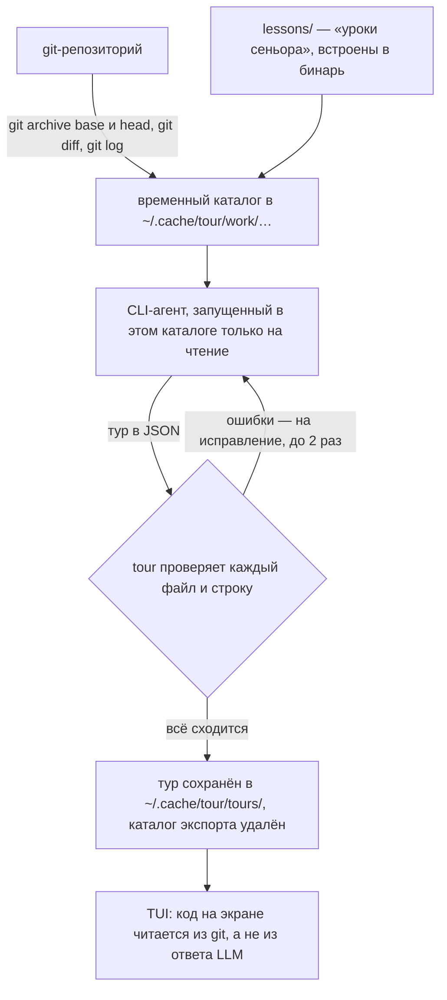

# 🧭 diff-tour (init-co-jp): экскурсия по git-изменению глазами сеньора

[**diff-tour**](https://github.com/init-co-jp/diff-tour) — консольная (TUI) утилита `tour`. Она берёт **одно git-изменение** (ветку, коммит, диапазон или незакоммиченные правки) и поручает уже установленному у тебя CLI-агенту (**Claude Code, Codex CLI, Gemini CLI, OpenCode 2 или Copilot CLI**) написать по нему **пошаговую экскурсию**. Листаешь её стрелками **→ / ←**. Экскурсия показывает, как такое изменение читал бы опытный ревьюер: зачем оно сделано, какие файлы читать вдумчиво, а какие можно пролистать, что будет при сбое или повторном вызове, какие замечания обязательны, а какие мелочь. Часть вопросов задаётся **до ответа**: сначала прикидываешь сам, ответ на следующем шаге.

Сведения о проекте: Go, лицензия **MIT**, автор — японская компания init-co-jp (Dai Aoki). Репозиторий создан 10.10.2026, на 01.11.2026 у него 336★ и 24 форка, последний релиз **v0.6.1** (29.10.2026). Русский язык интерфейса и туров появился в **v0.6.0** (24.10.2026). Пулреквесты авторы не принимают, только issues: все изменения они пишут сами, чтобы одинаково проверять, что LLM может читать и делать.

> [!note] Уточнение к посту
> Экскурсия строится не по всему репозиторию, а по **одному изменению** (diff), со ссылками на окружающий код. Обойти чужой проект целиком — это задача графов кода (см. [Understand Anything](../../Code-Graph/Understand%20Anything%20%E2%80%94%20%D0%B8%D0%BD%D1%82%D0%B5%D1%80%D0%B0%D0%BA%D1%82%D0%B8%D0%B2%D0%BD%D1%8B%D0%B9%20%D0%B3%D1%80%D0%B0%D1%84%20%D0%B7%D0%BD%D0%B0%D0%BD%D0%B8%D0%B9%20%D0%BF%D0%BE%20%D0%BA%D0%BE%D0%B4%D0%BE%D0%B2%D0%BE%D0%B9%20%D0%B1%D0%B0%D0%B7%D0%B5.md)). Поддержка пяти CLI есть, но у **Gemini CLI и Copilot CLI она экспериментальная**: режим «только чтение» на них проверен, а полный тур реальной моделью ещё не писали. OpenCode поддерживается **только второй версии**.

## ⚙️ Как работает



1. **Экспорт.** В каталог кэша выгружаются файлы «до» (`base/`) и «после» (`head/`), `change.diff`, `commits.txt` и встроенные `lessons/`. Берутся только файлы, отслеживаемые git. Для незакоммиченных правок добавляются ещё неотслеживаемые, но **не игнорируемые** файлы. То, что в `.gitignore` (например `.env`), не выгружается никогда.
2. **Написание.** Агент получает фиксированный промпт (он на японском, как и `lessons/`; тур пишется на выбранном языке) и **один вызов** читает код вокруг изменения. Занимает 2–5 минут, на экране видно, какие файлы он читает.
3. **Проверка.** Тур — это JSON со ссылками на файлы и номера строк. `tour` сверяет их с репозиторием, ошибки отправляет агенту на исправление, не больше двух раз.
4. **Показ.** Код, диффы и схемы БД берутся из git на нужном коммите. Код, которого нет в репозитории (наивный вариант, предлагаемое исправление), всегда помечен **Example**.

«Уроки сеньора» (`internal/generate/lessons`) — справочник, собранный авторами по книгам, исследованиям и разборам аварий. В нём 7 областей вопросов: обещания старого кода, сбои и повторы, выкатка и откат, доверие к входу, масштаб, дизайн, тесты. Отдельный раздел посвящён **коду, написанному ИИ** (например, несуществующие пакеты и API). Есть ещё файлы о порядке чтения, о взвешивании замечаний и о подаче материала. Агент читает справочник перед каждым туром.

Каждое утверждение в туре помечено, откуда оно известно:

| Метка | Значит |
| :--- | :--- |
| **Verified** | подтверждено кодом, тестами или сообщениями коммитов этого репозитория |
| **From the code** | выведено из устройства кода |
| **Senior view** | общее инженерное суждение, на этом репозитории не проверялось |

## 🔒 Что агенту доступно

`tour` сам в сеть не ходит, сервера у него нет, телеметрию не собирает. Код уходит **провайдеру выбранного CLI** (Anthropic, OpenAI, Google, GitHub; у OpenCode — провайдеру выбранной модели) по условиям твоего аккаунта. Ограничения задаются **флагами запуска каждого CLI**, а не только промптом: читать можно лишь каталог экспорта (рабочее дерево, `.git` и домашний каталог агенту недоступны), писать и менять ничего нельзя, сети нет, MCP, плагины, расширения и веб-поиск отключены.

| CLI | Чем ограничен |
| :--- | :--- |
| **Claude Code** | `claude -p --restricted --strict-mcp-config --tools Read,Grep,Glob --permission-mode dontAsk --permission-prompts none --no-session-persistence`, промпт подаётся через stdin |
| **Codex CLI** | собственный профиль песочницы: чтение каталога экспорта и системных путей, запись запрещена, сеть выключена; `--ignore-user-config`, `--ignore-rules`, `approval_policy="never"`, `--ephemeral`. Проверено на Linux (bubblewrap), на macOS (Seatbelt) ещё нет |
| **Gemini CLI** | временная `--admin-policy`: разрешены только `read_file`, `glob`, `grep_search`, `list_directory` внутри каталога; `--extensions none`. Сессию Gemini всё равно сохраняет в `~/.gemini/tmp` (по умолчанию удаляется через 30 дней) |
| **OpenCode 2** | свой агент `diff-tour` через `OPENCODE_CONFIG_CONTENT` (только `read`, `glob`, `grep`), пустой `OPENCODE_CONFIG_DIR`, из твоего конфига берутся только модель и провайдеры. Сессия остаётся в `~/.local/share/opencode/opencode.db`, системный конфиг `/etc/opencode` имеет приоритет |
| **Copilot CLI** | `--available-tools=view,grep,rg,glob --deny-tool=shell --deny-tool=write --disable-builtin-mcps --no-custom-instructions`, временный `COPILOT_HOME` только с данными входа. Политики организации продолжают действовать |

> [!warning] Что остаётся на тебе
> - Агент **читает весь код** обоих коммитов. Если в нём есть секреты, отслеживаемые git, они уйдут провайдеру. Защищены только файлы из `.gitignore`.
> - Текст в коде может пытаться повлиять на тур (prompt injection). Действовать агент не может, но **написать неправду может**. Тур — это объяснение, а не гарантия: сверяй его с показанным кодом, особенно метку **Senior view**.
> - По словам авторов, тур изменения примерно в 250 строк через Claude Code стоит **около $1,00–1,50 по ценам API** (на подписке расходуется квота). Повторное открытие сохранённого тура бесплатно.
> - Формат туров и экраны ещё меняются от релиза к релизу (README: «growing fast»).

## 📦 Установка

Нужны `git` и один из перечисленных CLI с выполненным входом. Готовые релизы: Linux, macOS и Windows, только **amd64 и arm64**, бинарь статический (`CGO_ENABLED=0`). Пакетов в дистрибутивах нет: на 01.11.2026 не найдено ни в `::gentoo`, ни в оверлеях (gpo.zugaina.org), ни в репозиториях Arch и AUR, ни в Debian.

| Система | Как поставить |
| :--- | :--- |
| **Gentoo** | ebuild нет → скрипт `install.sh` в `~/.local/bin` или `go install …@latest` (нужен Go **1.27.2+**, в Gentoo `dev-lang/go-1.27.3`). Пакет `dev-go/go-tour` кладёт свой `tour` в `GOTOOLDIR`, вне `PATH`, поэтому не конфликтует |
| **Debian / Ubuntu** | `install.sh`. Для `go install` в Debian 13 (trixie) Go 1.24 слишком старый → `sudo apt install -t trixie-backports golang-go` (1.27) или `GOTOOLCHAIN=auto go install …@latest`: Go сам скачает нужный toolchain |
| **Arch** | в AUR нет → `install.sh`, или `sudo pacman -S go` (1.27.3) и `go install …@latest` |
| **Windows** | zip из Releases (PowerShell-скрипт в README), авторы на Windows пока не тестировали |
| **Entware / RT-AX56U** | **не подходит**: сборок под armv7 нет, а Claude Code и другие CLI-агенты на роутере не запускаются. Утилита для рабочей машины |

<details>
<summary>Команды установки</summary>

```sh
# релиз: проверяет checksums.txt, кладёт tour в ~/.local/bin
curl -fsSL https://raw.githubusercontent.com/init-co-jp/diff-tour/main/install.sh | sh

# другой каталог или конкретная версия
curl -fsSL https://raw.githubusercontent.com/init-co-jp/diff-tour/main/install.sh \
  | TOUR_INSTALL_DIR=/usr/local/bin TOUR_VERSION=v0.6.1 sh

# из исходников (бинарь окажется в ~/go/bin)
go install github.com/init-co-jp/diff-tour/cmd/tour@latest

tour --version
```

</details>

> [!tip] Имя `tour`
> «A Tour of Go», поставленный через `go install golang.org/x/website/tour@latest`, тоже кладёт бинарь `tour` в `~/go/bin`. Если оба стоят, проверь `command -v tour`.

## ▶️ Использование

| Команда | Что показывает |
| :--- | :--- |
| `tour` | выбор ветки из списка, сравнение с веткой по умолчанию. Если есть незакоммиченные правки, первой идёт текущая ветка **вместе с ними** |
| `tour feature/x` / `tour origin/feature/x` | ветку, в том числе чужую с remote |
| `tour <commit>` | один коммит |
| `tour <base>..<head>` | диапазон |
| `tour файл.json` | сохранённый тур, без LLM и без входа |
| `tour setup` | заново выбрать язык и LLM |
| `tour --lang ru` | язык только на этот запуск (`en`, `ja`, `zh`, `zh-Hant`, `es`, `ru`) |
| `tour … --dump --cols 120 --rows 40 --plain` | вывести все шаги в stdout вместо TUI |

| Клавиша | Действие |
| :--- | :--- |
| <kbd>→</kbd> <kbd>Space</kbd> <kbd>Enter</kbd> | следующий шаг |
| <kbd>←</kbd> <kbd>Backspace</kbd> | предыдущий шаг |
| <kbd>?</kbd> | спросить о шаге: готовый вопрос или свой. Ответ становится следующим шагом (агенту при этом уходит весь тур и те же файлы) |
| <kbd>o</kbd> | открыть код шага в `$VISUAL` / `$EDITOR` (или по шаблону `TOUR_EDITOR='code -g {file}:{line}'`) |
| <kbd>↑</kbd> <kbd>↓</kbd> | прокрутка длинного шага |
| <kbd>q</kbd> | выход |

Кроме кода, в шаге бывают диаграммы потока и таймлайны, таблицы примеров данных и схема БД до и после изменения. Схема вычисляется прогоном миграций в SQLite в памяти, пока поддерживаются только миграции SQLite. Настройки лежат в `~/.config/tour/config.json`, туры в `~/.cache/tour/tours/` (с учётом `XDG_*`). Тур — обычный JSON: его можно передать коллеге, у которого есть тот же репозиторий.

<details>
<summary>Посмотреть готовый тур на русском без LLM</summary>

```sh
git clone https://github.com/init-co-jp/diff-tour-example && cd diff-tour-example
curl -fsSLO https://raw.githubusercontent.com/init-co-jp/diff-tour/main/tours/example-coupons.ru.json
tour example-coupons.ru.json
```

Тур по ветке `feature/coupons` (купоны при оплате, +241 −13 в 14 файлах): 6 глав и 17 шагов — «Что изменилось», «Зачем это изменение», «Карта», «Как устроено», «Где сеньор говорит «стоп»», «Итог». Главная находка: если покупатель дважды нажмёт «Применить», один купон спишется дважды на один заказ.

</details>

## 🧪 Проверено

Проверял 01.11.2026 на Gentoo (Go 1.27.3, Claude Code 2.1.316):

- `go build ./cmd/tour` с ветки `main` (5a267d9, после v0.6.1) собирается, `go test ./...` проходит во всех пакетах.
- Русский пример-тур открывается без LLM и входа, в `--dump` 17 шагов.
- Все флаги, которые `tour` передаёт `claude` (`--restricted`, `--permission-prompts none`, `--strict-mcp-config` и др.), в Claude Code 2.1.316 есть.
- Вместо `claude` подставлял скрипт-заглушку, который записывает аргументы и содержимое рабочего каталога. Результаты:
  - аргументы в точности совпадают с README;
  - агент запускается в `~/.cache/tour/work/<hash>/`, где лежат только `base/`, `head/`, `change.diff`, `commits.txt`, `lessons/` (и `uncommitted.diff` для незакоммиченных правок), а `.git` отсутствует;
  - игнорируемый `.env` с «секретом» не попал ни в файлы, ни в промпт, а неотслеживаемый `untracked.txt` в режиме незакоммиченных правок попал в `head/` (так и описано в README);
  - после завершения каталог `work/` пустой.
- Тур реальной моделью не генерировал: это 2–5 минут и около $1 квоты на изменение, а поведение генерации видно по коду и заглушке.

<details>
<summary>Скрипт-заглушка вместо claude</summary>

```sh
#!/bin/sh
# Заглушка: сохраняет, что tour передал агенту, и возвращает ошибку вместо тура.
LOG="$HOME/tour-stub-logs"; mkdir -p "$LOG"
echo "ARGS: $*" > "$LOG/args.txt"
pwd > "$LOG/cwd.txt"
find . -type f | sort > "$LOG/files.txt"
cat > "$LOG/prompt.txt"      # промпт приходит на stdin
printf '%s\n' '{"type":"result","result":"stub: no tour","is_error":true,"total_cost_usd":0}'
```

Запуск: положить скрипт как `claude` в отдельный каталог и поставить его первым в `PATH`, в `XDG_CONFIG_HOME/tour/config.json` указать `{"lang":"ru","llm":"claude-code"}`. TUI нужен терминал, поэтому без интерактивной сессии запускать через `script -qec "tour feature/x" /dev/null`.

</details>

## 💡 Когда полезно

- Нужно **принять или поддерживать код, написанный агентом**, и понять, почему он устроен именно так, а не просто убедиться, что тесты зелёные.
- **Ревью чужой ветки** (`tour origin/feature/x`) с подсказками, где обычно ломается: повторы, гонки, откат, доверие к входу.
- **Онбординг**: сохранённый тур по показательному изменению можно отдать новичку как обучающий материал.
- Для правки в одну строку тур не нужен, быстрее прочитать дифф (так пишут и сами авторы). Если нужен бот, который комментирует PR в CI, это другой класс инструментов, см. [OpenReview](OpenReview%20%28vercel-labs%29%20%E2%80%94%20self-hosted%20%D0%98%D0%98-%D1%80%D0%B5%D0%B2%D1%8C%D1%8E%D0%B5%D1%80%20pull%20request%20%D0%BD%D0%B0%20Claude%20%28%D0%BD%D0%B5%20%D0%BF%D1%80%D0%BE%D0%B4%D1%83%D0%BA%D1%82%20Vercel%2C%20%D0%BA%D0%BE%D0%BC%D0%BC%D0%B8%D1%82%D0%BE%D0%B2%20%D0%BD%D0%B5%D1%82%20%D1%81%20%D0%BC%D0%B0%D1%80%D1%82%D0%B0%2C%20%D1%81%D0%BA%D0%B8%D0%BB%D0%BB%D1%8B%20%D1%82%D0%BE%D0%BB%D1%8C%D0%BA%D0%BE%20%D0%BF%D0%BE%D0%B4%20Next-React%29.md).

## 🔗 Ссылки

- Репозиторий: [github.com/init-co-jp/diff-tour](https://github.com/init-co-jp/diff-tour) · [Releases](https://github.com/init-co-jp/diff-tour/releases)
- Пример-репозиторий для туров: [github.com/init-co-jp/diff-tour-example](https://github.com/init-co-jp/diff-tour-example)
- «Уроки сеньора» (на японском): [internal/generate/lessons](https://github.com/init-co-jp/diff-tour/tree/main/internal/generate/lessons)
- Источник новости: [«Не баг, а фича»](https://t.me/bugnotfeature/28576)
- Связанные: [Claude Code — гайд](../Claude%20Code%20%E2%80%94%20%D0%B3%D0%B0%D0%B9%D0%B4.md) · [Codex CLI — гайд](../Codex%20CLI%20%E2%80%94%20%D0%B3%D0%B0%D0%B9%D0%B4.md) · [OpenReview](OpenReview%20%28vercel-labs%29%20%E2%80%94%20self-hosted%20%D0%98%D0%98-%D1%80%D0%B5%D0%B2%D1%8C%D1%8E%D0%B5%D1%80%20pull%20request%20%D0%BD%D0%B0%20Claude%20%28%D0%BD%D0%B5%20%D0%BF%D1%80%D0%BE%D0%B4%D1%83%D0%BA%D1%82%20Vercel%2C%20%D0%BA%D0%BE%D0%BC%D0%BC%D0%B8%D1%82%D0%BE%D0%B2%20%D0%BD%D0%B5%D1%82%20%D1%81%20%D0%BC%D0%B0%D1%80%D1%82%D0%B0%2C%20%D1%81%D0%BA%D0%B8%D0%BB%D0%BB%D1%8B%20%D1%82%D0%BE%D0%BB%D1%8C%D0%BA%D0%BE%20%D0%BF%D0%BE%D0%B4%20Next-React%29.md) · [Understand Anything](../../Code-Graph/Understand%20Anything%20%E2%80%94%20%D0%B8%D0%BD%D1%82%D0%B5%D1%80%D0%B0%D0%BA%D1%82%D0%B8%D0%B2%D0%BD%D1%8B%D0%B9%20%D0%B3%D1%80%D0%B0%D1%84%20%D0%B7%D0%BD%D0%B0%D0%BD%D0%B8%D0%B9%20%D0%BF%D0%BE%20%D0%BA%D0%BE%D0%B4%D0%BE%D0%B2%D0%BE%D0%B9%20%D0%B1%D0%B0%D0%B7%D0%B5.md)

#diff-tour #AI #Claude_Code #Codex #OpenCode #CodeReview #Git #TUI #Go
