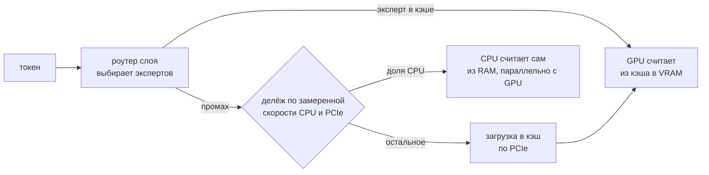

# tandem.cpp — MoE-модели, не влезающие в видеопамять, быстрее в llama.cpp

**[tandem.cpp](https://github.com/ewhacc/tandem.cpp)** — набор патчей к [llama.cpp](llama.cpp%20%E2%80%94%20%D0%B4%D0%B2%D0%B8%D0%B6%D0%BE%D0%BA%20%D0%BB%D0%BE%D0%BA%D0%B0%D0%BB%D1%8C%D0%BD%D0%BE%D0%B3%D0%BE%20%D0%B8%D0%BD%D1%84%D0%B5%D1%80%D0%B5%D0%BD%D1%81%D0%B0%20GGUF.md) для MoE-моделей, чьи эксперты не помещаются в видеопамять. Остаток видеопамяти занимает кэш экспертов, а промахи кэша частично считает процессор параллельно с видеокартой. Цель — генерация для одного пользователя. Заметка по посту [johenews](https://t.me/johenews/2374) от 4 ноября 2026 года, сверена с репозиторием и с llama.cpp.

| | |
| :--- | :--- |
| Автор | ewhacc, независимый проект, не ggml-org |
| Возраст | с 1 ноября 2026 года, 4 коммита (три из них — README), ~50 звёзд |
| Что внутри | один файл `tandem.patch` (432 КБ, 35 файлов llama.cpp) против закреплённого коммита llama.cpp `f5222f25c` от 28.10.2026 |
| Лицензия | MIT, как и у llama.cpp (GitHub пишет `NOASSERTION` из-за нестандартного хвоста в `LICENSE`) |
| Проверено автором | Linux, CUDA 13.0–13.4, RTX 4090 и RTX 6000 Ada (sm_89), RTX PRO 6000 Blackwell (sm_120) |

## 1. Как это работает



- Все эксперты лежат в оперативной памяти (`-cmoe`). Видеопамять, оставшаяся после плотных слоёв, KV-кэша и буферов, становится кэшем недавно использованных экспертов (`--moe-cache-mib auto`).
- Состав кэша меняется по ходу генерации. Это не раз и навсегда выбранные «частые» эксперты.
- Промахи делятся между процессором и загрузкой в кэш по замеренной скорости CPU и шины. Правило делёжки взято у [Strata](Strata%20%E2%80%94%20%D0%B4%D0%B2%D0%B8%D0%B6%D0%BE%D0%BA%20%D0%B4%D0%BB%D1%8F%20Qwen3.8-Flash-Next%20%28125B%20MoE%29%20%D0%BD%D0%B0%20%D0%B8%D0%B3%D1%80%D0%BE%D0%B2%D0%BE%D0%B9%20%D0%B2%D0%B8%D0%B4%D0%B5%D0%BE%D0%BA%D0%B0%D1%80%D1%82%D0%B5%2012%20%D0%93%D0%91%20%28%2B32%E2%80%9364%20%D0%93%D0%91%20RAM%29%2C%20API%20OpenAI%20%D0%B8%20Anthropic.md) — отдельного движка для Qwen3.8-Flash-Next.
- Сверху — ускорения под Qwen3.8: слитые ядра для hyper-connections и gated delta net, отложенный догоняющий шаг MTP, чтение эмбеддингов по слоям (per-layer embeddings) видеокартой прямо из закреплённой памяти хоста.

**Точность.** С выключенными умолчаниями (`LLAMA_MOE_NO_DEFAULTS=1`) патч считает ровно то же, что llama.cpp: KL-дивергенция 0. С умолчаниями отличается только округление: KLD ≈ 0,009, совпадение лучшего токена 95–96 %, перплексия та же. Режим с пропуском слабых экспертов (`LLAMA_MOE_TAIL_SKIP`) приближённый и по умолчанию выключен.

## 2. Цифры

Замеры автора: один пользователь, 200 вопросов GSM8K, генерация в ток/с. Обоим движкам даны одинаковый объём видеопамяти и одна и та же черновая модель.

**Обычный ПК:** i5-12400F (6 ядер), 64 ГБ DDR4, RTX 4090 24 ГБ, PCIe 4.0.

| Модель | llama.cpp | tandem.cpp | Strata, точный режим |
| :--- | ---: | ---: | ---: |
| Qwen3.8-Flash-Next IQ3_S (78 ГиБ) + голова MTP | 29,8 | **97,3** (3,3×) | 103,6 |
| gpt-oss-120b | 27,8 | **51,5** (1,85×) | — |
| DeepSeek-V4.1 IQ2_XS — втрое больше RAM, читается с SSD | 6,86 | 5,99 (0,87×) | 8,41 |

**Рабочая станция:** Threadripper PRO 5955WX, RTX 6000 Ada 48 ГБ.

| Модель, сколько видеопамяти разрешено | llama.cpp | tandem.cpp |
| :--- | ---: | ---: |
| Qwen3.8 IQ3_S + MTP, вся карта | 98,6 | **182,5** (1,85×) |
| Qwen3.6-35B-A3B, 12 ГБ | 97,2 | **136,5** (1,40×) |
| Qwen3.6-35B-A3B, 8 ГБ | 79,8 | **115,0** (1,44×) |
| Qwen3.6-35B-A3B, помещается целиком (22,4 ГБ) | 173,1 | 179,2 (1,04×) |
| GLM-4.5-Air (73 ГБ), вся карта | 31,9 | **54,6** (1,71×) |

- **Чтение промпта** на 64 тыс. токенов быстрее в 1,44–1,84 раза. До первого токена на коротких вопросах — в 1,6–2,7 раза быстрее.
- **Пользовательский отчёт** ([issue #1](https://github.com/ewhacc/tandem.cpp/issues/1)): ноутбук с RTX 3050 4 ГБ (sm_86), 14 ГБ RAM, Qwen3.5-35B-A3B IQ2_XXS — работает, 32–36 ток/с. Сравнения с обычным llama.cpp в отчёте нет.

### Что стоит за «97 ток/с, в 3,3 раза быстрее»

- **Железо и настройки.** Видеокарта — RTX 4090 на 24 ГБ, верх игрового сегмента. Квант — IQ3_S от ISTA-DASLab. Генерация со спекулятивным декодированием через голову MTP. Вопросы короткие, режим жадный: со штатным сэмплингом Qwen — 96,1 ток/с.
- **База сравнения.** «В 3,3 раза» — против llama.cpp с размещением по умолчанию (`-fit on`: плотные слои на GPU, затем столько экспертов, сколько влезет). Кэш экспертов `--moe-cache-mib`, который был в llama.cpp уже на базовом коммите, в этом сравнении выключен (раздел 3).
- **Strata.** В точном режиме она на 6 % быстрее при жадной генерации и на 2 % при сэмплинге. По умолчанию Strata пропускает слабые эксперты — это приближённо, зато 127,1 ток/с. Такой же приближённый режим tandem даёт 123,6.
- **Другие MoE.** Обычно выигрыш 1,4–2,1×. Чем ближе модель к тому, чтобы влезть в видеопамять целиком, тем он меньше.
- **Слабое место.** Модели больше RAM, которые читаются с SSD: выигрыша нет или даже медленнее. Автор обещает исправить.

## 3. Та же идея уже в llama.cpp

Пока tandem набирал звёзды, основной механизм вошёл в обычный llama.cpp:

| Что | Где | Статус на 8 ноября 2026 |
| :--- | :--- | :--- |
| `--moe-cache-mib N` — кэш на GPU для экспертов, оставленных в RAM (по умолчанию выключен) | был уже в `f5222f25c` | в master |
| новый алгоритм вытеснения (ClassLRU в духе LRFU/MQ), +6–7 % к генерации | [PR #31233](https://github.com/ggml-org/llama.cpp/pull/31233) | влит 6 ноября |
| `--moe-cache-cpu-share F` — доля промахов, которую считает CPU, и скрипт подбора `scripts/moe-cache-tune.py` | [PR #30966](https://github.com/ggml-org/llama.cpp/pull/30966) | влит 7 ноября |
| `--moe-cache-cpu-share auto` | [PR #31286](https://github.com/ggml-org/llama.cpp/pull/31286) | открыт |

Запуск в свежем llama.cpp: подбор параметров скриптом, затем сервер с найденными значениями.

```bash
python3 scripts/moe-cache-tune.py -- build/bin/llama-server -m model.gguf -cmoe -t 8 -c 32768
llama-server -m model.gguf -ngl 999 -cmoe --moe-cache-mib <N> --moe-cache-cpu-share <доля>
```

Сравнений свежего llama.cpp с tandem пока никто не публиковал. Что у tandem есть сверх upstream:
- автоматический размер кэша (`auto`) и делёжка по замеренным скоростям;
- ускорения под Qwen3.8 и доработки MTP;
- работа с закреплённой памятью и mmap.

Практически: сначала свежий llama.cpp — без патча, с обновлениями и поддержкой новых моделей. tandem — если нужен максимум на Qwen3.8-Flash-Next прямо сейчас и вы на Linux с NVIDIA.

## 4. Сборка

Нужны CUDA Toolkit, `cmake`, компилятор C++ и `git`. Автор проверял только CUDA 13, а CUDA 13 не поддерживает видеокарты старше Turing (Pascal, Volta). Собрать tandem с CUDA 12 теоретически можно — сам llama.cpp её поддерживает, — но это никто не проверял.

| Система | CUDA 13 |
| :--- | :--- |
| Gentoo | `dev-util/nvidia-cuda-toolkit-13.4.1` под `~amd64`: `echo 'dev-util/nvidia-cuda-toolkit ~amd64' >> /etc/portage/package.accept_keywords/cuda && emerge -av dev-util/nvidia-cuda-toolkit dev-build/cmake` |
| Debian 13 / Ubuntu 24.04, 26.04 | в репозиториях дистрибутивов только CUDA 12 (Debian 13 — 12.4). Репозиторий NVIDIA: `wget https://developer.download.nvidia.com/compute/cuda/repos/debian13/x86_64/cuda-keyring_1.1-1_all.deb && sudo dpkg -i cuda-keyring_1.1-1_all.deb && sudo apt update && sudo apt install cuda-toolkit-13-4 cmake build-essential git` (для Ubuntu — `ubuntu2404` или `ubuntu2604` в пути) |
| Arch | `sudo pacman -S cuda cmake base-devel git` — в `extra` CUDA 13.4 |
| Entware | неприменимо: нужна видеокарта NVIDIA |

Сама сборка — скрипт автора: клонирует llama.cpp, переключает на базовый коммит, накладывает патч и собирает `llama-server`.

```bash
git clone https://github.com/ewhacc/tandem.cpp && cd tandem.cpp
bash build.sh                                   # → tandem/build/bin/llama-server
# под одну архитектуру быстрее: bash build.sh tandem -DCMAKE_CUDA_ARCHITECTURES=89
```

## 5. Запуск

Любая MoE-модель, чьи эксперты не помещаются в видеопамять:

```bash
llama-server -m model.gguf -ngl 99 -cmoe --moe-cache-mib auto -lm none -np 1 -c 16384
```

- `-cmoe` — все эксперты в RAM; `--moe-cache-mib auto` — свободную видеопамять под кэш, минус запас `--moe-cache-margin-mib` (по умолчанию 1024).
- `-lm none` — прочитать веса в RAM целиком, а не через mmap.
- `-np 1 -c 16384` — один диалог на 16 тыс. токенов. Без этого `llama-server` откроет 4 слота с общим маленьким контекстом, слишком коротким для «думающей» модели.
- Строка `failed to fit params … abort` при старте ожидаема: `-ngl 99` выключает автоматическое размещение, его заменяет кэш.
- **RAM меньше модели** (Qwen3.8 IQ3_S — 78 ГиБ на ПК с 64 ГБ): без `-lm none`.
- **RAM совсем мало** (16 ГБ): ещё и `--cache-ram 0`. Иначе кэш промптов займёт до 8 ГиБ и вытеснит экспертов из страничного кэша.
- **В контейнере с лимитом памяти:** `LLAMA_MOE_PIN_EXPS=0 LLAMA_PLE_GPU_COPY=0`. Правила tandem смотрят на физическую RAM, а не на лимит cgroup.

Qwen3.8-Flash-Next с головой MTP, как в замерах:

```bash
hf download ISTA-DASLab/Qwen3.8-Flash-Next-GSQ-RCO-GGUF --include 'IQ3_S/*' --local-dir models
hf download ewhacc/qwen38-mtp-outq4_K-expsq4_K --include '*.gguf' --local-dir models

LLAMA_MTP_DRAFT_VOCAB=100000 llama-server -m models/IQ3_S/Qwen3.8-Flash-Next-GSQ-RCO-IQ3_S-00001-of-00002.gguf \
  -ngl 99 -cmoe --moe-cache-mib auto -lm none -np 1 -c 16384 \
  --spec-type draft-mtp -md models/qwen38-mtp-outq4_K-expsq4_K.gguf --spec-draft-n-max 3 --spec-draft-sampling probabilistic \
  -bs -ot '^token_embd\.weight=CUDA0'
```

- Голова MTP пережата автором в Q4_K: 1,8 ГиБ видеопамяти вместо 3,6 при той же доле принятых токенов, освободившееся уходит под кэш. Лицензия — Qwen Community License 1.0, как у модели.
- `--spec-draft-n-max 3` — для карт на 24 ГБ и процессоров на 6–10 ядер, 4 — для 48 ГБ. `probabilistic` оставляет сэмплированный вывод точным.
- Каждые лишние 16 тыс. токенов контекста забирают у кэша около 0,7 ГиБ.

## 6. Ограничения

- Только Linux и CUDA. На AMD, Intel и Apple не проверялось.
- Патч закреплён на коммите llama.cpp от 28 октября: исправления и новые модели из upstream сами не придут. Проект недельный, автор один.
- Рассчитан на одного пользователя. Параллельные запросы работают, но выигрыш меньше, а с маленьким кэшем может быть даже медленнее.
- Жадная генерация с кэшем не повторяется от запуска к запуску: что окажется в кэше, зависит от таймингов, а CPU и GPU округляют по-разному. Повторяемость даёт фиксированная доля, например `LLAMA_MOE_CPU=0.2`.
- Несколько GPU — только `-sm layer`: корректность проверена, скорость не настраивалась.
- Больше трёх черновых токенов — возможна нехватка видеопамяти на первой длинной проверке. Лечится увеличением `--moe-cache-margin-mib`.
- GGUF Qwen3.8, сконвертированные текущим llama.cpp, могут быть чуть медленнее файлов ISTA: одно слияние ядер не подходит к их раскладке.

## Связанные заметки

- [Strata — движок для Qwen3.8-Flash-Next на игровой видеокарте 12 ГБ](Strata%20%E2%80%94%20%D0%B4%D0%B2%D0%B8%D0%B6%D0%BE%D0%BA%20%D0%B4%D0%BB%D1%8F%20Qwen3.8-Flash-Next%20%28125B%20MoE%29%20%D0%BD%D0%B0%20%D0%B8%D0%B3%D1%80%D0%BE%D0%B2%D0%BE%D0%B9%20%D0%B2%D0%B8%D0%B4%D0%B5%D0%BE%D0%BA%D0%B0%D1%80%D1%82%D0%B5%2012%20%D0%93%D0%91%20%28%2B32%E2%80%9364%20%D0%93%D0%91%20RAM%29%2C%20API%20OpenAI%20%D0%B8%20Anthropic.md) — с ним tandem себя сравнивает; там же о самой модели, 125B MoE, 6B активных
- [MoE-оффлоад в llama.cpp (--n-cpu-moe)](MoE-%D0%BE%D1%84%D1%84%D0%BB%D0%BE%D0%B0%D0%B4%20%D0%B2%20llama.cpp%20%28--n-cpu-moe%29%20%E2%80%94%20Qwen3.6-35B%20%D0%BD%D0%B0%2012%20%D0%93%D0%91%20VRAM%20%28%D0%BF%D1%80%D0%BE%D0%B2%D0%B5%D1%80%D0%BA%D0%B0%20%D0%BF%D0%BE%D1%81%D1%82%D0%B0%20%E2%80%94%20%D1%82%D1%80%D1%8E%D0%BA%D1%83%20%D0%BF%D0%BE%D0%BB%D1%82%D0%BE%D1%80%D0%B0%20%D0%B3%D0%BE%D0%B4%D0%B0%2C%20--fit%20%D0%B4%D0%B5%D0%BB%D0%B0%D0%B5%D1%82%20%D1%8D%D1%82%D0%BE%20%D1%81%D0%B0%D0%BC%2C%201080%20Ti%20%D0%BF%D0%BE%D0%B4%D1%85%D0%BE%D0%B4%D0%B8%D1%82%29.md) — статическое размещение экспертов, с которого всё началось
- [FreeToken (FlashML) — движок для MoE на потребительском железе](FreeToken%20%28FlashML%29%20%E2%80%94%20%D0%B4%D0%B2%D0%B8%D0%B6%D0%BE%D0%BA%20%D0%B4%D0%BB%D1%8F%20MoE-%D0%BC%D0%BE%D0%B4%D0%B5%D0%BB%D0%B5%D0%B9%20%D0%BD%D0%B0%20%D0%BF%D0%BE%D1%82%D1%80%D0%B5%D0%B1%D0%B8%D1%82%D0%B5%D0%BB%D1%8C%D1%81%D0%BA%D0%BE%D0%BC%20%D0%B6%D0%B5%D0%BB%D0%B5%D0%B7%D0%B5%20%28%D1%82%D0%BE%D0%BB%D1%8C%D0%BA%D0%BE%20MoE%2C%20%D0%BD%D1%83%D0%B6%D0%BD%D1%8B%20CUDA%2013%20%D0%B8%20RTX%2030%2B%2C%20Pascal%20%D0%BC%D0%B8%D0%BC%D0%BE%29.md) — ещё один движок той же ниши
- [MTP-ускорение в llama.cpp](MTP-%D1%83%D1%81%D0%BA%D0%BE%D1%80%D0%B5%D0%BD%D0%B8%D0%B5%20%D0%B2%20llama.cpp%20%28Qwen3.6%2027B%29%20%E2%80%94%20%D1%82%D1%8E%D0%BD%D0%B8%D0%BD%D0%B3%20%D0%BB%D0%BE%D0%BA%D0%B0%D0%BB%D1%8C%D0%BD%D0%BE%D0%B3%D0%BE%20%D0%B0%D0%B3%D0%B5%D0%BD%D1%82%D0%BD%D0%BE%D0%B3%D0%BE%20%D0%B8%D0%BD%D1%84%D0%B5%D1%80%D0%B5%D0%BD%D1%81%D0%B0%20%28--fit%2C%20vLLM%2C%20%D1%88%D0%B0%D0%B1%D0%BB%D0%BE%D0%BD%D1%8B%29.md) — спекулятивное декодирование, на котором держатся цифры для Qwen3.8
- [73 ток/с из Qwen3.6-27B в llama.cpp (конспект johenews)](../../Education/Youtube/johenews/73%20%D1%82%D0%BE%D0%BA-%D1%81%20%D0%B8%D0%B7%20Qwen3.6-27B%20%D0%B2%20llama.cpp%20%D0%B1%D0%B5%D0%B7%20%D0%BF%D0%BE%D1%82%D0%B5%D1%80%D0%B8%20%D0%BA%D0%B0%D1%87%D0%B5%D1%81%D1%82%D0%B2%D0%B0%20%E2%80%94%20MTP%2C%20%D1%81%D1%8D%D0%BC%D0%BF%D0%BB%D0%B8%D0%BD%D0%B3%20%D0%B4%D0%BB%D1%8F%20%D0%BA%D0%BE%D0%B4%D0%B0%2C%20batch%2C%20-ts%2C%20CUDA%2013.3%20%28%D0%BA%D0%BE%D0%BD%D1%81%D0%BF%D0%B5%D0%BA%D1%82%20johenews%29.md) — тот же автор канала о тюнинге llama.cpp

## 🔗 Ссылки

- Пост: https://t.me/johenews/2374
- tandem.cpp: https://github.com/ewhacc/tandem.cpp
- llama.cpp PR #30966 (CPU считает промахи кэша, скрипт подбора): https://github.com/ggml-org/llama.cpp/pull/30966
- llama.cpp PR #31233 (алгоритм кэша ClassLRU): https://github.com/ggml-org/llama.cpp/pull/31233
- llama.cpp PR #31286 (`--moe-cache-cpu-share auto`): https://github.com/ggml-org/llama.cpp/pull/31286
- Strata: https://github.com/Niko1221/Strata
- Qwen3.8-Flash-Next GSQ-RCO GGUF (ISTA-DASLab): https://huggingface.co/ISTA-DASLab/Qwen3.8-Flash-Next-GSQ-RCO-GGUF
- Голова MTP в Q4_K: https://huggingface.co/ewhacc/qwen38-mtp-outq4_K-expsq4_K

#AI #Local_LLM #llama_cpp #MoE #Qwen #CUDA
