# 🚙 Lada Vesta SW Cross 1.8 MT — нормальные параметры двигателя (ELM327 + OpenDiag)

Заметка-шпаргалка: какие параметры двигателя **ВАЗ-21179** (1,8 л, 16 клапанов, 122 л.с., фазорегулятор на впуске, ЭБУ **M74.9 CAN**) можно снять через адаптер **ELM327** и программу **OpenDiag Mobile**, какие значения считаются нормой и как по ним понять, что мотор работает правильно. В конце — разбор живых замеров с этой машины: прогретый мотор утром и вечером 14.10.2026, холодный пуск, прогрев и горячий мотор после поездки 16.10.2026.

> [!info] Как читать нормы
> Все цифры ниже — **ориентиры для прогретого двигателя на холостом ходу** (температура ОЖ выше 85 °C, всё выключено, коробка в нейтрали). На этой машине стоит ЭБУ **M74.9 CAN** (Итэлма) — диагностика идёт по шине CAN (ISO 15765-4), её поддерживает любой исправный ELM327. Заводские нормы взяты из **таблицы 2.4-01 технологической инструкции АвтоВАЗ** [ТИ 3100.25100.12056](%D0%A2%D0%98%203100.25100.12056%20%E2%80%94%20%D0%AD%D0%A1%D0%A3%D0%94%2021129%20%D0%B8%2021179%20Lada%20Vesta%20%D1%81%20%D0%BA%D0%BE%D0%BD%D1%82%D1%80%D0%BE%D0%BB%D0%BB%D0%B5%D1%80%D0%BE%D0%BC%20%D0%9C86%2C%20%D1%83%D1%81%D1%82%D1%80%D0%BE%D0%B9%D1%81%D1%82%D0%B2%D0%BE%20%D0%B8%20%D0%B4%D0%B8%D0%B0%D0%B3%D0%BD%D0%BE%D1%81%D1%82%D0%B8%D0%BA%D0%B0%20%28%D1%82%D0%B5%D1%85%D0%BD%D0%BE%D0%BB%D0%BE%D0%B3%D0%B8%D1%87%D0%B5%D1%81%D0%BA%D0%B0%D1%8F%20%D0%B8%D0%BD%D1%81%D1%82%D1%80%D1%83%D0%BA%D1%86%D0%B8%D1%8F%20%D0%90%D0%B2%D1%82%D0%BE%D0%92%D0%90%D0%97%2C%20PDF%29.md) — она написана для 21129 с контроллером М86, поэтому для 21179 с M74.9 часть цифр отличается (обороты ХХ 750 вместо 840, у 1,8 л меньше нагрузка и длительность впрыска на ХХ). Сама инструкция называет значения рекомендательными. Номер прошивки виден на вкладке **«Информация»** в OpenDiag. Важнее не один снимок, а **поведение во времени**: строите график и смотрите, как параметр меняется.

---

## 1. Чем снимать

### Адаптер

- **ELM327 Bluetooth или Wi-Fi.** Лучше брать адаптер на микроконтроллере **PIC18F25K80** с прошивкой **v1.5**. Дешёвые клоны «v2.1» часто поддерживают не все протоколы и команды, OpenDiag с ними может не подключиться к ЭБУ.
- Разъём диагностики на Весте — под рулевой колонкой слева.
- Подключать при **выключенном** зажигании, затем включить зажигание или завести двигатель. Уходя, вынимать: некоторые клоны потихоньку разряжают аккумулятор.

### Программы

| Программа | Что даёт |
| :--- | :--- |
| **OpenDiag Mobile** (Android) | заводские параметры ЭБУ Lada на русском: всё, что на скриншотах ниже, включая каналы АЦП, детонацию, пропуски, адаптации; чтение и сброс ошибок. Часть сервисных функций зависит от версии программы |
| **Car Scanner**, **Torque** | только стандартные параметры OBD2 (обороты, температура, коррекции топлива в %, датчики кислорода); заводских параметров Lada нет |
| **python-OBD** на Linux | запись стандартных параметров в файл для анализа (см. раздел 6) |

**Как связаны коррекции в разных программах.** OpenDiag показывает коррекции коэффициентом около 1,0, а стандартные OBD2-программы — в процентах:

```
% в Car Scanner / Torque = (коэффициент OpenDiag − 1) × 100
0,90 → −10 %     1,00 → 0 %     1,04 → +4 %
```

---

## 2. Нормы: основные параметры (вкладка «Параметры ЭБУ»)

| Параметр | Норма (прогретый, ХХ) | О чём говорит отклонение |
| :--- | :--- | :--- |
| Количество ошибок | **0** | любые ошибки — читать на вкладке «Ошибки» |
| Напряжение бортовой сети | **13,0–14,5 В** при работающем двигателе (по ТИ); 12,4–12,8 В — заглушен | ниже 13,4 — генератор или ремень; выше 14,7 — регулятор напряжения |
| Температура ОЖ | **90–103 °C** (по ТИ; после пуска равномерно растёт до 94–102 °C); вентилятор включается около 101–105 °C | не поднимается выше 80–85 °C — термостат открыт; выше 108–110 °C — система охлаждения |
| Обороты ХХ | **750 ± 50 об/мин** (желаемые на прогретом — 750); на холодном выше и плавно снижаются по мере прогрева (на этой машине при +16…18 °C желаемые — **1070**) | «плавают» больше ±50 — подсос воздуха, грязный дроссель, пропуски |
| Угол опережения зажигания | **9 ± 5°** на ХХ (по ТИ; 30–35° на 3000 об/мин), постоянно немного «гуляет» | ЭБУ держит обороты ХХ углом, колебания в пределах нескольких градусов — норма |
| Длительность впрыска | **2,7–3,9 мс** по ТИ для 21129; у 21179 на ХХ обычно меньше — **около 2,2–2,8 мс** | больше — богатая смесь или большая нагрузка (кондиционер, фары, руль) |
| Положение дроссельной заслонки | **1–4 %** (по ТИ; 6–10 % на 3000 об/мин) | больше 5–6 % — дроссель грязный, ЭБУ открывает его сильнее, чтобы удержать обороты |
| Положение педали газа | **0 %** без нажатия | не 0 — датчик педали |
| Относительное заполнение воздухом (нагрузка) | **16–26 %** по ТИ для 21129; у 1,8 л на ХХ — **около 14–20 %** | больше — подсос воздуха мимо датчиков, нагрузка, неисправность ДАД |
| Расход топлива на ХХ | **0,7–1,0 л/ч** | больше 1,2 л/ч без нагрузки — богатая смесь |
| Заданное значение лямбда | **1,00** | на прогретом ХХ всегда 1,00 |
| Желаемые обороты ХХ | **750** | |

### Смесь и коррекции

| Параметр | Норма | Что значит |
| :--- | :--- | :--- |
| Текущий коэффициент коррекции впрыска (кратковременная, STFT) | **1,00 ± 0,15** (по ТИ), колеблется около 1,0 | быстрая подстройка по датчику кислорода |
| Мультипликативная составляющая коррекции самообучением (долговременная, LTFT) | **1,00 ± 0,15** — норма по ТИ; 0,95–1,05 — идеально | **меньше 1** — ЭБУ убирает топливо (смесь была бы богатой), **больше 1** — добавляет (смесь была бы бедной). Близко к пределам — скоро будут ошибки P0172 / P0171 |
| Адаптированное отклонение расхода воздуха мимо дросселя (аддитивная коррекция) | около **0** | заметно отличается — подсос воздуха на ХХ |
| Фактор высотной коррекции | **≈1,00** | |
| I-часть регулирования по датчику кислорода | около 0 | |
| Фактор старения нейтрализатора | **≤ 0,45** (по ТИ); чем меньше, тем лучше | растёт по мере износа катализатора |
| Коэффициент продувки адсорбера | **0–12 %** на ХХ, 0–18 % на 3000 об/мин (по ТИ), меняется | работа системы улавливания паров бензина |

### Датчики кислорода (лямбда-зонды)

| Датчик | Норма на прогретом ХХ |
| :--- | :--- |
| **ДК1** (до катализатора, управляющий) | **постоянно переключается 0,1 ↔ 0,8–0,9 В**, период сигнала **меньше 1,8 с** (по ТИ); АЦП — в пределах 0,18–0,95 В. Снимок может показать любое значение из этого диапазона — смотрите график |
| **ДК2** (после катализатора, диагностический) | **ровно 0,59–0,75 В** (по ТИ), почти не меняется. Если повторяет «пилу» ДК1 — катализатор не работает |

На только что заведённом двигателе, пока датчики не прогрелись, регулирование по ним не работает. В OpenDiag на M74.9 неготовый датчик выглядит так: **1,26 В** в «Параметрах ЭБУ» и **3,25 В** в «Каналах АЦП». Это не неисправность, а метка «сигнала ещё нет». ДК1 начинает работать через несколько минут, ДК2 — заметно позже: ЭБУ включает его подогрев, только когда выпуск достаточно прогреется (защита керамики от конденсата).

### Холостой ход и мониторы готовности

| Параметр | Норма |
| :--- | :--- |
| Разница крутящего момента от адаптированного | в пределах нескольких процентов |
| Потребность в моменте для регулирования ХХ: I-часть и PD-часть | **±8 %** (по ТИ), обычно около 0 |
| Нормальная утечка воздуха через дроссель | **3–5 кг/ч** (по ТИ) |
| «Проверка нейтрализатора / системы улавливания паров завершена» | **«Нет» — нормально** после короткой поездки или снятия клеммы; «Да» появится после цикла езды с разными режимами |

---

## 3. Нормы: каналы АЦП (напряжения датчиков)

| Датчик | Норма | Как проверить |
| :--- | :--- | :--- |
| Напряжение бортовой сети | как выше | |
| Датчик температуры ОЖ | **0,2–0,3 В** на прогретом; **около 3–4 В** на холодном | чем горячее, тем меньше напряжение |
| Датчик температуры воздуха на впуске | 0,6–2,5 В в зависимости от температуры | горячий — меньше |
| Датчик абсолютного давления (ДАД) | **1,2–1,6 В** на ХХ (разрежение ≈ 30–40 кПа); **≈4 В** с заглушенным мотором | на ХХ выше 1,8 В — подсос воздуха или слабая компрессия |
| Датчики дросселя 1 и 2 | работают **в противофазе**: ДПДЗ1 высокий, ДПДЗ2 низкий, **сумма ≈ 5,0 В**. По ТИ на ХХ: один канал **0,58–0,70 В**, другой **4,30–4,42 В** (в OpenDiag на M74.9 «1» и «2» могут быть названы наоборот) | сумма заметно не 5 В — датчик или проводка |
| Датчики педали газа 1 и 2 | ДППГ2 ≈ **половина** ДППГ1 (без нажатия ≈ 0,7 и 0,35 В; по ТИ ДППГ1 — **0,50–0,85 В**) | соотношение нарушено — датчик педали |
| Датчик кислорода 1 и 2 | как в разделе 2 | |
| «Сопротивление датчика кислорода» | у многих прошивок постоянно **25 000 Ом** | это значение-заглушка, на него не ориентируйтесь |
| «Измеренное напряжение с генератора» | на этой машине всегда **12,10 В** — и на холодном, и на горячем | тоже заглушка: напряжение сети смотрите в строке «Напряжение бортовой сети» |
| Датчик детонации | **0,03–0,3 В** на ХХ (на холодном меньше) | |
| Датчик давления фреона | **0,6–1,1 В** с выключенным кондиционером, зависит от температуры (на этой машине 0,66 В при +16 °C и 1,09 В на прогретом) | заметно ниже — мало фреона |
| Сигнал с генератора | загрузка генератора в % (на этой машине 16–25 без нагрузки) | растёт при включении потребителей: обогрев сиденья добавил ~3 единицы |
| Сигнал с датчика давления масла | **«Нет»** — давление в норме | «Да» на работающем моторе — **сразу глушить** и проверять масло |

---

## 4. Нормы: детонация и пропуски воспламенения

| Параметр | Норма |
| :--- | :--- |
| Отскок угла опережения при детонации, цил. 1–4, и общий | **0,0** на ХХ и при спокойной езде |
| Относительный уровень регулировки по детонации, цил. 1–4 | малые значения (около 0,1–0,3), **близкие между цилиндрами** |
| Счётчики пропусков воспламенения по цилиндрам | **0** |
| Тест плавности, цил. 1–4 | около 0 |
| Параметры адаптации демпфера, диапазоны 1–4 | ненулевые — адаптация задающего диска выполнена; 0 в некоторых диапазонах — для них адаптация ещё не прошла (проходит при сбросе газа с высоких оборотов) |

«Базовый угол опережения» и «Максимальная задержка УОЗ» — служебные расчётные величины ЭБУ, они немного меняются от режима (на этой машине 27,75° и 181,5° на холодном, 26,25° и 187,5° на горячем). Для проверки двигателя они не нужны.

---

## 5. Разбор замеров с этой машины (14.10 и 16.10.2026)

Утренние замеры сделаны около 06:21–06:24, вечерние — около 16:24–16:26. Двигатель в обоих случаях **прогрет** (температура ОЖ 101–102 °C; «температура ОЖ при пуске» утром — 101,3 °C, то есть мотор заводили уже тёплым). Ещё один снимок АЦП сделан днём в 15:51. Холодный пуск и прогрев 16.10 — в подразделах ниже.

### Основные параметры

| Параметр | Утро | Вечер | Норма | Вывод |
| :--- | ---: | ---: | :--- | :--- |
| Ошибки | 0 | 0 | 0 | ✅ |
| Бортовая сеть, В | 14,00 | 13,90 | 13,0–14,5 | ✅ |
| Температура ОЖ, °C | 101,3 | 102,0 | 90–103 | ✅ |
| Обороты ХХ (желаемые 750) | 750,5 | 753,0 | 750 ± 50 | ✅ точно держит |
| УОЗ, ° | 8,3 | 6,0 | 9 ± 5 | ✅ |
| Впрыск, мс | 2,34 | 2,35 | ≈2,2–2,8 для 1,8 л | ✅ |
| Дроссель, % | 3,0 | 3,6 | 1–4 | ✅ |
| Заполнение воздухом, % | 14,7 | 15,9 | 14–20 | ✅ |
| Расход на ХХ, л/ч | 0,87 | — | 0,7–1,0 | ✅ |
| Лямбда заданная | 1,00 | 1,00 | 1,00 | ✅ |
| Период сигнала ДК1, с | 1,00 | 1,02 | < 1,8 | ✅ зонд переключается бодро |
| ДК2 (после катализатора), В | 1,26 | 0,79 | 0,59–0,75 | ⚠️ утром — см. ниже |
| STFT | 0,98 | 1,04 | 1,00 ± 0,15 | ✅ |
| **LTFT** | **0,90** | — | 1,00 ± 0,15 | ✅ в норме, но стоит последить |
| Аддитивная коррекция | 0,00 | 0,00 | ≈0 | ✅ подсоса воздуха нет |
| Старение нейтрализатора | 0,02 | — | ≤ 0,45 | ✅ катализатор в порядке |
| Температура воздуха на впуске, °C | 44,3 | — | | под капотом после поездки |

 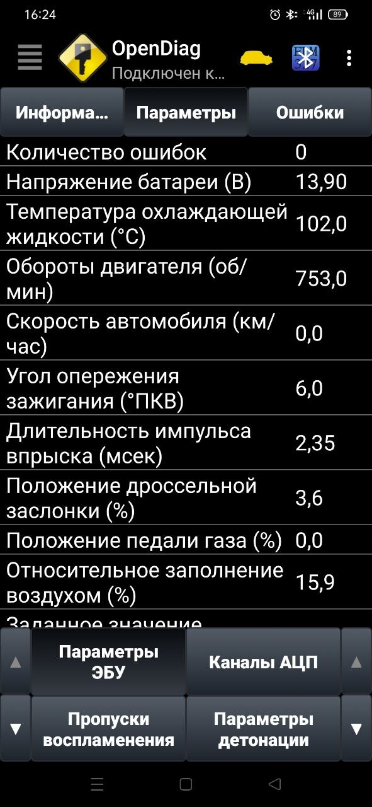

### Датчики (АЦП)

| Датчик | Утро | Вечер | Вывод |
| :--- | ---: | ---: | :--- |
| ДТОЖ, В | 0,215 | 0,215 | ✅ горячий мотор |
| ДТВ, В | 0,957 | 0,801 | ✅ |
| ДАД, В | 1,466 | 1,505 | ✅ нормальное разрежение на ХХ |
| ДПДЗ1 + ДПДЗ2, В | 4,379 + 0,586 = **4,965** | 4,374 + 0,596 = **4,970** | ✅ сумма ≈ 5 В |
| ДППГ1 / ДППГ2, В | 0,699 / 0,338 | 0,722 / 0,348 | ✅ соотношение ≈ 2:1 |
| ДК1, В (несколько снимков) | 0,625 | 0,100 · 0,675 · 0,075 | ✅ переключается |
| ДК2, В | 0,775 | 0,775 | ✅ ровно — катализатор работает (чуть выше 0,75 из ТИ — на ровном сигнале это не признак неисправности) |
| Датчик детонации, В | 0,108 | 0,149 | ✅ |
| Датчик давления масла | «Нет» | «Нет» | ✅ |

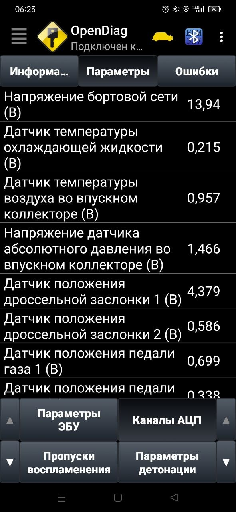 

### Детонация и пропуски

- Отскок угла при детонации по всем цилиндрам — **0,00** утром и вечером ✅
- Уровень регулировки по детонации: утром 0,125–0,141, вечером 0,125–0,208 — малые и близкие значения ✅
- Счётчики пропусков — **0**, тест плавности — 0 ✅
- Адаптация демпфера: диапазоны 1–2 — 0,217 и 0,208, диапазоны 3–4 — 0. Для двух диапазонов адаптация ещё не выполнена; на работу мотора это не влияет, только на чувствительность обнаружения пропусков.

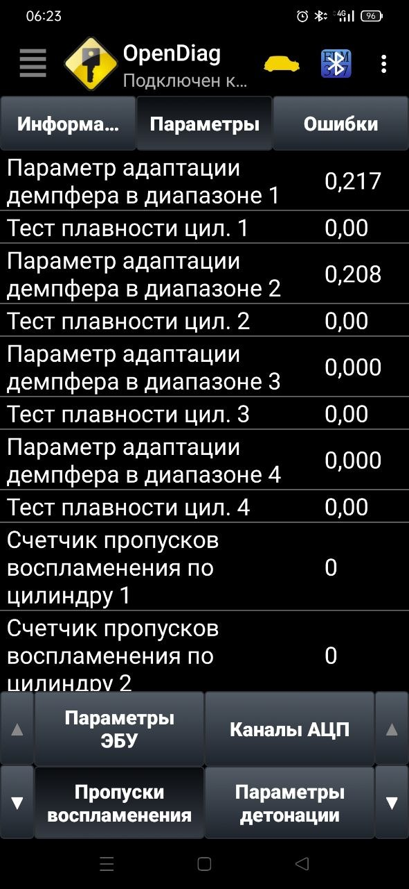 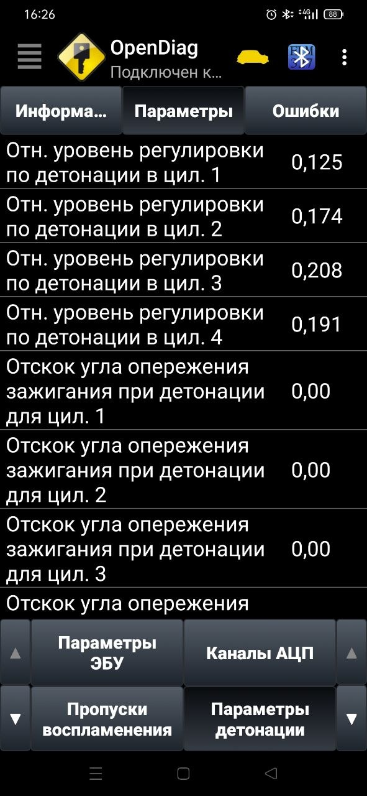

### Холодный пуск (16.10.2026, 05:48)

Мотор простоял ночь: температура ОЖ при пуске **15,8 °C**, на снимках через минуту-две — 18 °C.

| Параметр | Значение | Норма / что ожидать | Вывод |
| :--- | ---: | :--- | :--- |
| Ошибки | 0 | 0 | ✅ |
| Бортовая сеть, В | 14,10 | 13,0–14,5 | ✅ генератор заряжает сразу |
| Температура ОЖ / воздуха на впуске, °C | 18,0 / 15,8 | на холодном почти равны | ✅ ДТОЖ и ДТВ согласованы (1,855 и 1,836 В) |
| Обороты (желаемые 1070) | 1079,5 | желаемые ± 50 | ✅ повышенные обороты прогрева держит точно |
| УОЗ, ° | 12,0 | больше, чем на горячем | ✅ |
| Впрыск, мс | 2,69 | больше, чем на горячем (2,34) | ✅ обогащение при прогреве |
| Дроссель, % | 5,5 | больше, чем на горячем | ✅ нужно больше воздуха для повышенных оборотов |
| Заполнение воздухом, % | 18,0 | | ✅ |
| Давление во впуске, мбар / ДАД, В | 336,9 / 1,369 | 1,2–1,6 В | ✅ |
| Расход, л/ч | 1,52 | на холодном выше, чем 0,7–1,0 | ✅ |
| ДК1 и ДК2 | 1,26 В (АЦП 3,25 В) | датчики не прогреты | ✅ норма для первых минут |
| STFT / I-часть по ДК | 1,00 / 0,000 | | ✅ регулирования по ДК ещё нет — так и должно быть |
| **LTFT** | **0,89** | 1,00 ± 0,15 | ✅ почти как 14.10 (0,90) |
| Продувка адсорбера, % | 0,0 | на холодном выключена | ✅ |
| Старение нейтрализатора | 0,02 | ≤ 0,45 | ✅ |
| ДПДЗ1 + ДПДЗ2, В | 4,291 + 0,669 = **4,960** | ≈ 5,0 | ✅ |
| ДППГ1 / ДППГ2, В | 0,696 / 0,338 | ≈ 2:1 | ✅ |
| Регулирование ХХ: I- и PD-часть, % | −1,36 / −0,44 | ±8 | ✅ |
| Утечка воздуха через дроссель, кг/ч | 4,3 | 3–5 | ✅ |
| Датчик детонации, В | 0,033–0,042 | | ✅ холодный мотор работает тише |
| Детонация: уровень по цил. 1–4 / отскок | 0,050–0,075 / 0,00 | | ✅ |
| Пропуски по цил. 1–4, тест плавности | 0 / 0,00 | 0 | ✅ |
| Адаптация демпфера, диапазоны 1–4 | 0,223 · 0,208 · 0 · 0 | | как 14.10 |

Прочее на снимках:
- **Мониторы готовности** (нейтрализатор, адсорбер, ДК1, ДК2) — «Нет»: после пуска проверки начинаются заново, это нормально.
- **«Контроллер обучен: Нет», «Контроллер заблокирован: Да»** — флаги иммобилайзера. Раз мотор заводится и работает, на работу двигателя они не влияют.
- **«АБС / ESP присутствует: Нет»** и подобные строки — это флаги конфигурации прошивки ЭБУ, а не список оборудования машины.
- **Время работы** двигателя по ЭБУ — 19 362 мин (≈ 323 ч).

 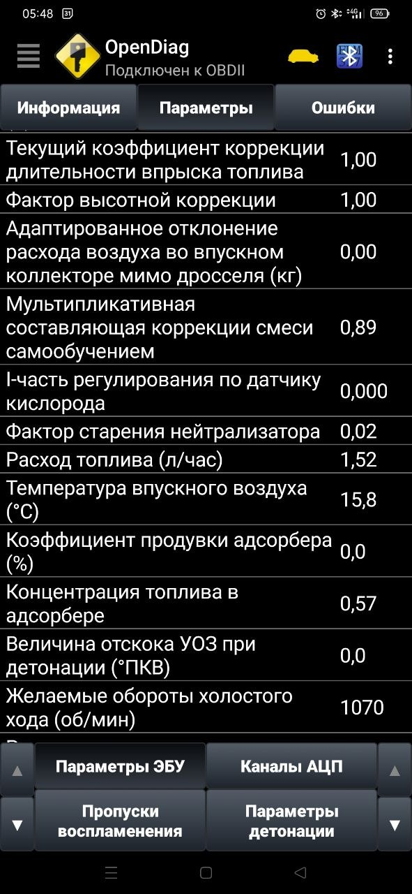 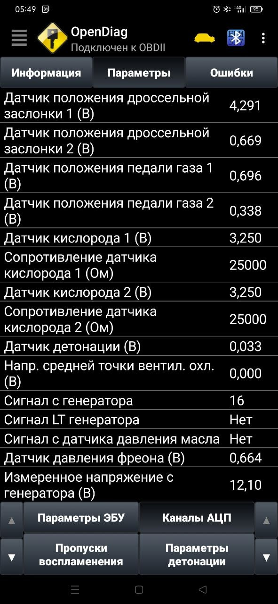

<details>
<summary>Остальные скриншоты холодного пуска</summary>

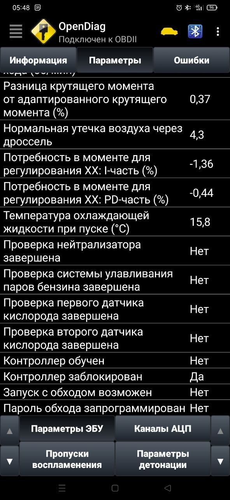 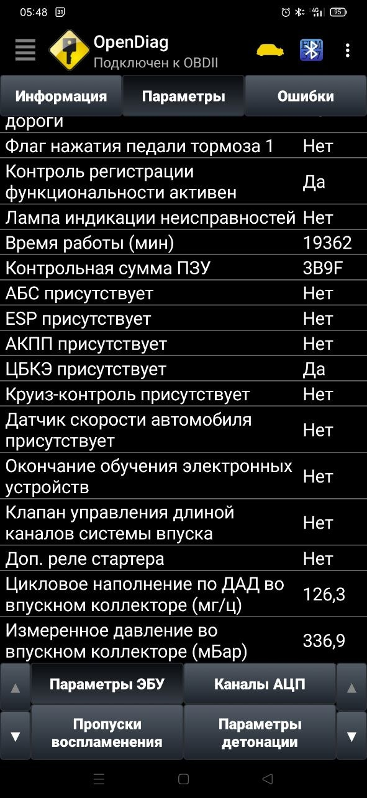 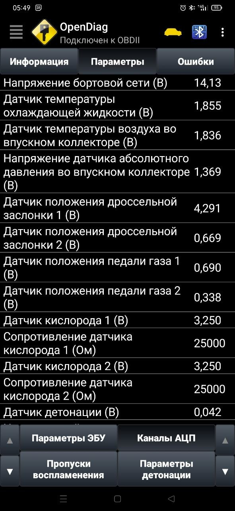  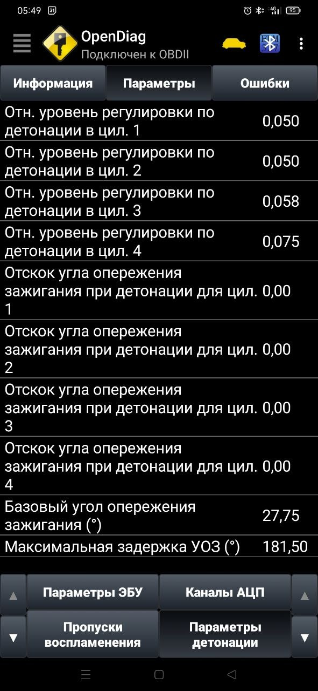

</details>

### Холодный пуск с включённым обогревом сиденья (утро, 05:33)

Ещё один холодный пуск — в другой день (дата на снимках не видна): «температура ОЖ при пуске» снова 15,8 °C, но через ~1–2 минуты после пуска ОЖ 18,8 °C. Сразу после пуска включён **обогрев сиденья** — удобный случай посмотреть, как мотор реагирует на дополнительную нагрузку на генератор.

| Параметр | С обогревом (05:33) | Без обогрева (16.10, 05:48) | Вывод |
| :--- | ---: | ---: | :--- |
| Ошибки | 0 | 0 | ✅ |
| Бортовая сеть, В | 14,00 (АЦП 14,13) | 14,10 (АЦП 14,13) | ✅ напряжение держится |
| **Сигнал с генератора** (загрузка) | **19** | 16 | нагрузка от обогрева видна |
| ОЖ / воздух на впуске, °C | 18,8 / 14,3 | 18,0 / 15,8 | ✅ ДТОЖ 1,855 В, ДТВ 1,895 В |
| Обороты (желаемые 1070) | 1082,0 | 1079,5 | ✅ |
| УОЗ, ° | 11,3 | 12,0 | ✅ |
| Впрыск, мс | 2,52 | 2,69 | ✅ |
| Дроссель, % | 5,0 | 5,5 | ✅ |
| Заполнение воздухом, % | 17,3 | 18,0 | ✅ |
| Расход, л/ч | 1,51 | 1,52 | ✅ |
| Регулирование ХХ: I- / PD-часть, % | −1,53 / 0,13 | −1,36 / −0,44 | ✅ ±8 |
| Разница момента от адаптированного, % | 0,87 | 0,37 | ✅ |
| Утечка воздуха через дроссель, кг/ч | 4,4 | 4,3 | ✅ |
| ДАД, В | 1,398 | 1,369 | ✅ |
| ДПДЗ1 + ДПДЗ2, В | 4,286 + 0,679 = **4,965** | 4,960 | ✅ |
| ДППГ1 / ДППГ2, В | 0,690 / 0,338 | 0,696 / 0,338 | ✅ |
| ДК1 / ДК2 | 1,26 В (АЦП 3,225–3,25 В) | то же | ✅ датчики ещё не прогреты |
| LTFT / STFT | 0,89 / 1,00 | 0,89 / 1,00 | ✅ |
| Высотная коррекция | 0,98 | 1,00 | ✅ |
| Продувка адсорбера, % / концентрация | 0,0 / 0,56 | 0,0 / 0,57 | ✅ на холодном выключена |
| Датчик детонации, В | 0,042 | 0,033–0,042 | ✅ |
| Датчик давления фреона, В | 0,625 | 0,664 | ✅ |

**Что видно:** обогрев сиденья (примерно 50–100 Вт на одно сиденье) поднял загрузку генератора с 16 до 19 единиц, а напряжение сети осталось 14,0 В — генератор и регулятор справляются. На работе мотора такая нагрузка почти не заметна: регулятор холостого хода чуть больше добавил момента (разница момента 0,87 % против 0,37 %), обороты держатся точно, а разница во впрыске и дросселе — в пределах разброса между двумя пусками. Всё остальное повторяет пуск 16.10 почти до сотых — стабильная, повторяемая картина.

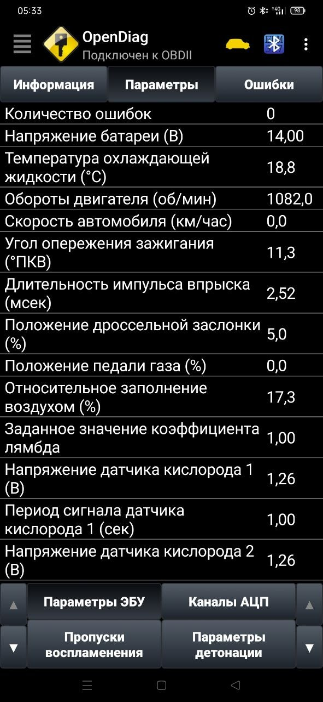 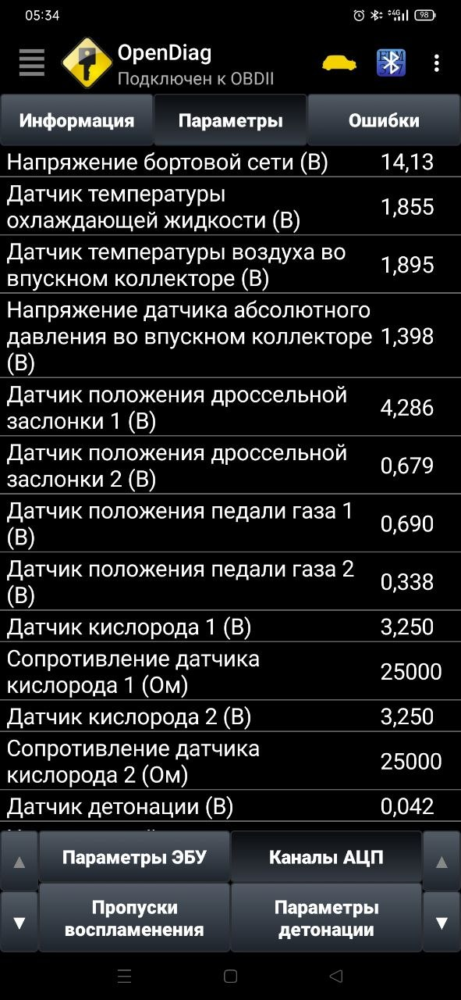 

<details>
<summary>Остальные скриншоты пуска с обогревом</summary>

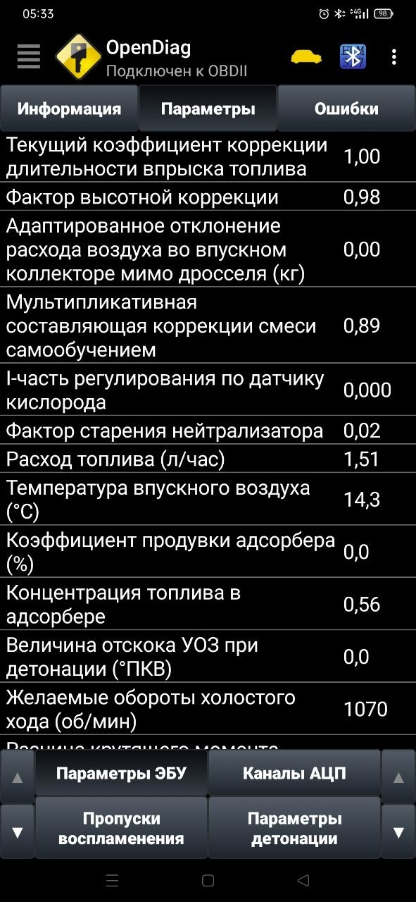 

</details>

### Прогрев до 38 °C (16.10.2026, 15:50)

| Параметр | Холодный (18 °C) | Прогрев (38 °C) | Горячий (101 °C, 14.10) |
| :--- | ---: | ---: | ---: |
| Обороты, об/мин | 1079,5 | 1023,5 | 750,5 |
| УОЗ, ° | 12,0 | 12,8 | 8,3 |
| Впрыск, мс | 2,69 | 2,38 | 2,34 |
| Дроссель, % | 5,5 | 4,6 | 3,0 |
| Заполнение воздухом, % | 18,0 | 16,9 | 14,7 |
| ДК1, В | 1,26 (не готов) | **0,35** (работает) | 0,625 (переключается) |
| ДК2, В | 1,26 (не готов) | 1,26 (не готов) | 0,775 |

Прогрев идёт как положено: обороты, впрыск и открытие дросселя плавно снижаются к значениям горячего мотора. ДК1 при 38 °C уже регулирует смесь, а ДК2 ещё не включился — подогрев датчика после катализатора ЭБУ включает позже.

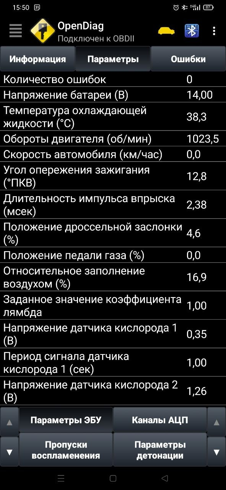

### После поездки (16.10.2026, время на снимках 15:11)

Мотор заводили при 22,5 °C («температура ОЖ при пуске»), после поездки он полностью прогрет. Счётчик времени работы ЭБУ — 19 446 мин, на 84 мин больше, чем утром.

| Параметр | После поездки 16.10 | Горячий 14.10 (утро) | Норма | Вывод |
| :--- | ---: | ---: | :--- | :--- |
| Ошибки | 0 | 0 | 0 | ✅ |
| Бортовая сеть, В | 14,00 (АЦП 14,04) | 14,00 | 13,0–14,5 | ✅ |
| Температура ОЖ, °C | 99,8 | 101,3 | 90–103 | ✅ |
| Обороты ХХ (желаемые 750) | 750,5 | 750,5 | 750 ± 50 | ✅ |
| УОЗ, ° | 8,3 | 8,3 | 9 ± 5 | ✅ |
| Впрыск, мс | 2,32 | 2,34 | ≈2,2–2,8 | ✅ |
| Дроссель, % | 3,1 | 3,0 | 1–4 | ✅ |
| Заполнение воздухом, % | 14,7 | 14,7 | 14–20 | ✅ |
| Давление во впуске, мбар / ДАД, В | 345,3 / 1,447 | — / 1,466 | 1,2–1,6 В | ✅ |
| Расход на ХХ, л/ч | 0,88 | 0,87 | 0,7–1,0 | ✅ |
| Период сигнала ДК1, с | 1,08 | 1,00 | < 1,8 | ✅ |
| ДК1, В (несколько снимков) | 0,71 · 0,550 · 0,725 | 0,625 | переключается | ✅ |
| **ДК2, В** | **0,79 / АЦП 0,775** | 1,26 / АЦП 0,775 | 0,59–0,75, ровно | ✅ ровный — катализатор работает |
| STFT | 1,00 | 0,98 | 1,00 ± 0,15 | ✅ |
| **LTFT** | **0,89** | 0,90 | 1,00 ± 0,15 | ✅ стабильно третий замер подряд |
| Фактор высотной коррекции | 0,98 | — | ≈1,00 | ✅ |
| Аддитивная коррекция | 0,00 | 0,00 | ≈0 | ✅ |
| Старение нейтрализатора | 0,02 | 0,02 | ≤ 0,45 | ✅ |
| Регулирование ХХ: I- и PD-часть, % | 0,12 / 0,02 | | ±8 | ✅ |
| Разница момента от адаптированного, % | 1,33 | | несколько % | ✅ |
| Утечка воздуха через дроссель, кг/ч | 4,3 | | 3–5 | ✅ |
| ДПДЗ1 + ДПДЗ2, В | 4,369 + 0,591 = **4,960** | 4,965 | ≈ 5,0 | ✅ |
| ДППГ1 / ДППГ2, В | 0,709 / 0,348 | 0,699 / 0,338 | ≈ 2:1 | ✅ |
| ДТОЖ / ДТВ, В | 0,215 / 1,152 | 0,215 / 0,957 | | ✅ (воздух на впуске 38,3 °C) |
| Датчик детонации, В | 0,125 | 0,108 | 0,03–0,3 | ✅ |
| Детонация: уровень по цил. 1–4 / отскок | 0,133–0,149 / 0,00 | 0,125–0,141 / 0,00 | | ✅ ровно по цилиндрам |
| Пропуски, тест плавности | 0 / 0,00 | 0 / 0,00 | 0 | ✅ |
| Датчик давления фреона, В | 1,035 | 1,094 | 0,6–1,1 | ✅ |
| Датчик давления масла | «Нет» | «Нет» | «Нет» | ✅ |

Горячий мотор после поездки повторяет замеры 14.10 почти до сотых. Главное новое: **ДК2 на полностью прогретом моторе показывает ровные 0,79 В и в параметрах ЭБУ, и в каналах АЦП** — это подтверждает, что 1,26 В в прошлых снимках было лишь «датчик ещё не готов».

Мониторы готовности (нейтрализатор, адсорбер, ДК1, ДК2) после поездки всё ещё «Нет». Это не неисправность: для каждой проверки ЭБУ ждёт своих условий (например, ровного движения с постоянной скоростью несколько минут), и не каждая поездка их даёт.

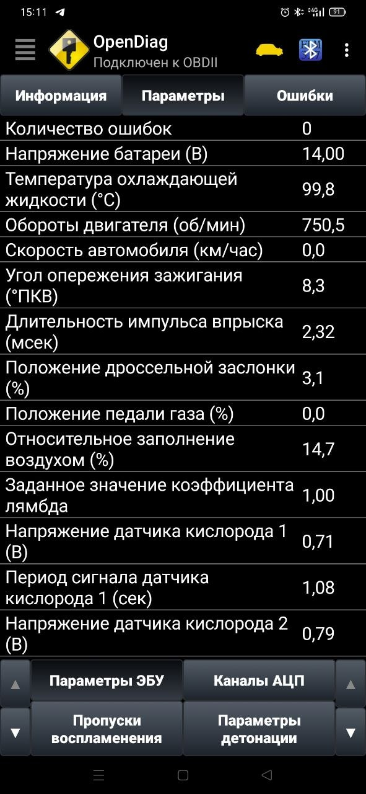 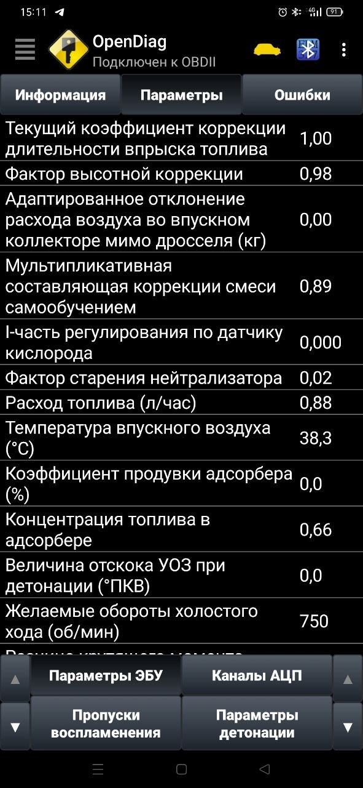 

<details>
<summary>Остальные скриншоты после поездки</summary>

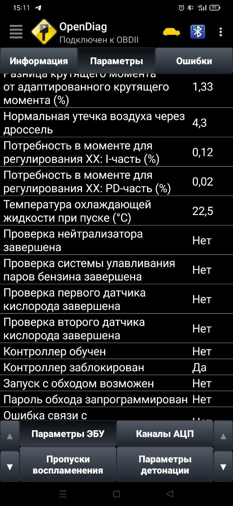  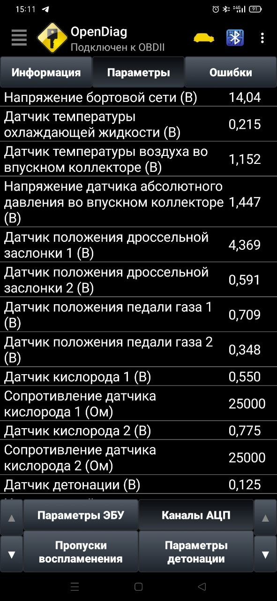 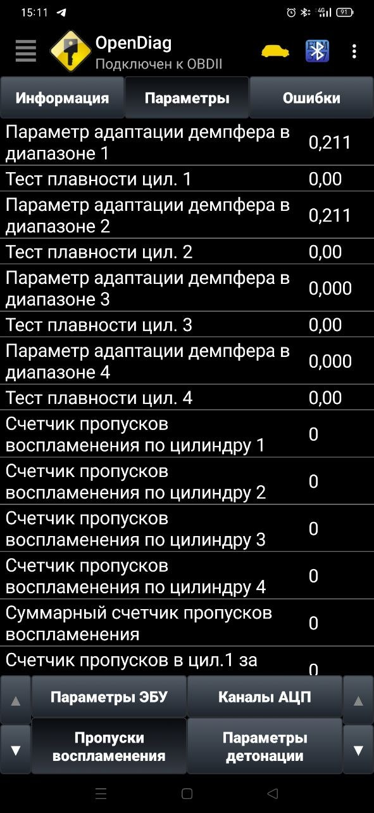 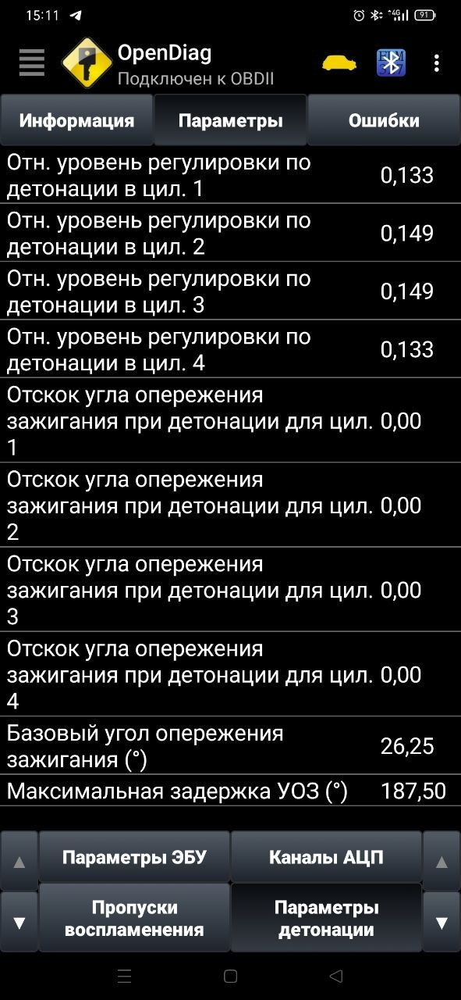

</details>

### Итог

**Двигатель работает исправно**: обороты ХХ держатся точно, смесь регулируется (ДК1 переключается с периодом около секунды), катализатор работает (ДК2 ровный, фактор старения 0,02), пропусков и детонации нет, все датчики в согласованных диапазонах.

Стоит последить за двумя вещами:

1. **Долговременная коррекция 0,90 (−10 %)** 14.10, 0,89 на холодном пуске и 0,89 после поездки 16.10. Значение стабильно, не «уплывает». ЭБУ постоянно убирает 10–11 % топлива, то есть без коррекции смесь была бы богатой. По заводской норме (1,00 ± 0,15) это **в пределах допуска**, но заметно в сторону обеднения ЭБУ. Что сделать:
   - снять LTFT ещё раз после длинной ровной поездки по трассе и сравнить;
   - если коррекция уходит ниже 0,88–0,85 — проверить форсунки (подтекание, промывка на стенде), давление топлива и герметичность клапана продувки адсорбера: в момент замера концентрация топлива в адсорбере была 0,53, а продувка — 8,3 %, то есть пары бензина из адсорбера тоже подмешивались в смесь.
2. **ДК2 = 1,26 В утром 14.10** в параметрах ЭБУ при 0,775 В в каналах АЦП минутой позже. Замеры 16.10 это объяснили: **1,26 В — так OpenDiag показывает датчик, который ещё не готов** (на холодном пуске оба ДК — 1,26 В, в АЦП — 3,25 В; при 38 °C ДК1 уже работает, а ДК2 ещё 1,26 В). Значит, 14.10 в момент снимка ДК2 ещё не вышел на режим или ЭБУ на время отключал его подогрев. **Окончательно подтверждено после поездки 16.10**: на горячем моторе ДК2 — ровные 0,79 В, датчик исправен. Беспокоиться стоит, только если ДК2 держит 1,26 В или выше 1 В **постоянно** на полностью прогретом моторе после поездки — тогда проверить подогрев датчика (сопротивление нагревателя, предохранитель) и проводку.

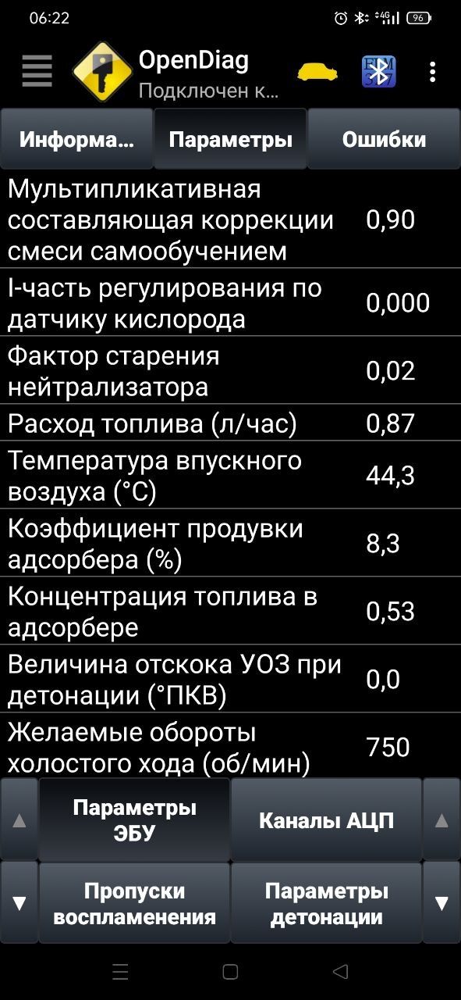 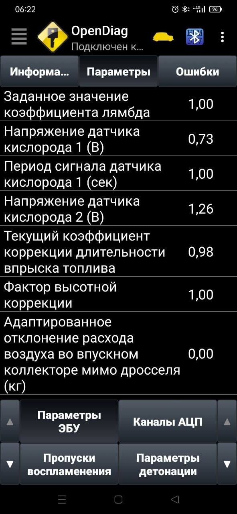 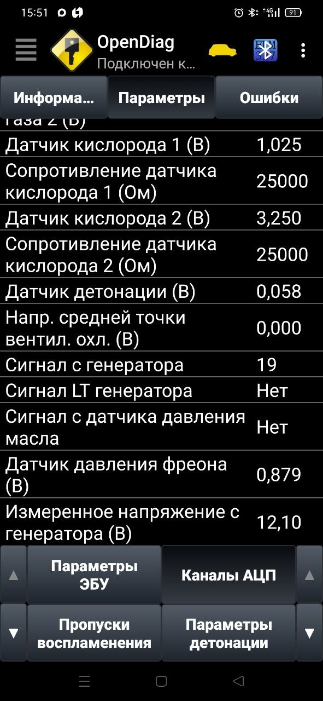

<details>
<summary>Остальные скриншоты</summary>

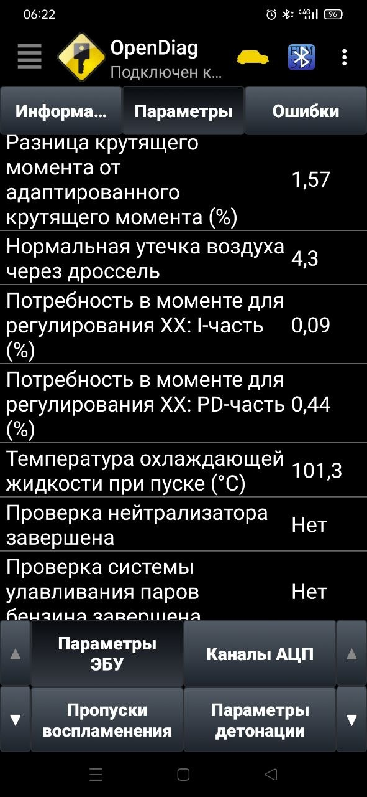 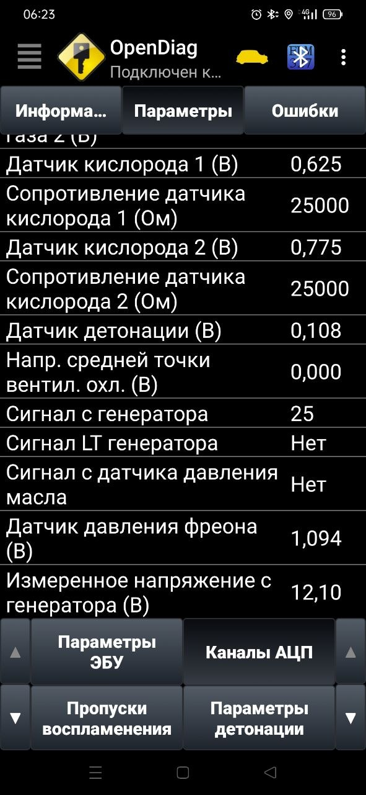 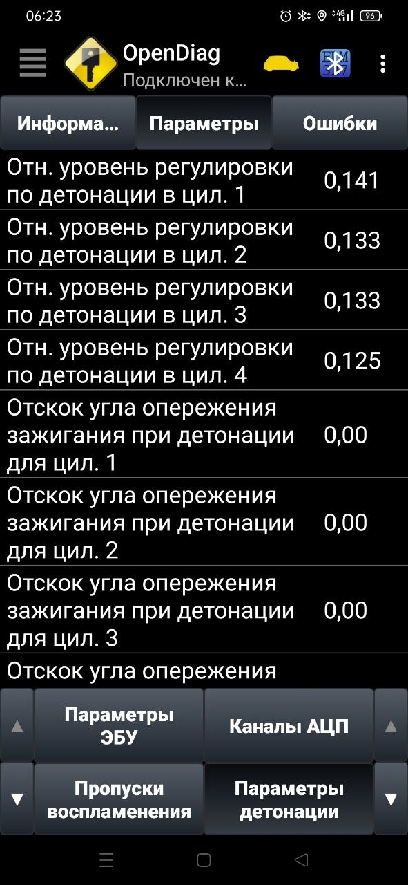 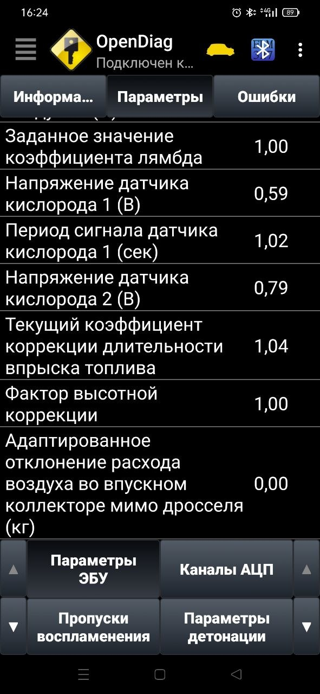 

</details>

### Что ещё стоит снять для полноты

- **Прогрев целиком на графике** (OpenDiag умеет строить графики): через сколько минут начинает переключаться ДК1 и когда ДК2 выходит на ровные 0,6–0,8 В.
- **LTFT в динамике**: если через месяц-два коррекция останется 0,88–0,90 — это просто особенность экземпляра; если поползёт к 0,85 — проверка форсунок и давления топлива.
- **Движение**: LTFT на трассе, отскок угла при детонации под нагрузкой (на АИ-92 в жару может появляться).
- **Ошибки** на вкладке «Ошибки», в том числе сохранённые.

---

## 6. Запись параметров на Linux (python-OBD)

Для стандартных параметров OBD2 (обороты, температура, STFT/LTFT в %, лямбда-зонды) можно вести журнал с ноутбука. Заводские параметры Lada, как в OpenDiag, так не прочитать.

**Подключение Bluetooth-адаптера как последовательного порта:**

| Система | Утилита `rfcomm` |
| :--- | :--- |
| **Gentoo** | `net-wireless/bluez` с USE-флагом `deprecated` |
| **Debian / Ubuntu** | входит в пакет `bluez` |
| **Arch** | пакет `bluez-deprecated-tools` |
| **Entware** | не подходит: роутер не стоит в машине |

```bash
bluetoothctl                      # scan on → pair <MAC> (PIN обычно 1234 или 0000)
sudo rfcomm bind 0 <MAC> 1        # появится /dev/rfcomm0
python3 -m venv ~/obd && . ~/obd/bin/activate && pip install obd
```

```python
import obd, time, csv
con = obd.OBD("/dev/rfcomm0")
cmds = [obd.commands.RPM, obd.commands.COOLANT_TEMP,
        obd.commands.SHORT_FUEL_TRIM_1, obd.commands.LONG_FUEL_TRIM_1,
        obd.commands.TIMING_ADVANCE, obd.commands.O2_B1S1, obd.commands.O2_B1S2]
with open("vesta-log.csv", "w", newline="") as f:
    w = csv.writer(f); w.writerow(["t"] + [c.name for c in cmds])
    while True:
        w.writerow([time.time()] + [con.query(c).value for c in cmds]); time.sleep(0.5)
```

Не каждый ЭБУ отдаёт все стандартные параметры — список поддерживаемых показывает `con.supported_commands`.

---

## 7. Что известно про мотор 21179

- **Расход масла**: на этом моторе встречается заметный расход масла даже на новых машинах (по данным «За рулём» — до 0,5 л на 1000 км). Уровень масла стоит проверять регулярно, а не только перед ТО.
- **При обрыве ремня ГРМ клапаны встречаются с поршнями** — замену ремня делать строго по регламенту.
- Высокий расход топлива в городе для этого мотора — частая жалоба владельцев.

Подробнее: [10 проблем двигателя 1.8 Весты — «За рулём»](https://www.zr.ru/content/articles/930712-lada-vesta-10-problem-dvigatelya-1-8-l/).

Связанная заметка: [StarLine A93 V2 — автосигнализация](../StarLine%20A93%20V2%20%E2%80%94%20%D0%B0%D0%B2%D1%82%D0%BE%D1%81%D0%B8%D0%B3%D0%BD%D0%B0%D0%BB%D0%B8%D0%B7%D0%B0%D1%86%D0%B8%D1%8F%20%28%D0%BD%D0%B0%D1%81%D1%82%D1%80%D0%BE%D0%B9%D0%BA%D0%B0%20%D0%B8%20%D1%83%D0%BF%D1%80%D0%B0%D0%B2%D0%BB%D0%B5%D0%BD%D0%B8%D0%B5%29.md).

## 🔗 Ссылки

- OpenDiag: https://opendiag.ru/
- python-OBD: https://github.com/brendan-w/python-OBD
- «За рулём» о двигателе 1.8: https://www.zr.ru/content/articles/930712-lada-vesta-10-problem-dvigatelya-1-8-l/

#Авто #Lada_Vesta #Диагностика #ELM327 #OBD2 #OpenDiag
