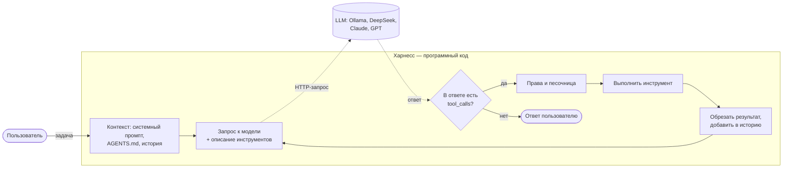
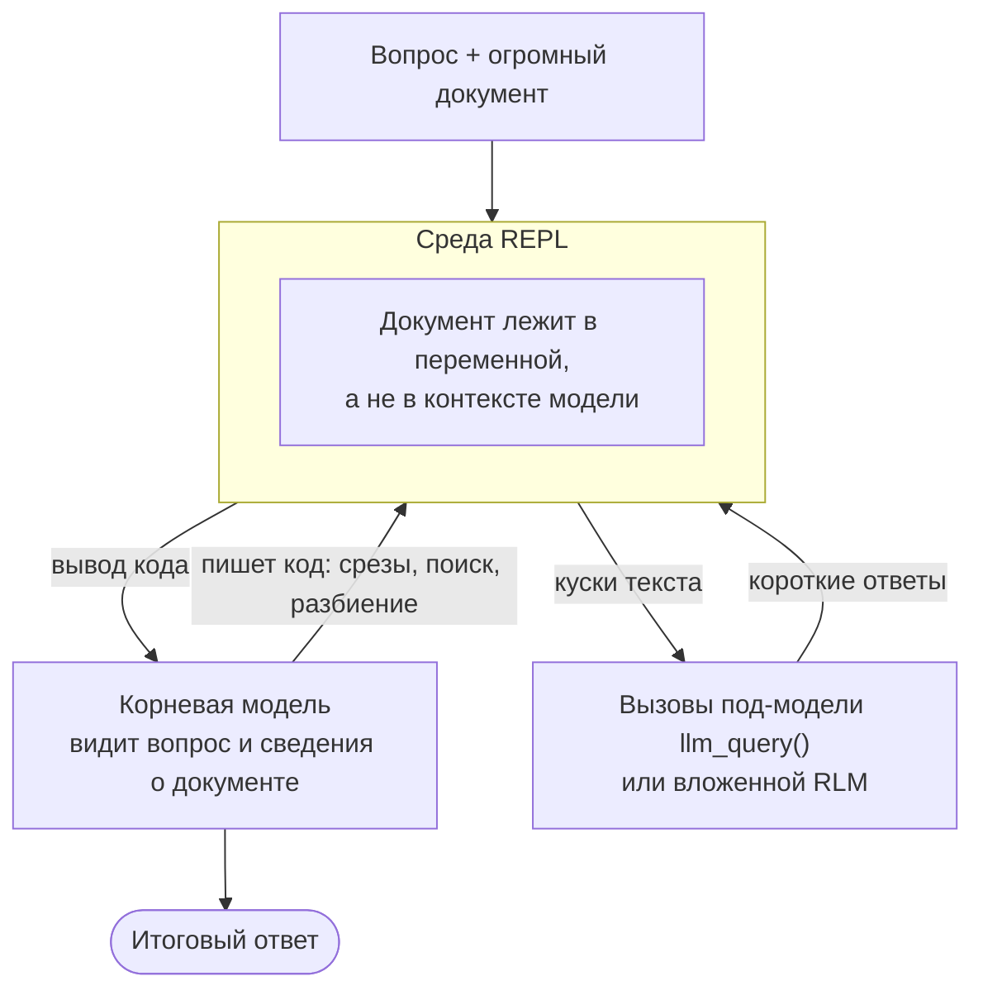

# 🧩 ИИ-агент vs харнесс — в чём разница и свой харнесс на 6 языках

Конспект ролика [«ИИ-Агент vs Харнесс — В чем разница? Пишем свой Харнесс»](https://www.youtube.com/watch?v=0o08ZDSJy8A) канала [**Артём Шумейко**](https://www.youtube.com/@artemshumeiko) (12.10.2026, 18:46). Конспект сверен с субтитрами и главами ролика. Харнесс из видео переписан заново на **Java, Python, JavaScript, Go, Rust и Bash**, все шесть версий проверены. Вопросы из комментариев к ролику разобраны по документации и первоисточникам на 27.10.2026. Две рекламные вставки (интенсив по агентной разработке) в конспект не вошли.

**Главная мысль ролика — формула:**

> **LLM** — функция «текст на входе → текст на выходе».
> **Харнесс** (harness, «обвязка») — программный код вокруг модели: передаёт ей сообщения, контекст и список инструментов, выполняет вызовы, крутит цикл.
> **ИИ-агент = харнесс + LLM.**

Код без модели ничего не умеет, а модель без кода только отвечает текстом. Агентом становится их связка.



## 🪜 От LLM к агенту — четыре шага ролика

### 1. LLM: текст → текст

Автор берёт **локальную модель в Ollama**. У него две модели по 4 млрд параметров, одна из них Qwen; ей хватает около 3 ГБ свободной памяти. Скрипт отправляет сообщение и получает ответ: обычный чат.

Важная деталь, которую ролик проговаривает вскользь («передаём весь контекст»): **модель ничего не помнит между запросами**. Историю переписки хранит и каждый раз отправляет заново вызывающий код. Это первая обязанность будущего харнесса.

<details><summary>Один запрос к модели (curl, OpenAI-совместимый API)</summary>

```sh
curl -s http://localhost:11434/v1/chat/completions \
  -H "Content-Type: application/json" \
  -d '{"model": "qwen3:4b",
       "messages": [{"role": "system", "content": "Отвечай кратко."},
                    {"role": "user", "content": "Привет, как дела?"}]}' \
  | jq -r '.choices[0].message.content'
```

В харнессах ниже это функция `chat()`: тот же POST на `/chat/completions`, только с полем `tools`.

</details>

### 2. Tools: у модели появляются «руки»

Инструменты — обычные функции харнесса, **описанные для модели в JSON Schema**: имя, описание и параметры. В ролике их три: «список файлов», «прочитать файл» и «создать путь» (каталог или файл). Описание уходит модели вместе с сообщениями.

Ключевой момент: **модель сама ничего не выполняет**. Она лишь отвечает «вызови `read_file` с такими аргументами» (`tool_calls`). Выполняет вызов харнесс, и он же решает, разрешать ли его.

<details><summary>Как выглядит описание инструмента и запрос модели на вызов</summary>

Описание, которое харнесс отправляет в поле `tools`:

```json
{"type": "function",
 "function": {
   "name": "read_file",
   "description": "Read a text file.",
   "parameters": {"type": "object",
                  "properties": {"path": {"type": "string"}},
                  "required": ["path"]}}}
```

Ответ модели, которой нужен инструмент: текста нет, есть `tool_calls`. Аргументы приходят **строкой** с JSON внутри:

```json
{"role": "assistant",
 "content": null,
 "tool_calls": [{"id": "call_1", "type": "function",
                 "function": {"name": "read_file", "arguments": "{\"path\": \"bot/main.py\"}"}}]}
```

Результат харнесс возвращает отдельным сообщением с тем же `id`:

```json
{"role": "tool", "tool_call_id": "call_1", "content": "import telebot\n..."}
```

</details>

В демо модель с тремя инструментами получает задачу «сделай Telegram-бота из нескольких файлов». Она создаёт каталог и **возвращает управление**. Дальше приходится писать «продолжай», «дальше», «next» после каждого шага. Неудобно, но видно главное: модель уже меняет файлы.

Можно дать ей и запросы в интернет, SSH на сервер или полный доступ к терминалу. Автор предупреждает, что это рискованно, особенно в самописном харнессе. Готовые оболочки (Codex, Claude Code) поэтому умеют либо работать в режиме полного доверия, либо спрашивать подтверждение на каждую команду.

### 3. Агентный цикл: «дальше, дальше» пишет код, а не человек

Файл `agent.py` из ролика делает то же самое, только **в цикле**: пока модель просит инструменты, харнесс выполняет их, дописывает результаты в историю и снова зовёт модель. Ответ без `tool_calls` означает «готово». У автора простое приложение из трёх файлов было готово через пять итераций.

<details><summary>Псевдокод агентного цикла</summary>

```text
история = [системный промпт, задача пользователя]
повторять не больше MAX_STEPS раз:
    ответ = LLM(история, описание_инструментов)
    история += ответ                         # как есть, со всеми полями
    если в ответе нет tool_calls:
        показать ответ.content и выйти       # модель сказала «готово»
    для каждого вызова из ответа.tool_calls:
        результат = выполнить(вызов)         # с проверкой прав
        история += {role: tool, tool_call_id: вызов.id, content: результат}
```

</details>

### 4. Харнесс — весь этот код, и в реальных оболочках он огромный

«Вот этот файл, вот этот программный код — это и есть харнесс». Минимальный харнесс принимает сообщения, передаёт их модели (локальной или платной в облаке), сообщает список инструментов и крутит цикл. Настоящие оболочки — «десятки, сотни или миллионы строк», и почти всё, что вы настраиваете в Claude Code или Codex, — это харнесс:

| Обязанность харнесса | Что говорится в ролике | Как это в Claude Code | В нашем харнессе ниже |
| :--- | :--- | :--- | :--- |
| **Память проекта** | правила и установки подмешиваются в начало каждой сессии; `AGENTS.md`, `CLAUDE.md` | `CLAUDE.md`, может читать и `AGENTS.md`; плюс auto memory | `AGENTS.md` из рабочей папки дописывается в системный промпт |
| **Инструменты** | список, чтение, создание файлов | Read/Edit/Write/Bash/Grep…, MCP-серверы | `list_files`, `read_file`, `write_file` |
| **Цикл** | итерации до готового результата | агентный цикл, субагенты | до 20 шагов на задачу |
| **Права** | «полное доверие» или подтверждение каждой команды | режимы разрешений, allow/deny-правила | вопрос `[y/N]` перед записью, `AUTO_APPROVE=1` — без вопросов |
| **Песочница** | доступ к bash «чреват» | sandbox: bubblewrap на Linux, Seatbelt на macOS | пути только внутри `WORKDIR` |
| **Хуки** | перехват событий: отправка сообщения, перед сжатием контекста; запуск тестов, линтера, логирование | `UserPromptSubmit`, `PreToolUse`, `PostToolUse`, `PreCompact`… | лог каждого вызова в stderr |
| **Экономия контекста** | лог на 100 000 символов не скармливать целиком: часть отдать, часть сжать, полный вывод по запросу | обрезка вывода, компакция, субагенты | результат инструмента режется до 10 000 символов |

Последняя строка — то, что автор называет «умным харнессом»: он работает **на стороне пользователя** и экономит его токены.

### 5. ИИ-агент = харнесс + LLM

Харнесс — это программный код, сам по себе бесполезный. Аналогия автора: приложение доставки еды с красивым интерфейсом, которым никто не пользуется. Агент — этот же код, которому дали модель. Разные харнессы (Codex, Claude Code, OpenCode и десятки других) **по-разному** собирают контекст, подмешивают память, режут вывод и принимают решения, поэтому одна и та же модель ведёт себя в них по-разному.

> **Уточнение к фразе «свой харнесс никто не пишет»** (кроме энтузиастов и компаний вроде OpenAI и Anthropic). Для кодинга это так: зрелые оболочки не догнать. А вот **прикладные агенты** — бот, разбор входящих документов, задача в CI — часто и есть небольшой свой харнесс: так проще контролировать инструменты, данные и стоимость. Промежуточный вариант — харнесс-библиотека: Tool Runner в SDK Anthropic крутит цикл над вашими функциями, а Claude Agent SDK — это харнесс Claude Code в виде библиотеки для Python и TypeScript.

## 🛠️ Пишем свой харнесс (6 языков)

Тот же харнесс, что в ролике, но с «взрослыми» обязанностями из таблицы выше. Он короткий, без фреймворков, и одинаково устроен во всех шести языках:

- **OpenAI-совместимый API** (`/chat/completions`), как у Ollama в ролике. Тот же код без изменений работает с llama.cpp, LM Studio, vLLM, DeepSeek, OpenRouter и LiteLLM.
- **Три инструмента**, как в ролике: `list_files`, `read_file`, `write_file`. Последний создаёт и родительские каталоги.
- **Агентный цикл** с предохранителем: не больше 20 шагов на задачу.
- **Память проекта:** `AGENTS.md` из рабочей папки дописывается в системный промпт.
- **Песочница:** пути только внутри `WORKDIR`; `../` и абсолютные пути отклоняются.
- **Права:** перед каждой записью вопрос `Разрешить write_file …? [y/N]`; `AUTO_APPROVE=1` — режим «полного доверия».
- **Экономия контекста:** результат инструмента обрезается до 10 000 символов с пометкой `[...truncated N chars]`.
- **Ошибки — модели, а не падение:** неизвестный инструмент, битый JSON в аргументах или отсутствующий файл возвращаются модели текстом `error: …`, и она может исправиться.
- **Ответ модели кладётся в историю как есть.** Это не мелочь: DeepSeek в режиме размышлений с инструментами требует возвращать `reasoning_content` во всех последующих запросах, иначе API ответит ошибкой 400. Харнесс, который пересобирает сообщение из «нужных» полей, ломается на таких моделях.
- Ход работы печатается в stderr: `[шаг N] имя аргументы`. Пустая строка или Ctrl+D завершает сеанс; между задачами история сохраняется.

Строки для модели (системный промпт, описания инструментов) написаны по-английски. Для маленьких локальных моделей это обычно надёжнее, а отвечать по-русски можно попросить в `AGENTS.md`.

### Настройка через переменные окружения

| Переменная | По умолчанию | Смысл |
| :--- | :--- | :--- |
| `LLM_BASE_URL` | `http://localhost:11434/v1` | адрес OpenAI-совместимого API (Ollama) |
| `LLM_MODEL` | `qwen3:4b` | модель **с поддержкой tools** (в каталоге Ollama такие помечены тегом `tools`) |
| `LLM_API_KEY` | `ollama` | ключ; локальные серверы его игнорируют |
| `WORKDIR` | `.` | папка-песочница, с которой работает агент |
| `AUTO_APPROVE` | — | `1` — не спрашивать подтверждение записи |

| Бэкенд | `LLM_BASE_URL` | `LLM_MODEL` (пример) |
| :--- | :--- | :--- |
| [Ollama](../../../AI/Local-LLM/Ollama%20%E2%80%94%20%D0%BC%D0%B5%D0%BD%D0%B5%D0%B4%D0%B6%D0%B5%D1%80%20%D0%B8%20%D1%81%D0%B5%D1%80%D0%B2%D0%B5%D1%80%20%D0%BB%D0%BE%D0%BA%D0%B0%D0%BB%D1%8C%D0%BD%D1%8B%D1%85%20LLM.md) | `http://localhost:11434/v1` | `qwen3:4b` (сначала `ollama pull qwen3:4b`) |
| [llama.cpp](../../../AI/Local-LLM/llama.cpp%20%E2%80%94%20%D0%B4%D0%B2%D0%B8%D0%B6%D0%BE%D0%BA%20%D0%BB%D0%BE%D0%BA%D0%B0%D0%BB%D1%8C%D0%BD%D0%BE%D0%B3%D0%BE%20%D0%B8%D0%BD%D1%84%D0%B5%D1%80%D0%B5%D0%BD%D1%81%D0%B0%20GGUF.md) `llama-server --jinja` | `http://localhost:8080/v1` | любое: сервер отдаёт загруженную модель |
| [LM Studio](../../../AI/Local-LLM/LM%20Studio%20%E2%80%94%20%D0%B4%D0%B5%D1%81%D0%BA%D1%82%D0%BE%D0%BF-GUI%20%D0%B4%D0%BB%D1%8F%20%D0%BB%D0%BE%D0%BA%D0%B0%D0%BB%D1%8C%D0%BD%D1%8B%D1%85%20LLM.md) | `http://localhost:1234/v1` | имя загруженной модели |
| DeepSeek API | `https://api.deepseek.com` | `deepseek-flash` |
| OpenRouter | `https://openrouter.ai/api/v1` | имя модели из каталога OpenRouter |
| [LiteLLM](../../../AI/ProxyLLM/LiteLLM%20%E2%80%94%20%D0%B5%D0%B4%D0%B8%D0%BD%D1%8B%D0%B9%20%D1%88%D0%BB%D1%8E%D0%B7%20%28proxy%29%20%D0%BA%20100%2B%20LLM.md) (прокси) | `http://localhost:4000/v1` | имя из конфига прокси |

Пример: `WORKDIR=./sandbox LLM_MODEL=qwen3:4b python3 harness.py`, затем задача вроде «Сделай простой Telegram-бот из нескольких файлов».

### Код

<details><summary>☕ Java 21+ — Harness.java (основной; Jackson 3)</summary>

Зависимость одна — `tools.jackson.core:jackson-databind:3.2.4` (в Maven/Gradle). Без системы сборки достаточно трёх jar и запуска исходника напрямую:

```sh
mkdir -p lib
curl -L -o lib/jackson-databind-3.2.4.jar https://repo1.maven.org/maven2/tools/jackson/core/jackson-databind/3.2.4/jackson-databind-3.2.4.jar
curl -L -o lib/jackson-core-3.2.4.jar https://repo1.maven.org/maven2/tools/jackson/core/jackson-core/3.2.4/jackson-core-3.2.4.jar
curl -L -o lib/jackson-annotations-2.22.jar https://repo1.maven.org/maven2/com/fasterxml/jackson/core/jackson-annotations/2.22/jackson-annotations-2.22.jar
java -cp 'lib/*' Harness.java
```

```java
import tools.jackson.databind.JsonNode;
import tools.jackson.databind.json.JsonMapper;
import tools.jackson.databind.node.ArrayNode;
import tools.jackson.databind.node.ObjectNode;

import java.io.BufferedReader;
import java.io.InputStreamReader;
import java.net.URI;
import java.net.http.HttpClient;
import java.net.http.HttpRequest;
import java.net.http.HttpResponse;
import java.nio.charset.StandardCharsets;
import java.nio.file.Files;
import java.nio.file.Path;
import java.time.Duration;
import java.util.stream.Collectors;

/** Минимальный харнесс: LLM + инструменты + агентный цикл (OpenAI-совместимый API). */
public class Harness {
    static final String BASE_URL = env("LLM_BASE_URL", "http://localhost:11434/v1");
    static final String MODEL = env("LLM_MODEL", "qwen3:4b");
    static final String API_KEY = env("LLM_API_KEY", "ollama");
    static final Path ROOT = Path.of(env("WORKDIR", ".")).toAbsolutePath().normalize();
    static final boolean AUTO_APPROVE = "1".equals(System.getenv("AUTO_APPROVE"));
    static final int MAX_STEPS = 20;       // предохранитель от бесконечного цикла
    static final int MAX_OUTPUT = 10_000;  // сколько символов результата отдаём модели

    static final JsonMapper JSON = JsonMapper.builder().build();
    static final HttpClient HTTP = HttpClient.newHttpClient();
    static final BufferedReader IN = new BufferedReader(new InputStreamReader(System.in, StandardCharsets.UTF_8));

    static final JsonNode TOOLS = JSON.readTree("""
        [{"type": "function", "function": {
            "name": "list_files",
            "description": "List files and directories at a path relative to the working directory.",
            "parameters": {"type": "object", "properties": {"path": {"type": "string"}}, "required": ["path"]}}},
         {"type": "function", "function": {
            "name": "read_file",
            "description": "Read a text file.",
            "parameters": {"type": "object", "properties": {"path": {"type": "string"}}, "required": ["path"]}}},
         {"type": "function", "function": {
            "name": "write_file",
            "description": "Create or overwrite a text file; parent directories are created.",
            "parameters": {"type": "object",
                           "properties": {"path": {"type": "string"}, "content": {"type": "string"}},
                           "required": ["path", "content"]}}}]
        """);

    static String env(String name, String def) {
        String value = System.getenv(name);
        return value == null || value.isEmpty() ? def : value;
    }

    static String systemPrompt() throws Exception {
        String text = "You are a coding agent. Work only through the tools; paths are relative to the working directory. "
                + "When the task is done, answer with a short summary and no tool calls.";
        Path memory = ROOT.resolve("AGENTS.md");  // память проекта, как AGENTS.md / CLAUDE.md
        if (Files.isRegularFile(memory)) {
            text += "\n\nProject instructions (AGENTS.md):\n" + Files.readString(memory);
        }
        return text;
    }

    static Path safePath(String p) {  // песочница: никаких выходов за ROOT
        Path full = ROOT.resolve(p).normalize();
        if (!full.startsWith(ROOT)) throw new SecurityException("path outside workdir");
        return full;
    }

    static String ask(String prompt) throws Exception {
        System.out.print(prompt);
        System.out.flush();
        String line = IN.readLine();
        return line == null ? null : line.strip();
    }

    static boolean approve(String action) throws Exception {
        return AUTO_APPROVE || "y".equalsIgnoreCase(ask("  Разрешить " + action + "? [y/N] "));
    }

    static String runTool(String name, String rawArgs) {
        try {
            JsonNode args = JSON.readTree(rawArgs == null || rawArgs.isBlank() ? "{}" : rawArgs);
            switch (name) {
                case "list_files" -> {
                    try (var entries = Files.list(safePath(args.required("path").asString()))) {
                        return entries.map(e -> e.getFileName() + (Files.isDirectory(e) ? "/" : ""))
                                .sorted().collect(Collectors.joining("\n"));
                    }
                }
                case "read_file" -> {
                    return Files.readString(safePath(args.required("path").asString()));
                }
                case "write_file" -> {
                    String path = args.required("path").asString();
                    String content = args.required("content").asString();
                    Path file = safePath(path);
                    if (!approve("write_file " + path)) return "error: user denied the write";
                    Files.createDirectories(file.getParent());
                    Files.writeString(file, content);
                    return "ok: wrote " + content.length() + " chars to " + path;
                }
                default -> {
                    return "error: unknown tool " + name;
                }
            }
        } catch (Exception e) {  // ошибку — модели, а не падение харнесса
            return "error: " + e;
        }
    }

    static String truncate(String text) {
        if (text.length() <= MAX_OUTPUT) return text;
        return text.substring(0, MAX_OUTPUT) + "\n[...truncated " + (text.length() - MAX_OUTPUT) + " chars]";
    }

    static JsonNode chat(ArrayNode messages) throws Exception {
        ObjectNode body = JSON.createObjectNode().put("model", MODEL);
        body.set("messages", messages);
        body.set("tools", TOOLS);
        HttpRequest request = HttpRequest.newBuilder(URI.create(BASE_URL + "/chat/completions"))
                .header("Content-Type", "application/json")
                .header("Authorization", "Bearer " + API_KEY)
                .timeout(Duration.ofMinutes(10))
                .POST(HttpRequest.BodyPublishers.ofString(JSON.writeValueAsString(body)))
                .build();
        HttpResponse<String> response = HTTP.send(request, HttpResponse.BodyHandlers.ofString());
        if (response.statusCode() != 200) {
            throw new IllegalStateException("HTTP " + response.statusCode() + ": " + response.body());
        }
        return JSON.readTree(response.body()).path("choices").path(0).path("message");
    }

    public static void main(String[] args) throws Exception {
        ArrayNode messages = JSON.createArrayNode();
        messages.addObject().put("role", "system").put("content", systemPrompt());
        System.out.printf("Харнесс: %s @ %s, папка %s. Пустая строка — выход.%n", MODEL, BASE_URL, ROOT);
        String task;
        while ((task = ask("> ")) != null && !task.isEmpty()) {
            messages.addObject().put("role", "user").put("content", task);
            int step = 1;
            for (; step <= MAX_STEPS; step++) {  // агентный цикл
                JsonNode msg = chat(messages);
                messages.add(msg);  // ответ модели — в историю как есть
                JsonNode calls = msg.path("tool_calls");
                if (calls.isEmpty()) {
                    System.out.println(msg.path("content").asString(""));
                    break;
                }
                for (JsonNode call : calls) {
                    String name = call.path("function").path("name").asString();
                    String raw = call.path("function").path("arguments").asString();
                    System.err.printf("  [шаг %d] %s %s%n", step, name, raw);
                    messages.addObject().put("role", "tool").put("tool_call_id", call.path("id").asString())
                            .put("content", truncate(runTool(name, raw)));
                }
            }
            if (step > MAX_STEPS) System.out.println("Остановлено: больше " + MAX_STEPS + " шагов.");
        }
    }
}
```

</details>

<details><summary>🐍 Python 3.9+ — harness.py (только стандартная библиотека)</summary>

```sh
python3 harness.py
```

```python
#!/usr/bin/env python3
"""Минимальный харнесс: LLM + инструменты + агентный цикл (OpenAI-совместимый API)."""
import json
import os
import sys
import urllib.request
from pathlib import Path

BASE_URL = os.environ.get("LLM_BASE_URL", "http://localhost:11434/v1")
MODEL = os.environ.get("LLM_MODEL", "qwen3:4b")
API_KEY = os.environ.get("LLM_API_KEY", "ollama")
ROOT = Path(os.environ.get("WORKDIR", ".")).resolve()
AUTO_APPROVE = os.environ.get("AUTO_APPROVE") == "1"
MAX_STEPS = 20       # предохранитель от бесконечного цикла
MAX_OUTPUT = 10_000  # сколько символов результата отдаём модели

TOOLS = [
    {"type": "function", "function": {
        "name": "list_files",
        "description": "List files and directories at a path relative to the working directory.",
        "parameters": {"type": "object", "properties": {"path": {"type": "string"}}, "required": ["path"]}}},
    {"type": "function", "function": {
        "name": "read_file",
        "description": "Read a text file.",
        "parameters": {"type": "object", "properties": {"path": {"type": "string"}}, "required": ["path"]}}},
    {"type": "function", "function": {
        "name": "write_file",
        "description": "Create or overwrite a text file; parent directories are created.",
        "parameters": {"type": "object",
                       "properties": {"path": {"type": "string"}, "content": {"type": "string"}},
                       "required": ["path", "content"]}}},
]


def system_prompt():
    text = ("You are a coding agent. Work only through the tools; paths are relative to the working directory. "
            "When the task is done, answer with a short summary and no tool calls.")
    memory = ROOT / "AGENTS.md"  # память проекта, как AGENTS.md / CLAUDE.md
    if memory.is_file():
        text += "\n\nProject instructions (AGENTS.md):\n" + memory.read_text(encoding="utf-8")
    return text


def safe_path(p):  # песочница: никаких выходов за ROOT
    full = (ROOT / p).resolve()
    if not full.is_relative_to(ROOT):
        raise PermissionError("path outside workdir")
    return full


def approve(action):
    return AUTO_APPROVE or input(f"  Разрешить {action}? [y/N] ").strip().lower() == "y"


def run_tool(name, raw_args):
    try:
        args = json.loads(raw_args or "{}")
        if name == "list_files":
            return "\n".join(sorted(e.name + ("/" if e.is_dir() else "") for e in safe_path(args["path"]).iterdir()))
        if name == "read_file":
            return safe_path(args["path"]).read_text(encoding="utf-8")
        if name == "write_file":
            file = safe_path(args["path"])
            if not approve(f"write_file {args['path']}"):
                return "error: user denied the write"
            file.parent.mkdir(parents=True, exist_ok=True)
            file.write_text(args["content"], encoding="utf-8")
            return f"ok: wrote {len(args['content'])} chars to {args['path']}"
        return f"error: unknown tool {name}"
    except Exception as e:  # ошибку — модели, а не падение харнесса
        return f"error: {e!r}"


def truncate(text):
    if len(text) <= MAX_OUTPUT:
        return text
    return text[:MAX_OUTPUT] + f"\n[...truncated {len(text) - MAX_OUTPUT} chars]"


def chat(messages):
    req = urllib.request.Request(
        f"{BASE_URL}/chat/completions",
        data=json.dumps({"model": MODEL, "messages": messages, "tools": TOOLS}).encode(),
        headers={"Content-Type": "application/json", "Authorization": f"Bearer {API_KEY}"})
    with urllib.request.urlopen(req, timeout=600) as resp:
        return json.load(resp)["choices"][0]["message"]


def main():
    messages = [{"role": "system", "content": system_prompt()}]
    print(f"Харнесс: {MODEL} @ {BASE_URL}, папка {ROOT}. Пустая строка — выход.")
    while True:
        try:
            task = input("> ").strip()
        except EOFError:
            break
        if not task:
            break
        messages.append({"role": "user", "content": task})
        for step in range(1, MAX_STEPS + 1):  # агентный цикл
            msg = chat(messages)
            messages.append(msg)  # ответ модели — в историю как есть
            calls = msg.get("tool_calls") or []
            if not calls:
                print(msg.get("content") or "")
                break
            for call in calls:
                name, raw = call["function"]["name"], call["function"]["arguments"]
                print(f"  [шаг {step}] {name} {raw}", file=sys.stderr)
                messages.append({"role": "tool", "tool_call_id": call["id"],
                                 "content": truncate(run_tool(name, raw))})
        else:
            print(f"Остановлено: больше {MAX_STEPS} шагов.")


if __name__ == "__main__":
    main()
```

</details>

<details><summary>🟨 JavaScript (Node.js 18+) — harness.mjs (без зависимостей)</summary>

```sh
node harness.mjs
```

```javascript
#!/usr/bin/env node
// Минимальный харнесс: LLM + инструменты + агентный цикл (OpenAI-совместимый API).
import fs from "node:fs";
import path from "node:path";
import readline from "node:readline";

const BASE_URL = process.env.LLM_BASE_URL || "http://localhost:11434/v1";
const MODEL = process.env.LLM_MODEL || "qwen3:4b";
const API_KEY = process.env.LLM_API_KEY || "ollama";
const ROOT = path.resolve(process.env.WORKDIR || ".");
const AUTO_APPROVE = process.env.AUTO_APPROVE === "1";
const MAX_STEPS = 20;       // предохранитель от бесконечного цикла
const MAX_OUTPUT = 10_000;  // сколько символов результата отдаём модели

const tool = (name, description, params) => ({
  type: "function",
  function: {
    name, description,
    parameters: {
      type: "object",
      properties: Object.fromEntries(params.map((p) => [p, {type: "string"}])),
      required: params,
    },
  },
});
const TOOLS = [
  tool("list_files", "List files and directories at a path relative to the working directory.", ["path"]),
  tool("read_file", "Read a text file.", ["path"]),
  tool("write_file", "Create or overwrite a text file; parent directories are created.", ["path", "content"]),
];

const lines = readline.createInterface({input: process.stdin})[Symbol.asyncIterator]();
async function ask(prompt) {
  process.stdout.write(prompt);
  const {value, done} = await lines.next();
  return done ? null : value.trim();
}

function systemPrompt() {
  let text = "You are a coding agent. Work only through the tools; paths are relative to the working directory. " +
    "When the task is done, answer with a short summary and no tool calls.";
  const memory = path.join(ROOT, "AGENTS.md");  // память проекта, как AGENTS.md / CLAUDE.md
  if (fs.existsSync(memory)) text += "\n\nProject instructions (AGENTS.md):\n" + fs.readFileSync(memory, "utf8");
  return text;
}

function safePath(p) {  // песочница: никаких выходов за ROOT
  const full = path.resolve(ROOT, p);
  if (full !== ROOT && !full.startsWith(ROOT + path.sep)) throw new Error("path outside workdir");
  return full;
}

const approve = async (action) =>
  AUTO_APPROVE || (await ask(`  Разрешить ${action}? [y/N] `))?.toLowerCase() === "y";

async function runTool(name, rawArgs) {
  try {
    const args = JSON.parse(rawArgs || "{}");
    switch (name) {
      case "list_files":
        return fs.readdirSync(safePath(args.path), {withFileTypes: true})
          .map((e) => e.name + (e.isDirectory() ? "/" : "")).sort().join("\n");
      case "read_file":
        return fs.readFileSync(safePath(args.path), "utf8");
      case "write_file": {
        const file = safePath(args.path);
        if (!(await approve(`write_file ${args.path}`))) return "error: user denied the write";
        fs.mkdirSync(path.dirname(file), {recursive: true});
        fs.writeFileSync(file, args.content);
        return `ok: wrote ${args.content.length} chars to ${args.path}`;
      }
      default:
        return `error: unknown tool ${name}`;
    }
  } catch (e) {  // ошибку — модели, а не падение харнесса
    return `error: ${e.message}`;
  }
}

const truncate = (text) => text.length <= MAX_OUTPUT ? text
  : text.slice(0, MAX_OUTPUT) + `\n[...truncated ${text.length - MAX_OUTPUT} chars]`;

async function chat(messages) {
  const resp = await fetch(`${BASE_URL}/chat/completions`, {
    method: "POST",
    headers: {"Content-Type": "application/json", Authorization: `Bearer ${API_KEY}`},
    body: JSON.stringify({model: MODEL, messages, tools: TOOLS}),
  });
  if (!resp.ok) throw new Error(`HTTP ${resp.status}: ${await resp.text()}`);
  return (await resp.json()).choices[0].message;
}

const messages = [{role: "system", content: systemPrompt()}];
console.log(`Харнесс: ${MODEL} @ ${BASE_URL}, папка ${ROOT}. Пустая строка — выход.`);
for (let task; (task = await ask("> "));) {
  messages.push({role: "user", content: task});
  let step = 1;
  for (; step <= MAX_STEPS; step++) {  // агентный цикл
    const msg = await chat(messages);
    messages.push(msg);  // ответ модели — в историю как есть
    const calls = msg.tool_calls ?? [];
    if (calls.length === 0) {
      console.log(msg.content ?? "");
      break;
    }
    for (const call of calls) {
      const {name, arguments: raw} = call.function;
      console.error(`  [шаг ${step}] ${name} ${raw}`);
      messages.push({role: "tool", tool_call_id: call.id, content: truncate(await runTool(name, raw))});
    }
  }
  if (step > MAX_STEPS) console.log(`Остановлено: больше ${MAX_STEPS} шагов.`);
}
process.exit(0);
```

</details>

<details><summary>🐹 Go 1.18+ — main.go (только стандартная библиотека)</summary>

```sh
go mod init harness && go run .
# для роутера на ARMv7 (статический бинарник ~6,6 МБ):
GOOS=linux GOARCH=arm GOARM=7 CGO_ENABLED=0 go build -ldflags="-s -w" -o harness-armv7 .
```

В Go 1.24+ для песочницы есть готовый `os.Root`: он не даёт выйти за каталог и через симлинки. Здесь оставлена простая проверка пути, чтобы код был одинаковым во всех языках.

```go
// Минимальный харнесс: LLM + инструменты + агентный цикл (OpenAI-совместимый API).
package main

import (
	"bufio"
	"bytes"
	"encoding/json"
	"errors"
	"fmt"
	"io"
	"net/http"
	"os"
	"path/filepath"
	"strings"
	"unicode/utf8"
)

const (
	maxSteps  = 20     // предохранитель от бесконечного цикла
	maxOutput = 10_000 // сколько символов результата отдаём модели
)

var (
	baseURL     = env("LLM_BASE_URL", "http://localhost:11434/v1")
	model       = env("LLM_MODEL", "qwen3:4b")
	apiKey      = env("LLM_API_KEY", "ollama")
	root, _     = filepath.Abs(env("WORKDIR", "."))
	autoApprove = os.Getenv("AUTO_APPROVE") == "1"
	stdin       = bufio.NewScanner(os.Stdin)
)

var tools = []any{
	tool("list_files", "List files and directories at a path relative to the working directory.", "path"),
	tool("read_file", "Read a text file.", "path"),
	tool("write_file", "Create or overwrite a text file; parent directories are created.", "path", "content"),
}

// toolCall и assistantMsg — только для чтения ответа; в историю идёт исходный JSON.
type toolCall struct {
	ID       string `json:"id"`
	Function struct {
		Name      string `json:"name"`
		Arguments string `json:"arguments"`
	} `json:"function"`
}

type assistantMsg struct {
	Content   string     `json:"content"`
	ToolCalls []toolCall `json:"tool_calls"`
}

func tool(name, description string, params ...string) map[string]any {
	props := map[string]any{}
	for _, p := range params {
		props[p] = map[string]string{"type": "string"}
	}
	return map[string]any{"type": "function", "function": map[string]any{
		"name": name, "description": description,
		"parameters": map[string]any{"type": "object", "properties": props, "required": params},
	}}
}

func env(name, def string) string {
	if v := os.Getenv(name); v != "" {
		return v
	}
	return def
}

func systemPrompt() string {
	text := "You are a coding agent. Work only through the tools; paths are relative to the working directory. " +
		"When the task is done, answer with a short summary and no tool calls."
	if b, err := os.ReadFile(filepath.Join(root, "AGENTS.md")); err == nil { // память проекта, как AGENTS.md / CLAUDE.md
		text += "\n\nProject instructions (AGENTS.md):\n" + string(b)
	}
	return text
}

func safePath(p string) (string, error) { // песочница: никаких выходов за root
	full := filepath.Join(root, p)
	if full != root && !strings.HasPrefix(full, root+string(filepath.Separator)) {
		return "", errors.New("path outside workdir")
	}
	return full, nil
}

func ask(prompt string) (string, bool) {
	fmt.Print(prompt)
	if !stdin.Scan() {
		return "", false
	}
	return strings.TrimSpace(stdin.Text()), true
}

func approve(action string) bool {
	if autoApprove {
		return true
	}
	answer, _ := ask("  Разрешить " + action + "? [y/N] ")
	return strings.EqualFold(answer, "y")
}

func runTool(name, rawArgs string) (string, error) {
	var args map[string]string
	if err := json.Unmarshal([]byte(rawArgs), &args); err != nil {
		return "", err
	}
	switch name {
	case "list_files":
		dir, err := safePath(args["path"])
		if err != nil {
			return "", err
		}
		entries, err := os.ReadDir(dir) // уже отсортированы по имени
		if err != nil {
			return "", err
		}
		names := make([]string, 0, len(entries))
		for _, e := range entries {
			if e.IsDir() {
				names = append(names, e.Name()+"/")
			} else {
				names = append(names, e.Name())
			}
		}
		return strings.Join(names, "\n"), nil
	case "read_file":
		file, err := safePath(args["path"])
		if err != nil {
			return "", err
		}
		b, err := os.ReadFile(file)
		return string(b), err
	case "write_file":
		file, err := safePath(args["path"])
		if err != nil {
			return "", err
		}
		if !approve("write_file " + args["path"]) {
			return "", errors.New("user denied the write")
		}
		if err := os.MkdirAll(filepath.Dir(file), 0o755); err != nil {
			return "", err
		}
		if err := os.WriteFile(file, []byte(args["content"]), 0o644); err != nil {
			return "", err
		}
		return fmt.Sprintf("ok: wrote %d chars to %s", utf8.RuneCountInString(args["content"]), args["path"]), nil
	}
	return "", fmt.Errorf("unknown tool %s", name)
}

func truncate(text string) string {
	runes := []rune(text)
	if len(runes) <= maxOutput {
		return text
	}
	return string(runes[:maxOutput]) + fmt.Sprintf("\n[...truncated %d chars]", len(runes)-maxOutput)
}

func chat(messages []any) (json.RawMessage, error) {
	body, err := json.Marshal(map[string]any{"model": model, "messages": messages, "tools": tools})
	if err != nil {
		return nil, err
	}
	req, err := http.NewRequest(http.MethodPost, baseURL+"/chat/completions", bytes.NewReader(body))
	if err != nil {
		return nil, err
	}
	req.Header.Set("Content-Type", "application/json")
	req.Header.Set("Authorization", "Bearer "+apiKey)
	resp, err := http.DefaultClient.Do(req)
	if err != nil {
		return nil, err
	}
	defer resp.Body.Close()
	data, _ := io.ReadAll(resp.Body)
	if resp.StatusCode != http.StatusOK {
		return nil, fmt.Errorf("HTTP %d: %s", resp.StatusCode, data)
	}
	var out struct {
		Choices []struct {
			Message json.RawMessage `json:"message"`
		} `json:"choices"`
	}
	if err := json.Unmarshal(data, &out); err != nil || len(out.Choices) == 0 {
		return nil, fmt.Errorf("unexpected response: %s", data)
	}
	return out.Choices[0].Message, nil
}

func main() {
	messages := []any{map[string]string{"role": "system", "content": systemPrompt()}}
	fmt.Printf("Харнесс: %s @ %s, папка %s. Пустая строка — выход.\n", model, baseURL, root)
	for {
		task, ok := ask("> ")
		if !ok || task == "" {
			return
		}
		messages = append(messages, map[string]string{"role": "user", "content": task})
		step := 1
		for ; step <= maxSteps; step++ { // агентный цикл
			raw, err := chat(messages)
			if err != nil {
				fmt.Fprintln(os.Stderr, "ошибка:", err)
				os.Exit(1)
			}
			messages = append(messages, raw) // ответ модели — в историю как есть
			var msg assistantMsg
			if err := json.Unmarshal(raw, &msg); err != nil {
				fmt.Fprintln(os.Stderr, "ошибка:", err)
				os.Exit(1)
			}
			if len(msg.ToolCalls) == 0 {
				fmt.Println(msg.Content)
				break
			}
			for _, call := range msg.ToolCalls {
				fmt.Fprintf(os.Stderr, "  [шаг %d] %s %s\n", step, call.Function.Name, call.Function.Arguments)
				result, err := runTool(call.Function.Name, call.Function.Arguments)
				if err != nil { // ошибку — модели, а не падение харнесса
					result = "error: " + err.Error()
				}
				messages = append(messages, map[string]string{
					"role": "tool", "tool_call_id": call.ID, "content": truncate(result),
				})
			}
		}
		if step > maxSteps {
			fmt.Printf("Остановлено: больше %d шагов.\n", maxSteps)
		}
	}
}
```

</details>

<details><summary>🦀 Rust 1.88+ — Cargo.toml + src/main.rs (ureq 3, serde_json)</summary>

`Cargo.toml`:

```toml
[package]
name = "harness"
version = "0.1.0"
edition = "2024"

[dependencies]
serde_json = "1"
ureq = { version = "3", features = ["json"] }
```

```sh
cargo run --release
```

```rust
// Минимальный харнесс: LLM + инструменты + агентный цикл (OpenAI-совместимый API).
use serde_json::{Value, json};
use std::error::Error;
use std::io::{self, BufRead, StdinLock, Write};
use std::path::{Component, Path, PathBuf};
use std::{env, fs};

const MAX_STEPS: usize = 20; // предохранитель от бесконечного цикла
const MAX_OUTPUT: usize = 10_000; // сколько символов результата отдаём модели

struct Harness {
    base_url: String,
    model: String,
    api_key: String,
    root: PathBuf,
    auto_approve: bool,
    tools: Value,
    stdin: io::Lines<StdinLock<'static>>,
}

fn var(name: &str, default: &str) -> String {
    env::var(name)
        .ok()
        .filter(|v| !v.is_empty())
        .unwrap_or_else(|| default.to_string())
}

fn truncate(text: String) -> String {
    let len = text.chars().count();
    if len <= MAX_OUTPUT {
        return text;
    }
    let head: String = text.chars().take(MAX_OUTPUT).collect();
    format!("{head}\n[...truncated {} chars]", len - MAX_OUTPUT)
}

impl Harness {
    fn system_prompt(&self) -> String {
        let mut text = String::from(
            "You are a coding agent. Work only through the tools; paths are relative to the working directory. \
             When the task is done, answer with a short summary and no tool calls.",
        );
        // память проекта, как AGENTS.md / CLAUDE.md
        if let Ok(memory) = fs::read_to_string(self.root.join("AGENTS.md")) {
            text += "\n\nProject instructions (AGENTS.md):\n";
            text += &memory;
        }
        text
    }

    fn safe_path(&self, p: &str) -> Result<PathBuf, String> {
        // песочница: только относительные пути без «..»
        let rel = Path::new(p);
        if rel
            .components()
            .any(|c| !matches!(c, Component::Normal(_) | Component::CurDir))
        {
            return Err("path outside workdir".into());
        }
        Ok(self.root.join(rel))
    }

    fn ask(&mut self, prompt: &str) -> Option<String> {
        print!("{prompt}");
        io::stdout().flush().ok();
        self.stdin.next()?.ok().map(|line| line.trim().to_string())
    }

    fn approve(&mut self, action: &str) -> bool {
        self.auto_approve
            || self
                .ask(&format!("  Разрешить {action}? [y/N] "))
                .is_some_and(|a| a.eq_ignore_ascii_case("y"))
    }

    fn run_tool(&mut self, name: &str, raw_args: &str) -> Result<String, String> {
        let args: Value = serde_json::from_str(raw_args).map_err(|e| e.to_string())?;
        let arg = |key: &str| {
            args[key]
                .as_str()
                .map(str::to_string)
                .ok_or(format!("missing argument {key}"))
        };
        match name {
            "list_files" => {
                let mut names: Vec<String> = fs::read_dir(self.safe_path(&arg("path")?)?)
                    .map_err(|e| e.to_string())?
                    .filter_map(Result::ok)
                    .map(|e| {
                        let name = e.file_name().to_string_lossy().into_owned();
                        if e.path().is_dir() { name + "/" } else { name }
                    })
                    .collect();
                names.sort();
                Ok(names.join("\n"))
            }
            "read_file" => {
                fs::read_to_string(self.safe_path(&arg("path")?)?).map_err(|e| e.to_string())
            }
            "write_file" => {
                let (path, content) = (arg("path")?, arg("content")?);
                let file = self.safe_path(&path)?;
                if !self.approve(&format!("write_file {path}")) {
                    return Err("user denied the write".into());
                }
                if let Some(dir) = file.parent() {
                    fs::create_dir_all(dir).map_err(|e| e.to_string())?;
                }
                fs::write(&file, &content).map_err(|e| e.to_string())?;
                Ok(format!(
                    "ok: wrote {} chars to {path}",
                    content.chars().count()
                ))
            }
            _ => Err(format!("unknown tool {name}")),
        }
    }

    fn chat(&self, messages: &[Value]) -> Result<Value, Box<dyn Error>> {
        let mut resp = ureq::post(format!("{}/chat/completions", self.base_url))
            .header("Authorization", format!("Bearer {}", self.api_key))
            .send_json(json!({"model": self.model, "messages": messages, "tools": self.tools}))?;
        let body: Value = resp.body_mut().read_json()?;
        Ok(body["choices"][0]["message"].clone())
    }
}

fn main() -> Result<(), Box<dyn Error>> {
    let mut h = Harness {
        base_url: var("LLM_BASE_URL", "http://localhost:11434/v1"),
        model: var("LLM_MODEL", "qwen3:4b"),
        api_key: var("LLM_API_KEY", "ollama"),
        root: fs::canonicalize(var("WORKDIR", "."))?,
        auto_approve: env::var("AUTO_APPROVE").as_deref() == Ok("1"),
        tools: json!([
            {"type": "function", "function": {
                "name": "list_files",
                "description": "List files and directories at a path relative to the working directory.",
                "parameters": {"type": "object", "properties": {"path": {"type": "string"}}, "required": ["path"]}}},
            {"type": "function", "function": {
                "name": "read_file",
                "description": "Read a text file.",
                "parameters": {"type": "object", "properties": {"path": {"type": "string"}}, "required": ["path"]}}},
            {"type": "function", "function": {
                "name": "write_file",
                "description": "Create or overwrite a text file; parent directories are created.",
                "parameters": {"type": "object",
                               "properties": {"path": {"type": "string"}, "content": {"type": "string"}},
                               "required": ["path", "content"]}}}
        ]),
        stdin: io::stdin().lock().lines(),
    };
    let mut messages = vec![json!({"role": "system", "content": h.system_prompt()})];
    println!(
        "Харнесс: {} @ {}, папка {}. Пустая строка — выход.",
        h.model,
        h.base_url,
        h.root.display()
    );
    while let Some(task) = h.ask("> ").filter(|t| !t.is_empty()) {
        messages.push(json!({"role": "user", "content": task}));
        let mut finished = false;
        for step in 1..=MAX_STEPS {
            // агентный цикл
            let msg = h.chat(&messages)?;
            messages.push(msg.clone()); // ответ модели — в историю как есть
            let calls = msg["tool_calls"].as_array().cloned().unwrap_or_default();
            if calls.is_empty() {
                println!("{}", msg["content"].as_str().unwrap_or(""));
                finished = true;
                break;
            }
            for call in calls {
                let name = call["function"]["name"].as_str().unwrap_or("");
                let raw = call["function"]["arguments"].as_str().unwrap_or("");
                eprintln!("  [шаг {step}] {name} {raw}");
                // ошибку — модели, а не падение харнесса
                let result = h
                    .run_tool(name, raw)
                    .unwrap_or_else(|e| format!("error: {e}"));
                messages.push(json!({"role": "tool", "tool_call_id": call["id"], "content": truncate(result)}));
            }
        }
        if !finished {
            println!("Остановлено: больше {MAX_STEPS} шагов.");
        }
    }
    Ok(())
}
```

</details>

<details><summary>🐚 Bash 4+ — harness.sh (curl + jq 1.6+)</summary>

```sh
bash harness.sh
```

История хранится во временном файле, а не в переменной: аргумент команды в Linux ограничен 128 КБ, и длинная переписка в `jq --argjson` перестала бы влезать. Вызовы инструментов читаются через дескриптор 3, чтобы stdin оставался свободным для вопроса `[y/N]`.

```bash
#!/usr/bin/env bash
# Минимальный харнесс: LLM + инструменты + агентный цикл (OpenAI-совместимый API). Нужны bash 4+, curl, jq 1.6+.
set -uo pipefail

BASE_URL=${LLM_BASE_URL:-http://localhost:11434/v1}
MODEL=${LLM_MODEL:-qwen3:4b}
API_KEY=${LLM_API_KEY:-ollama}
ROOT=$(cd "${WORKDIR:-.}" && pwd -P) || exit 1
MAX_STEPS=20      # предохранитель от бесконечного цикла
MAX_OUTPUT=10000  # сколько символов результата отдаём модели

TOOLS='[
 {"type": "function", "function": {
   "name": "list_files",
   "description": "List files and directories at a path relative to the working directory.",
   "parameters": {"type": "object", "properties": {"path": {"type": "string"}}, "required": ["path"]}}},
 {"type": "function", "function": {
   "name": "read_file",
   "description": "Read a text file.",
   "parameters": {"type": "object", "properties": {"path": {"type": "string"}}, "required": ["path"]}}},
 {"type": "function", "function": {
   "name": "write_file",
   "description": "Create or overwrite a text file; parent directories are created.",
   "parameters": {"type": "object",
                  "properties": {"path": {"type": "string"}, "content": {"type": "string"}},
                  "required": ["path", "content"]}}}]'

SYSTEM="You are a coding agent. Work only through the tools; paths are relative to the working directory. \
When the task is done, answer with a short summary and no tool calls."
if [[ -f $ROOT/AGENTS.md ]]; then  # память проекта, как AGENTS.md / CLAUDE.md
  SYSTEM+=$'\n\nProject instructions (AGENTS.md):\n'"$(<"$ROOT/AGENTS.md")"
fi

# История живёт в файле: так её размер не упирается в лимит длины аргумента команды.
WORK=$(mktemp -d) && trap 'rm -rf "$WORK"' EXIT
HIST=$WORK/history.json REQ=$WORK/request.json OUT=$WORK/tool.out
jq -n --arg s "$SYSTEM" '[{role: "system", content: $s}]' >"$HIST"

push() {  # добавить сообщение (JSON со stdin) в историю
  jq --slurpfile m /dev/stdin '. + $m' "$HIST" >"$HIST.new" && mv "$HIST.new" "$HIST"
}

safe_path() {  # песочница: только относительные пути без «..»
  [[ $1 == /* || /$1/ == */../* ]] && return 1
  printf '%s/%s' "$ROOT" "$1"
}

run_tool() {  # $1 — имя, $2 — аргументы (JSON); результат пишется в $OUT
  local name=$1 args=$2 path file ans=""
  case $name in
    list_files | read_file | write_file) ;;
    *) echo "error: unknown tool $name" >"$OUT"; return ;;
  esac
  path=$(jq -r '.path // ""' <<<"$args" 2>/dev/null) || { echo "error: arguments are not valid JSON" >"$OUT"; return; }
  file=$(safe_path "$path") || { echo "error: path outside workdir" >"$OUT"; return; }
  case $name in
    list_files)
      ls -Ap -- "$file" >"$OUT" 2>&1 || echo "error: cannot list $path" >"$OUT" ;;
    read_file)
      if [[ -f $file ]]; then cat -- "$file" >"$OUT"; else echo "error: no such file $path" >"$OUT"; fi ;;
    write_file)
      jq -e '.content | strings' <<<"$args" >/dev/null || { echo "error: missing argument content" >"$OUT"; return; }
      if [[ ${AUTO_APPROVE:-} != 1 ]]; then
        read -r -p "  Разрешить write_file $path? [y/N] " ans
        [[ ${ans,,} == y ]] || { echo "error: user denied the write" >"$OUT"; return; }
      fi
      if mkdir -p -- "$(dirname -- "$file")" && jq -j '.content' <<<"$args" >"$file"; then
        echo "ok: wrote $(jq '.content | length' <<<"$args") chars to $path" >"$OUT"
      else
        echo "error: cannot write $path" >"$OUT"
      fi ;;
  esac
}

chat() {  # отправить историю модели, напечатать сообщение ассистента (JSON)
  jq -n --slurpfile m "$HIST" --argjson tools "$TOOLS" --arg model "$MODEL" \
    '{model: $model, messages: $m[0], tools: $tools}' >"$REQ"
  curl -sS --fail-with-body -H "Content-Type: application/json" -H "Authorization: Bearer $API_KEY" \
    --data-binary @"$REQ" "$BASE_URL/chat/completions" | jq -c '.choices[0].message'
}

echo "Харнесс: $MODEL @ $BASE_URL, папка $ROOT. Пустая строка — выход."
while IFS= read -r -p "> " task && [[ -n $task ]]; do
  jq -n --arg t "$task" '{role: "user", content: $t}' | push
  for ((step = 1; step <= MAX_STEPS; step++)); do  # агентный цикл
    msg=$(chat) || { echo "ошибка запроса к модели" >&2; exit 1; }
    push <<<"$msg"  # ответ модели — в историю как есть
    if [[ $(jq '.tool_calls // [] | length' <<<"$msg") == 0 ]]; then
      jq -r '.content // ""' <<<"$msg"
      break
    fi
    # вызовы читаем из fd 3, чтобы stdin остался для подтверждений
    while IFS= read -r call <&3; do
      name=$(jq -r '.function.name' <<<"$call")
      args=$(jq -r '.function.arguments' <<<"$call")
      echo "  [шаг $step] $name $args" >&2
      run_tool "$name" "$args"  # ошибку — модели, а не падение харнесса
      jq -n --arg id "$(jq -r '.id' <<<"$call")" --rawfile r "$OUT" --argjson max "$MAX_OUTPUT" \
        '{role: "tool", tool_call_id: $id,
          content: ($r | if length > $max then .[:$max] + "\n[...truncated \(length - $max) chars]" else . end)}' | push
    done 3< <(jq -c '.tool_calls[]' <<<"$msg")
  done
  if ((step > MAX_STEPS)); then echo "Остановлено: больше $MAX_STEPS шагов."; fi
done
```

</details>

> [!warning] Проверка пути — ещё не песочница
> Такой проверкой агента не выпустить за папку через `../`, но симлинк внутри `WORKDIR` может вести наружу, а инструмент вроде `bash` обходит любые проверки путей. Настоящие харнессы изолируют процесс средствами ОС: Claude Code — через bubblewrap на Linux и Seatbelt на macOS. Для своего агента с доступом к shell — контейнер или отдельная ВМ.

### Как проверено

Все шесть версий прогнаны против тестового сервера, который изображает OpenAI-совместимый API и проверяет каждый запрос харнесса. Сценарий:

1. Модель просит **четыре вызова в одном ответе**: `list_files .`, `read_file ../secret.txt` (выход из песочницы), несуществующий `delete_all` и `read_file` с битым JSON. Ожидается список файлов и три ответа `error: …`, а харнесс не должен упасть.
2. `write_file bot/main.py` с кириллицей внутри плюс чтение файла на 30 000 символов. Ожидается запись после подтверждения и обрезка до 10 000 символов с пометкой.
3. Чтение записанного файла: содержимое должно совпасть байт в байт.
4. Финальный ответ без `tool_calls`.

Сервер также проверяет авторизацию, имя модели, три описания инструментов, системный промпт с текстом из `AGENTS.md` и то, что ответ ассистента вернулся в историю целиком. Каждую версию прогнали дважды: с `AUTO_APPROVE=1` и с ответом `y` на вопрос. Все 12 прогонов прошли. Окружение: JDK 25 (код собран с `--release 21`), Python 3.14, Node 26, Go 1.27, Rust 1.98 (clippy без замечаний), bash 5.3 + jq 1.8. С живой моделью код не запускался: формат запросов и ответов взят из спецификации, его воспроизводит тестовый сервер.

<details><summary>🧪 Тестовый сервер-«модель» (Python): проверить свой харнесс без LLM</summary>

Приём полезен сам по себе: детерминированная «модель» по сценарию ловит ошибки харнесса быстрее и дешевле живой. Запуск: `python3 mock_server.py 8765 ./work result.json`, затем харнесс с `LLM_BASE_URL=http://127.0.0.1:8765/v1 LLM_MODEL=mock-model LLM_API_KEY=test-key WORKDIR=./work`. В `./work` должны лежать `AGENTS.md` со строкой `ALWAYS-ANSWER-IN-RUSSIAN` и `big.log` на 30 000 символов. Найденные расхождения пишутся в `result.json`.

```python
#!/usr/bin/env python3
"""Mock OpenAI-compatible /v1/chat/completions server with a scripted agent run.

Checks every request the harness sends and records failures to RESULT file.
Usage: mock_server.py PORT WORKDIR RESULT_JSON
"""
import json, os, sys
from http.server import BaseHTTPRequestHandler, HTTPServer

PORT, WORKDIR, RESULT = int(sys.argv[1]), sys.argv[2], sys.argv[3]
fails, steps = [], []


def check(cond, msg):
    if not cond:
        fails.append(msg)


def call(cid, name, args):
    return {"id": cid, "type": "function",
            "function": {"name": name, "arguments": args if isinstance(args, str) else json.dumps(args)}}


def tool_results(msgs):
    return {m["tool_call_id"]: m.get("content") or "" for m in msgs if m.get("role") == "tool"}


class H(BaseHTTPRequestHandler):
    def log_message(self, *a):
        pass

    def do_POST(self):
        check(self.path == "/v1/chat/completions", f"path {self.path}")
        check(self.headers.get("Authorization") == "Bearer test-key", f"auth {self.headers.get('Authorization')}")
        body = json.loads(self.rfile.read(int(self.headers["Content-Length"])))
        msgs = body["messages"]
        check(body.get("model") == "mock-model", f"model {body.get('model')}")
        names = sorted(t["function"]["name"] for t in body.get("tools", []))
        check(names == ["list_files", "read_file", "write_file"], f"tools {names}")
        for t in body.get("tools", []):
            check(t.get("type") == "function" and "parameters" in t["function"], f"tool shape {t}")
        check(msgs[0]["role"] == "system", "first message must be system")
        check("ALWAYS-ANSWER-IN-RUSSIAN" in msgs[0]["content"], "AGENTS.md not injected into system prompt")
        k = sum(1 for m in msgs if m.get("role") == "assistant" and m.get("tool_calls"))
        res = tool_results(msgs)
        steps.append(k)
        if k == 0:
            check(msgs[-1]["role"] == "user", "step0: last must be user")
            msg = {"role": "assistant", "content": None, "tool_calls": [
                call("c1", "list_files", {"path": "."}),
                call("c2", "read_file", {"path": "../secret.txt"}),
                call("c3", "delete_all", {}),
                call("c4", "read_file", "{oops"),
            ]}
        elif k == 1:
            check(all(c in res for c in ("c1", "c2", "c3", "c4")), f"step1: missing tool results {list(res)}")
            check("AGENTS.md" in res.get("c1", "") and "big.log" in res.get("c1", ""), f"c1 list: {res.get('c1')!r}")
            check(res.get("c2", "").startswith("error") and "secret" not in res.get("c2", "").split("error", 1)[0], f"c2 sandbox: {res.get('c2')!r}")
            check(res.get("c3", "").startswith("error"), f"c3 unknown tool: {res.get('c3')!r}")
            check(res.get("c4", "").startswith("error"), f"c4 bad json: {res.get('c4')!r}")
            # tool messages must directly follow the assistant message that requested them
            idx = max(i for i, m in enumerate(msgs) if m.get("role") == "assistant")
            check([m.get("role") for m in msgs[idx + 1:]] == ["tool"] * 4, "step1: 4 tool messages after assistant")
            check(msgs[idx].get("tool_calls", [{}])[0].get("id") == "c1", "assistant tool_calls not echoed back")
            msg = {"role": "assistant", "content": "Пишу файл.", "tool_calls": [
                call("c5", "write_file", {"path": "bot/main.py", "content": "print('привет')\n"}),
                call("c6", "read_file", {"path": "big.log"}),
            ]}
        elif k == 2:
            p = os.path.join(WORKDIR, "bot", "main.py")
            check(os.path.exists(p) and open(p, encoding="utf-8").read() == "print('привет')\n", "c5: file not written correctly")
            check(res.get("c5", "").startswith("ok"), f"c5 result: {res.get('c5')!r}")
            big = res.get("c6", "")
            check(10000 <= len(big) <= 10100 and "truncated" in big, f"c6 truncation len={len(big)} tail={big[-60:]!r}")
            msg = {"role": "assistant", "content": None, "tool_calls": [call("c7", "read_file", {"path": "bot/main.py"})]}
        elif k == 3:
            check(res.get("c7") == "print('привет')\n", f"c7 read back: {res.get('c7')!r}")
            msg = {"role": "assistant", "content": "Готово: бот создан в bot/main.py."}
        else:
            check(False, f"unexpected step {k}")
            msg = {"role": "assistant", "content": "?"}
        out = json.dumps({"id": "x", "object": "chat.completion", "model": "mock-model",
                          "choices": [{"index": 0, "message": msg,
                                       "finish_reason": "tool_calls" if msg.get("tool_calls") else "stop"}]},
                         ensure_ascii=False).encode()
        self.send_response(200)
        self.send_header("Content-Type", "application/json")
        self.send_header("Content-Length", str(len(out)))
        self.end_headers()
        self.wfile.write(out)
        json.dump({"fails": fails, "steps": steps}, open(RESULT, "w"), ensure_ascii=False)


HTTPServer(("127.0.0.1", PORT), H).serve_forever()
```

</details>

### Где запускать — по системам

| | Gentoo | Debian / Ubuntu | Arch | Entware (RT-AX56U, armv7) |
| :--- | :--- | :--- | :--- | :--- |
| **Java 21+** | `emerge dev-java/openjdk:21` (или `openjdk-bin`) | `apt install openjdk-21-jdk` | `pacman -S jdk21-openjdk` | ❌ JDK в репозитории нет |
| **Python 3.9+** | есть в системе | `apt install python3` | `pacman -S python` | `opkg install python3` (3.13) |
| **Node.js 18+** | `emerge net-libs/nodejs` | `apt install nodejs` | `pacman -S nodejs` | `opkg install node` (v18.20) |
| **Go 1.18+** | `emerge dev-lang/go` | `apt install golang` | `pacman -S go` | собрать на ПК (команда выше) и скопировать бинарник; пакет `go` есть, но занимает 235 МБ |
| **Rust 1.88+** | `emerge dev-lang/rust` (или `rust-bin`) | через rustup: в Debian 13 rustc 1.85, в Ubuntu 24.04 — 1.75 | `pacman -S rust` | кросс-сборка на ПК под `armv7-unknown-linux-musleabihf` (например, через `cargo zigbuild`); на роутере не проверялось |
| **Bash + curl + jq** | `emerge app-misc/jq` (bash и curl уже есть) | `apt install curl jq` | `pacman -S curl jq` | `opkg install bash curl jq` |

На роутере работает только харнесс, а модель остаётся снаружи: Ollama на ПК в локальной сети (`LLM_BASE_URL=http://<ip-пк>:11434/v1`, на ПК — `OLLAMA_HOST=0.0.0.0`) или облачный API. Для 512 МБ ОЗУ лучше всего подходят версии на Bash и Go.

### Если модель — Claude: чем отличается Messages API

Наш харнесс говорит на OpenAI-совместимом диалекте: его понимает почти любой локальный сервер. У Anthropic свой формат `/v1/messages`, и при переносе меняется вот что:

| | OpenAI-совместимый `/v1/chat/completions` | Anthropic `/v1/messages` |
| :--- | :--- | :--- |
| Авторизация | `Authorization: Bearer …` | `x-api-key: …` + `anthropic-version: 2026-10-21` |
| Системный промпт | сообщение `role: "system"` | поле `system` верхнего уровня |
| Описание инструмента | `{"type": "function", "function": {name, description, parameters}}` | `{name, description, input_schema}` |
| Модель просит вызов | `message.tool_calls[]`, `arguments` — **строка** с JSON | блок `{"type": "tool_use", id, name, input}` в `content`, `input` — уже объект |
| Признак «нужен инструмент» | `finish_reason: "tool_calls"` | `stop_reason: "tool_use"` |
| Результат вызова | отдельное сообщение `role: "tool"` с `tool_call_id` | блок `{"type": "tool_result", tool_use_id, content}` в сообщении `role: "user"`; все результаты одного шага — **в одном** сообщении |
| Ошибка инструмента | просто текст | тот же `tool_result` с `is_error: true` |
| `max_tokens` | необязателен | обязателен |
| Встроенные инструменты | нет | `bash` и `str_replace_based_edit_tool` (текстовый редактор): объявляются только по `type`, их схема **зашита в модель** |

Последняя строка объясняет, почему у «родных» харнессов есть фора (см. вопрос 3 ниже). Вместо ручного цикла можно взять Tool Runner из официального SDK (`client.beta.messages.tool_runner` в Python) или Claude Agent SDK, если нужен готовый харнесс Claude Code целиком.

## 💬 Вопросы из комментариев

Под роликом развернулась дискуссия, которую стоит разобрать по пунктам. Первый комментатор: *современные харнессы, ещё и самообучающиеся, вроде Hermes или dsh, прекрасно работают с моделями Claude и OpenAI, не хуже родных; выбирать их стоит по задачам и возможностям.* Ему отвечают:

- Hermes — скорее **Agentic OS**, чем харнесс;
- главная проблема Hermes — **самообучаемость**: он сам решает, хорошо ли справился, и на этом основании пишет скилл;
- сторонние системы плохо реализуют (или не реализуют вовсе) идею **RLM** — Recursive Language Model, важную для сложной аналитики и кодинга. По опыту автора ответа, Anthropic справилась на «отлично», OpenAI и xAI — на «четыре», харнесс DeepSeek пока не убеждает;
- **подписку Claude к чужому харнессу не подключить**, а с дешёвыми моделями по API он работать отказывается;
- агентов на DeepSeek он строит **с помощью Claude**, потому что DeepSeek не может написать системный промпт, защищённый от **prompt injection**, а Claude может.

### 1. Харнесс или Agentic OS

Строгого определения у «Agentic OS» нет, это скорее ярлык для **следующего слоя над харнессом**. Харнесс крутит цикл в рамках сессии. Agentic OS живёт постоянно: сама получает задачи из мессенджеров и по расписанию, копит память и навыки между сессиями, запускает субагентов.

| | Харнесс | Agentic OS |
| :--- | :--- | :--- |
| Примеры | Claude Code, Codex, OpenCode, Pi, [dsh](../../../AI/Agents/DeepSeek%20Harness%20%28dsh%29%20%E2%80%94%20%D0%B0%D0%B3%D0%B5%D0%BD%D1%82%D1%81%D0%BA%D0%B0%D1%8F%20%D1%81%D1%80%D0%B5%D0%B4%D0%B0%20%C2%AB%D0%B2%D1%81%D1%91%20%D0%B5%D1%81%D1%82%D1%8C%20%D0%BF%D0%BB%D0%B0%D0%B3%D0%B8%D0%BD%C2%BB%20%28216k%20%D0%B7%D0%B2%D1%91%D0%B7%D0%B4%20%D0%B7%D0%B0%2026%20%D0%B4%D0%BD%D0%B5%D0%B9%2C%20developer%20preview%2C%20%D1%82%D0%BE%D0%BF%D0%B8%D0%BA%20%D0%BF%D0%BB%D0%B0%D0%B3%D0%B8%D0%BD%D0%BE%D0%B2%20%D0%BD%D0%B0%D0%B1%D0%B8%D1%82%20%D0%BF%D0%BE%D1%81%D1%82%D0%BE%D1%80%D0%BE%D0%BD%D0%BD%D0%B8%D0%BC%29.md), наш скрипт | **Hermes Agent** (Nous Research), OpenClaw |
| Время жизни | сессия в терминале или IDE | постоянный процесс на ПК или VPS |
| Откуда задачи | человек в терминале, CI | шлюз в Telegram, Discord, Slack, WhatsApp, Signal, почту; встроенный cron |
| Память | файлы проекта (`CLAUDE.md`, `AGENTS.md`), история сессии | долговременная память, полнотекстовый поиск по прошлым сессиям, модель пользователя |
| Навыки | скиллы, которые пишет человек | скиллы, которые агент **пишет и правит сам** |
| Где выполняются команды | обычно локально, в песочнице | на выбор: local, Docker, SSH, Modal, Daytona, Vercel Sandbox |

**Hermes Agent** — опенсорс (MIT), ~257 тыс. звёзд на GitHub. Сам проект называет себя «self-improving AI agent» и «единственным агентом со встроенным циклом обучения». Внутри у него тоже харнесс: цикл, инструменты, субагенты. Поэтому оба взгляда верны: Hermes — это харнесс, обросший слоем «операционной системы». Установка на наших системах (включая службу OpenRC для Gentoo), Telegram, cron и безопасная настройка — в заметке [Hermes Agent](../../../AI/Agents/Hermes%20Agent%20%28Nous%20Research%29%20%E2%80%94%20%D1%81%D0%B0%D0%BC%D0%BE%D0%BE%D0%B1%D1%83%D1%87%D0%B0%D1%8E%D1%89%D0%B8%D0%B9%D1%81%D1%8F%20%D0%B0%D0%B3%D0%B5%D0%BD%D1%82%2024-7%20%28%D1%83%D1%81%D1%82%D0%B0%D0%BD%D0%BE%D0%B2%D0%BA%D0%B0%20%D0%BD%D0%B0%20Gentoo-OpenRC%2C%20Debian%2C%20Arch%2C%20Docker%3B%20Telegram%2C%20cron%2C%20%D1%80%D0%B5%D0%B2%D1%8C%D1%8E%20%D1%81%D0%BA%D0%B8%D0%BB%D0%BB%D0%BE%D0%B2%2C%20%D0%B1%D0%B5%D0%B7%D0%BE%D0%BF%D0%B0%D1%81%D0%BD%D0%BE%D1%81%D1%82%D1%8C%29.md). Обзор экосистемы — в заметке [awesome-hermes-agent](../../../AI/Skills/awesome-hermes-agent%20%280xNyk%29%20%E2%80%94%20%D0%BD%D0%B5%D0%B7%D0%B0%D0%B2%D0%B8%D1%81%D0%B8%D0%BC%D1%8B%D0%B9%20%D0%BA%D0%B0%D1%82%D0%B0%D0%BB%D0%BE%D0%B3%20%D1%8D%D0%BA%D0%BE%D1%81%D0%B8%D1%81%D1%82%D0%B5%D0%BC%D1%8B%20Hermes%20Agent%20%28%D1%81%D0%BA%D0%B8%D0%BB%D0%BB%D1%8B%2C%20%D0%BF%D0%B0%D0%BC%D1%8F%D1%82%D1%8C%2C%20%D0%BC%D1%83%D0%BB%D1%8C%D1%82%D0%B8%D0%B0%D0%B3%D0%B5%D0%BD%D1%82%D0%BD%D0%BE%D1%81%D1%82%D1%8C%29%2C%20%D1%81%20%D0%BC%D0%B5%D1%82%D0%BA%D0%B0%D0%BC%D0%B8%20%D0%B7%D1%80%D0%B5%D0%BB%D0%BE%D1%81%D1%82%D0%B8.md). У dsh от DeepSeek другая ставка — «всё есть плагин» поверх фреймворка Cordis, разбор в [заметке про dsh](../../../AI/Agents/DeepSeek%20Harness%20%28dsh%29%20%E2%80%94%20%D0%B0%D0%B3%D0%B5%D0%BD%D1%82%D1%81%D0%BA%D0%B0%D1%8F%20%D1%81%D1%80%D0%B5%D0%B4%D0%B0%20%C2%AB%D0%B2%D1%81%D1%91%20%D0%B5%D1%81%D1%82%D1%8C%20%D0%BF%D0%BB%D0%B0%D0%B3%D0%B8%D0%BD%C2%BB%20%28216k%20%D0%B7%D0%B2%D1%91%D0%B7%D0%B4%20%D0%B7%D0%B0%2026%20%D0%B4%D0%BD%D0%B5%D0%B9%2C%20developer%20preview%2C%20%D1%82%D0%BE%D0%BF%D0%B8%D0%BA%20%D0%BF%D0%BB%D0%B0%D0%B3%D0%B8%D0%BD%D0%BE%D0%B2%20%D0%BD%D0%B0%D0%B1%D0%B8%D1%82%20%D0%BF%D0%BE%D1%81%D1%82%D0%BE%D1%80%D0%BE%D0%BD%D0%BD%D0%B8%D0%BC%29.md).

### 2. Самообучение: в чём подвох и как страховаться

Как это устроено у Hermes, по его документации:

- Системный промпт просит агента сохранять **нетривиальный рабочий процесс** как скилл через инструмент `skill_manage` (действия `create`, `patch`, `delete`, `write_file`, `remove_file`). Поводы: удалось выстроить многошаговый процесс, который стоит повторять; после ошибок и тупиков нашёлся рабочий путь; пользователь поправил подход.
- После сессии фоновый обзор может предложить или подготовить правки скиллов, а отдельный «куратор» обслуживает созданные агентом скиллы.
- **Подтверждение записи выключено по умолчанию**: агент «пишет скиллы свободно». Сканер `skills.guard_agent_created` ищет опасные шаблоны (утечку данных, инъекции, разрушительные команды), но это эвристика по содержимому, а не одобрение.
- Как агент решает, что задача решена хорошо, документация не говорит.

Опасение комментатора по делу: если судья — сама модель, в библиотеку попадает и «решение», которое только казалось удачным. Ошибка закрепляется и всплывает в следующих задачах. Как страховаться:

1. **Включить ревью записей:** `skills.write_approval: true` в `~/.hermes/config.yaml` (или `hermes config set skills.write_approval true`, на ходу — `/skills approval on`). Тогда каждая запись скилла откладывается в `~/.hermes/pending/skills/`, а посмотреть и решить можно командами `/skills pending`, `/skills diff <id>`, `/skills approve <id>` и `/skills reject <id>`. Куратор и пример «осторожного» `config.yaml` — в [заметке про Hermes](../../../AI/Agents/Hermes%20Agent%20%28Nous%20Research%29%20%E2%80%94%20%D1%81%D0%B0%D0%BC%D0%BE%D0%BE%D0%B1%D1%83%D1%87%D0%B0%D1%8E%D1%89%D0%B8%D0%B9%D1%81%D1%8F%20%D0%B0%D0%B3%D0%B5%D0%BD%D1%82%2024-7%20%28%D1%83%D1%81%D1%82%D0%B0%D0%BD%D0%BE%D0%B2%D0%BA%D0%B0%20%D0%BD%D0%B0%20Gentoo-OpenRC%2C%20Debian%2C%20Arch%2C%20Docker%3B%20Telegram%2C%20cron%2C%20%D1%80%D0%B5%D0%B2%D1%8C%D1%8E%20%D1%81%D0%BA%D0%B8%D0%BB%D0%BB%D0%BE%D0%B2%2C%20%D0%B1%D0%B5%D0%B7%D0%BE%D0%BF%D0%B0%D1%81%D0%BD%D0%BE%D1%81%D1%82%D1%8C%29.md).
2. **Опираться на объективную проверку, а не на самооценку.** Тесты, линтер, код возврата, сверка с эталоном: скилл сохраняется только после «зелёного» результата. На этом построены [LLM-as-a-Verifier](../../../AI/Agents/Tooling/LLM-as-a-Verifier%20%E2%80%94%20%D0%B2%D0%B5%D1%80%D0%B8%D1%84%D0%B8%D0%BA%D0%B0%D1%86%D0%B8%D1%8F%20%D0%B2%D0%BC%D0%B5%D1%81%D1%82%D0%BE%20%D0%B4%D0%BE%D0%BE%D0%B1%D1%83%D1%87%D0%B5%D0%BD%D0%B8%D1%8F%20%2879%20%D0%B8%2088%20%D0%B8%D0%B7%20%D1%80%D0%B0%D0%B7%D0%BD%D1%8B%D1%85%20%D0%BA%D0%BE%D0%BD%D1%84%D0%B8%D0%B3%D1%83%D1%80%D0%B0%D1%86%D0%B8%D0%B9%2C%20%D0%BF%D1%80%D0%BE%20Fable%205%20%D0%B8%20%C2%AB11%C3%97%20%D0%B4%D0%B5%D1%88%D0%B5%D0%B2%D0%BB%D0%B5%C2%BB%20%D0%B8%D1%81%D1%82%D0%BE%D1%87%D0%BD%D0%B8%D0%BA%D0%BE%D0%B2%20%D0%BD%D0%B5%D1%82%29.md) и [Harness² от Google Research](../../../AI/Agents/Tooling/Harness%C2%B2%20%28Google%20Research%29%20%E2%80%94%20%D1%80%D0%B5%D0%BA%D1%83%D1%80%D1%81%D0%B8%D0%B2%D0%BD%D0%B0%D1%8F%20%D0%B4%D0%BE%D0%B2%D0%BE%D0%B4%D0%BA%D0%B0%20%D0%BE%D0%B1%D0%B2%D1%8F%D0%B7%D0%BA%D0%B8%20%D0%98%D0%98-%D0%B0%D0%B3%D0%B5%D0%BD%D1%82%D0%B0%20%D0%BF%D0%BE%D0%B4%20%D0%B7%D0%B0%D0%B4%D0%B0%D1%87%D1%83%20%28%D0%B8%D1%81%D1%81%D0%BB%D0%B5%D0%B4%D0%BE%D0%B2%D0%B0%D0%BD%D0%B8%D0%B5%2C%20%D0%B0%20%D0%BD%D0%B5%20%D0%B3%D0%BE%D1%82%D0%BE%D0%B2%D1%8B%D0%B9%20%D0%BA%D0%BE%D0%BD%D1%84%D0%B8%D0%B3%3B%208%20%D0%BA%D0%BE%D0%BC%D0%BF%D0%BE%D0%BD%D0%B5%D0%BD%D1%82%D0%BE%D0%B2%29.md): там правку обвязки принимают по контрасту между реальными прогонами, а уроки сохраняют вместе с подтверждающими фактами.
3. **Держать скиллы в git** и смотреть их diff, как код. Неудачный скилл тогда откатывается одной командой.

### 3. «Чужой харнесс работает с Claude и GPT не хуже родного»?

Отчасти да, но «не хуже» зависит от задачи:

- **Обвязка влияет на результат сильнее, чем кажется.** В [Harness²](../../../AI/Agents/Tooling/Harness%C2%B2%20%28Google%20Research%29%20%E2%80%94%20%D1%80%D0%B5%D0%BA%D1%83%D1%80%D1%81%D0%B8%D0%B2%D0%BD%D0%B0%D1%8F%20%D0%B4%D0%BE%D0%B2%D0%BE%D0%B4%D0%BA%D0%B0%20%D0%BE%D0%B1%D0%B2%D1%8F%D0%B7%D0%BA%D0%B8%20%D0%98%D0%98-%D0%B0%D0%B3%D0%B5%D0%BD%D1%82%D0%B0%20%D0%BF%D0%BE%D0%B4%20%D0%B7%D0%B0%D0%B4%D0%B0%D1%87%D1%83%20%28%D0%B8%D1%81%D1%81%D0%BB%D0%B5%D0%B4%D0%BE%D0%B2%D0%B0%D0%BD%D0%B8%D0%B5%2C%20%D0%B0%20%D0%BD%D0%B5%20%D0%B3%D0%BE%D1%82%D0%BE%D0%B2%D1%8B%D0%B9%20%D0%BA%D0%BE%D0%BD%D1%84%D0%B8%D0%B3%3B%208%20%D0%BA%D0%BE%D0%BC%D0%BF%D0%BE%D0%BD%D0%B5%D0%BD%D1%82%D0%BE%D0%B2%29.md) веса модели заморожены, меняется только обвязка, и это даёт до +11,5 пункта на WorkBuddy-Bench, +4,5 на JobBench и +11,8 п. п. на LAB. Хороший сторонний харнесс поэтому может работать на уровне родного, а плохой может испортить сильную модель.
- **У родного харнесса есть фора.** Модель дообучают под инструменты своей оболочки. У Anthropic схема инструментов `bash` и текстового редактора буквально зашита в модель, а Claude Code и модели развиваются вместе.
- **Бенчмарки оценивают пару «харнесс + модель».** В Terminal-Bench 4.0 (tbench.ai, обновлён 23.10.2026) первые места занимают Claude Code + Opus 5.5 (64,8 %), Claude Code + Sonnet 5.5 (61,8 %) и Codex + GPT-6 Astra (58,2 %). В той же таблице GLM-5.3 и Qwen3.8-Max запускаются **внутри Claude Code** (41,8 % и 27,0 %): харнесс и модель отделимы в обе стороны.

Вывод совпадает с первым комментатором: **выбирать по задаче.**

| Задача | Что разумно взять |
| :--- | :--- |
| Кодинг в репозитории на Claude или GPT | родной харнесс (Claude Code, Codex): он лучше всего притёрт к модели |
| Ассистент 24/7 в мессенджерах, задачи по расписанию, память между сессиями | Agentic OS вроде Hermes или OpenClaw, с ревью скиллов |
| Локальные или дешёвые модели | открытые харнессы (OpenCode, Pi, [mini-swe-agent](../../../AI/Agents/mini-swe-agent%20%E2%80%94%20%D0%BA%D0%BE%D0%B4%D0%B8%D0%BD%D0%B3-%D0%B0%D0%B3%D0%B5%D0%BD%D1%82%20%C2%AB%D0%B2%20100%20%D1%81%D1%82%D1%80%D0%BE%D0%BA%C2%BB%20%28%D1%80%D0%B5%D0%B0%D0%BB%D1%8C%D0%BD%D0%BE%20190%20%D0%B8%20618%20%D0%9C%D0%91%20%D0%B7%D0%B0%D0%B2%D0%B8%D1%81%D0%B8%D0%BC%D0%BE%D1%81%D1%82%D0%B5%D0%B9%3B%2074%25%20%D0%BD%D0%B0%20SWE-bench%20%D0%B4%D0%B0%D1%91%D1%82%20%D0%BC%D0%BE%D0%B4%D0%B5%D0%BB%D1%8C%3B%20%D0%BF%D0%B5%D1%81%D0%BE%D1%87%D0%BD%D0%B8%D1%86%D1%8B%20%D0%BF%D0%BE%20%D1%83%D0%BC%D0%BE%D0%BB%D1%87%D0%B0%D0%BD%D0%B8%D1%8E%20%D0%BD%D0%B5%D1%82%29.md)); сравнение — в [сводной таблице агентов](../../../AI/Agents/%D0%A1%D0%B2%D0%BE%D0%B4%D0%BD%D0%B0%D1%8F%20%D1%82%D0%B0%D0%B1%D0%BB%D0%B8%D1%86%D0%B0%20AI-%D0%B0%D0%B3%D0%B5%D0%BD%D1%82%D0%BE%D0%B2%20%D0%B4%D0%BB%D1%8F%20%D0%BF%D1%80%D0%BE%D0%B3%D1%80%D0%B0%D0%BC%D0%BC%D0%B8%D1%80%D0%BE%D0%B2%D0%B0%D0%BD%D0%B8%D1%8F%20%28%D0%BE%D0%BA%D1%82%D1%8F%D0%B1%D1%80%D1%8C%202026%29.md) |
| Узкий прикладной агент (бот, обработка документов, CI) | свой небольшой харнесс, как выше, или харнесс-библиотека |

### 4. RLM — Recursive Language Models

**Что это.** Статья [«Recursive Language Models»](https://arxiv.org/abs/2512.24601) — Alex L. Zhang, Tim Kraska, Omar Khattab (MIT CSAIL), первая версия 31.12.2025, переработанная — 11.05.2026. Это **способ вызывать модель**, а не новая модель. Длинный промпт не кладут в контекст: он становится **частью внешней среды**, переменной в REPL. Корневая модель пишет код, который смотрит на куски текста, ищет по нему и режет его на части, и **рекурсивно вызывает саму себя** на этих кусках. Собственный контекст корневой модели остаётся маленьким.



**Результаты из статьи:** обрабатываются входы **на два порядка больше окна контекста**. На GPT-5 медианный выигрыш по четырём задачам с длинным контекстом составил 26 % против компакции, 130 % против CodeAct с подвызовами и **13 % против Claude Code** при сопоставимой стоимости. Дообученная под этот подход **RLM-Qwen3-8B** в среднем на 28,3 % лучше исходной Qwen3-8B.

**Код:** [alexzhang13/rlm](https://github.com/alexzhang13/rlm) (MIT). Под-модель вызывается через `llm_query` и `llm_query_batched`, вложенная RLM — через `rlm_query`. Бэкенды: OpenAI, Anthropic, OpenRouter, Portkey, локальные через vLLM. Среда по умолчанию `local` выполняет код модели через `exec` **прямо в вашем процессе, без изоляции**. Для чего-то кроме опытов есть `docker`, `modal`, `e2b`, `daytona` и `prime`.

**Своя мини-реализация на 6 языках** (документ в REPL, рекурсивный `llm_query`, сравнение изоляции кода модели, песочница bubblewrap, тесты) — в заметке [RLM на практике](../../../AI/Agents/Tooling/RLM%20%D0%BD%D0%B0%20%D0%BF%D1%80%D0%B0%D0%BA%D1%82%D0%B8%D0%BA%D0%B5%20%E2%80%94%20%D1%81%D0%B2%D0%BE%D0%B9%20Recursive%20Language%20Model%20%D0%BD%D0%B0%206%20%D1%8F%D0%B7%D1%8B%D0%BA%D0%B0%D1%85%20%28%D0%B4%D0%BE%D0%BA%D1%83%D0%BC%D0%B5%D0%BD%D1%82%20%D0%B2%20REPL%2C%20%D1%80%D0%B5%D0%BA%D1%83%D1%80%D1%81%D0%B8%D0%B2%D0%BD%D1%8B%D0%B9%20llm_query%3B%20exec%2C%20vm%2C%20JShell%2C%20yaegi%2C%20Rhai%2C%20bash%3B%20%D0%BF%D0%B5%D1%81%D0%BE%D1%87%D0%BD%D0%B8%D1%86%D0%B0%29.md).

<details><summary>Минимальный пример из README (Python — библиотека только для него)</summary>

```sh
pip install rlms   # Python 3.11+
```

```python
from rlm import RLM

rlm = RLM(
    backend="openai",
    backend_kwargs={"model_name": "gpt-5-nano"},
    verbose=True,  # For printing to console with rich, disabled by default.
)

print(rlm.completion("Print me the first 100 powers of two, each on a newline.").response)
```

</details>

**Связь с харнессами.** RLM — сама по себе обвязка вокруг модели: REPL плюс рекурсия. В кодинговых харнессах те же идеи встречаются по частям:

- **поиск по месту вместо «всё в контекст»:** агент читает grep'ом и кусками, а не загружает репозиторий целиком;
- **субагенты со своим контекстом**, которые возвращают главному агенту только выжимку (в Claude Code, у Hermes — изолированные субагенты);
- **программный вызов инструментов** в API Anthropic: Claude пишет код в песочнице, этот код сам вызывает ваши инструменты, и промежуточные данные не попадают в контекст модели.

Насколько полно каждый вендор реализует идею RLM, общепринятого бенчмарка я не нашёл. Оценка комментатора (Anthropic — «отлично», OpenAI и xAI — «четыре») — это его практический опыт. Для своего харнесса практический вывод такой: **большой вывод инструментов не тащить в контекст**. Его надо сохранять и отдавать модели по частям (обрезка в нашем харнессе — первый шаг), а разбор огромных документов поручать под-вызовам с отдельным контекстом.

### 5. Подписка Claude в чужом харнессе

Комментатор прав, если речь о **лимитах, включённых в подписку**. Что говорят первоисточники:

- **Документация Claude Code:** OAuth-вход (подписки Free, Pro, Max, Team, Enterprise) предназначен «исключительно» для обычного использования **Claude Code и других нативных приложений Anthropic**. Разработчикам, в том числе на Agent SDK, нужен API-ключ из Claude Console или облачного провайдера. Сторонним разработчикам **запрещено** предлагать вход через Claude.ai в своих приложениях и пропускать запросы через учётные данные Free, Pro или Max. Явно разрешено одно: входить своей подпиской в **немодифицированный бинарник Claude Code**.
- **С 4 апреля 2026** лимиты подписки не покрывают сторонние харнессы: первым под правило попал OpenClaw, а в письме Anthropic оно объявлено для всех сторонних харнессов. Со входом через аккаунт Claude такие запросы списываются с **extra usage** — отдельной оплаты по факту.
- **Документация Hermes** это подтверждает: вход через `hermes model` по OAuth работает **только на Max с докупленным extra usage**, на Pro не работает, а базовый лимит Max Hermes не расходует. Ещё Hermes умеет подхватывать логин Claude Code; отключается это через `auth.adopt_external_logins: false`.

Рабочие варианты:

1. **API-ключ** — оплата за токены. Для своего харнесса на Claude это основной путь.
2. **Extra usage** на аккаунте — тоже оплата сверх подписки.
3. **Запускать сам Claude Code** из своего скрипта или харнесса. Документация так и советует делать из языков, для которых нет SDK: `claude -p "…" --output-format json | jq -r '.result'`. Это нативный бинарник, вход подпиской для него разрешён, а лимиты Pro и Max рассчитаны на обычное индивидуальное использование. Флаг `--bare` подписку не использует, ему нужен `ANTHROPIC_API_KEY`.

У OpenAI ситуация другая: Hermes официально поддерживает вход подпиской ChatGPT для провайдера `openai-codex` (device code или импорт логина Codex CLI). Сам Hermes оговаривается, что как такое использование расходует лимиты Codex, не задокументировано.

### 6. Prompt injection: «системный промпт, защищённый от инъекций»

Модели действительно различаются по устойчивости к prompt injection: вендоры её измеряют, Anthropic публикует замеры в system card моделей. Сильная модель к тому же пишет более продуманные промпты и правила для слабой. Но **опираться на один системный промпт нельзя ни с какой моделью**:

- OWASP Top 10 for LLM 2025, пункт LLM07: системный промпт «не следует считать секретом и **не следует использовать как средство контроля безопасности**»; контроль нужно обеспечивать **независимо от LLM**.
- Документация Claude Code о `CLAUDE.md`: модель воспринимает его «как контекст, а не как принудительную конфигурацию». Чтобы гарантированно запретить действие, нужен хук `PreToolUse`.

Защита строится в харнессе, слоями:

| Слой | Суть | В нашем харнессе |
| :--- | :--- | :--- |
| Минимум прав | только нужные инструменты, без shell, если можно обойтись | три файловых инструмента, без `bash` |
| Песочница | ограничение файлов и сети на уровне кода и ОС | пути только внутри `WORKDIR` (на уровне ОС — контейнер) |
| Человек в контуре | подтверждение необратимых и внешних действий | `[y/N]` перед каждой записью |
| Данные отдельно от инструкций | недоверенный текст (страницы, письма, файлы) помечается как данные; правила — только в системном промпте и коде | результаты приходят отдельными сообщениями `role: "tool"` |
| Разорвать «смертельную триаду» | термин Simon Willison: доступ к приватным данным + недоверенный контент + канал наружу. Убрать хотя бы одно | сетевых инструментов нет |
| Архитектурные паттерны | Dual LLM, CaMeL (Google DeepMind, 2025): планировщик не видит недоверенный текст, а модель, которая его читает, не имеет инструментов | — |
| Тесты | прогонять агента на наборе инъекций, как обычные тесты | можно добавить сценарий в тестовый сервер |

Схема «агента для DeepSeek проектирует Claude» хорошо ложится на эту картину. Сильная модель пишет промпты, правила и тесты, дешёвая исполняет. А гарантии дают ограничения харнесса, которые не зависят от того, поддалась ли модель на инъекцию.

## 💡 Итог

- **LLM** — текст → текст, без памяти. **Tools** — функции харнесса, описанные для модели; выполняет их харнесс, а не модель. **Агентный цикл** повторяет «модель → инструмент → результат», пока модель не скажет «готово». **Харнесс** — весь этот код, **агент** — харнесс + LLM.
- Минимальный харнесс — это 100–230 строк на любом из шести языков (выше, проверены). Почти вся «магия» Claude Code и Codex — это харнесс: память проекта, права, песочница, хуки, экономия контекста, субагенты.
- Сторонние харнессы и Agentic OS (Hermes, OpenClaw) работают с любыми моделями, но родные оболочки притёрты к своим моделям. Выбирать по задаче.
- Самообучение без внешней проверки закрепляет ошибки: включать ревью скиллов (`skills.write_approval`) и принимать навыки по тестам, а не по самооценке модели.
- RLM — способ работать с текстами больше окна контекста: документ в REPL, рекурсивные под-вызовы. В харнессах он проявляется как поиск по месту, субагенты и программный вызов инструментов.
- Включённые в подписку Claude лимиты в чужом харнессе не тратятся: только API-ключ, extra usage или запуск самого Claude Code (`claude -p`).
- От prompt injection защищает не системный промпт, а права, песочница, подтверждения и архитектура харнесса.

## 🔗 Ссылки

- Видео: https://www.youtube.com/watch?v=0o08ZDSJy8A
- Канал «Артём Шумейко»: https://www.youtube.com/@artemshumeiko
- Hermes Agent: [GitHub](https://github.com/NousResearch/hermes-agent) · [скиллы и самообучение](https://hermes-agent.nousresearch.com/docs/user-guide/features/skills) · [провайдеры и подписки](https://hermes-agent.nousresearch.com/docs/integrations/providers) · [настройка](https://hermes-agent.nousresearch.com/docs/user-guide/configuration)
- RLM: [статья arXiv 2512.24601](https://arxiv.org/abs/2512.24601) · [код alexzhang13/rlm](https://github.com/alexzhang13/rlm)
- Anthropic: [правила аутентификации Claude Code](https://code.claude.com/docs/en/legal-and-compliance) · [claude -p (headless)](https://code.claude.com/docs/en/headless) · [Agent SDK](https://code.claude.com/docs/en/agent-sdk/overview) · [память CLAUDE.md / AGENTS.md](https://code.claude.com/docs/en/memory) · [хуки](https://code.claude.com/docs/en/hooks) · [TechCrunch о сторонних харнессах, 04.04.2026](https://techcrunch.com/2026/04/04/anthropic-says-claude-code-subscribers-will-need-to-pay-extra-for-openclaw-support/)
- Безопасность: [OWASP LLM07:2025 System Prompt Leakage](https://genai.owasp.org/llmrisk/llm072025-system-prompt-leakage/)
- DeepSeek: [thinking mode и reasoning_content](https://api-docs.deepseek.com/guides/thinking_mode)
- Бенчмарк: [Terminal-Bench](https://www.tbench.ai/)
- Jackson 3 (для Java-версии): [tools.jackson.core:jackson-databind на Maven Central](https://repo1.maven.org/maven2/tools/jackson/core/jackson-databind/)
- В хранилище: [Claude Code — гайд](../../../AI/Agents/Claude%20Code%20%E2%80%94%20%D0%B3%D0%B0%D0%B9%D0%B4.md) · [Сводная таблица AI-агентов](../../../AI/Agents/%D0%A1%D0%B2%D0%BE%D0%B4%D0%BD%D0%B0%D1%8F%20%D1%82%D0%B0%D0%B1%D0%BB%D0%B8%D1%86%D0%B0%20AI-%D0%B0%D0%B3%D0%B5%D0%BD%D1%82%D0%BE%D0%B2%20%D0%B4%D0%BB%D1%8F%20%D0%BF%D1%80%D0%BE%D0%B3%D1%80%D0%B0%D0%BC%D0%BC%D0%B8%D1%80%D0%BE%D0%B2%D0%B0%D0%BD%D0%B8%D1%8F%20%28%D0%BE%D0%BA%D1%82%D1%8F%D0%B1%D1%80%D1%8C%202026%29.md) · [DeepSeek Harness (dsh)](../../../AI/Agents/DeepSeek%20Harness%20%28dsh%29%20%E2%80%94%20%D0%B0%D0%B3%D0%B5%D0%BD%D1%82%D1%81%D0%BA%D0%B0%D1%8F%20%D1%81%D1%80%D0%B5%D0%B4%D0%B0%20%C2%AB%D0%B2%D1%81%D1%91%20%D0%B5%D1%81%D1%82%D1%8C%20%D0%BF%D0%BB%D0%B0%D0%B3%D0%B8%D0%BD%C2%BB%20%28216k%20%D0%B7%D0%B2%D1%91%D0%B7%D0%B4%20%D0%B7%D0%B0%2026%20%D0%B4%D0%BD%D0%B5%D0%B9%2C%20developer%20preview%2C%20%D1%82%D0%BE%D0%BF%D0%B8%D0%BA%20%D0%BF%D0%BB%D0%B0%D0%B3%D0%B8%D0%BD%D0%BE%D0%B2%20%D0%BD%D0%B0%D0%B1%D0%B8%D1%82%20%D0%BF%D0%BE%D1%81%D1%82%D0%BE%D1%80%D0%BE%D0%BD%D0%BD%D0%B8%D0%BC%29.md) · [Harness²](../../../AI/Agents/Tooling/Harness%C2%B2%20%28Google%20Research%29%20%E2%80%94%20%D1%80%D0%B5%D0%BA%D1%83%D1%80%D1%81%D0%B8%D0%B2%D0%BD%D0%B0%D1%8F%20%D0%B4%D0%BE%D0%B2%D0%BE%D0%B4%D0%BA%D0%B0%20%D0%BE%D0%B1%D0%B2%D1%8F%D0%B7%D0%BA%D0%B8%20%D0%98%D0%98-%D0%B0%D0%B3%D0%B5%D0%BD%D1%82%D0%B0%20%D0%BF%D0%BE%D0%B4%20%D0%B7%D0%B0%D0%B4%D0%B0%D1%87%D1%83%20%28%D0%B8%D1%81%D1%81%D0%BB%D0%B5%D0%B4%D0%BE%D0%B2%D0%B0%D0%BD%D0%B8%D0%B5%2C%20%D0%B0%20%D0%BD%D0%B5%20%D0%B3%D0%BE%D1%82%D0%BE%D0%B2%D1%8B%D0%B9%20%D0%BA%D0%BE%D0%BD%D1%84%D0%B8%D0%B3%3B%208%20%D0%BA%D0%BE%D0%BC%D0%BF%D0%BE%D0%BD%D0%B5%D0%BD%D1%82%D0%BE%D0%B2%29.md) · [LLM-as-a-Verifier](../../../AI/Agents/Tooling/LLM-as-a-Verifier%20%E2%80%94%20%D0%B2%D0%B5%D1%80%D0%B8%D1%84%D0%B8%D0%BA%D0%B0%D1%86%D0%B8%D1%8F%20%D0%B2%D0%BC%D0%B5%D1%81%D1%82%D0%BE%20%D0%B4%D0%BE%D0%BE%D0%B1%D1%83%D1%87%D0%B5%D0%BD%D0%B8%D1%8F%20%2879%20%D0%B8%2088%20%D0%B8%D0%B7%20%D1%80%D0%B0%D0%B7%D0%BD%D1%8B%D1%85%20%D0%BA%D0%BE%D0%BD%D1%84%D0%B8%D0%B3%D1%83%D1%80%D0%B0%D1%86%D0%B8%D0%B9%2C%20%D0%BF%D1%80%D0%BE%20Fable%205%20%D0%B8%20%C2%AB11%C3%97%20%D0%B4%D0%B5%D1%88%D0%B5%D0%B2%D0%BB%D0%B5%C2%BB%20%D0%B8%D1%81%D1%82%D0%BE%D1%87%D0%BD%D0%B8%D0%BA%D0%BE%D0%B2%20%D0%BD%D0%B5%D1%82%29.md) · [MCP](../../../AI/Agents/Tooling/MCP%20%E2%80%94%20%D1%81%D0%B5%D1%80%D0%B2%D0%B5%D1%80%D1%8B%20Model%20Context%20Protocol.md) · [mini-swe-agent](../../../AI/Agents/mini-swe-agent%20%E2%80%94%20%D0%BA%D0%BE%D0%B4%D0%B8%D0%BD%D0%B3-%D0%B0%D0%B3%D0%B5%D0%BD%D1%82%20%C2%AB%D0%B2%20100%20%D1%81%D1%82%D1%80%D0%BE%D0%BA%C2%BB%20%28%D1%80%D0%B5%D0%B0%D0%BB%D1%8C%D0%BD%D0%BE%20190%20%D0%B8%20618%20%D0%9C%D0%91%20%D0%B7%D0%B0%D0%B2%D0%B8%D1%81%D0%B8%D0%BC%D0%BE%D1%81%D1%82%D0%B5%D0%B9%3B%2074%25%20%D0%BD%D0%B0%20SWE-bench%20%D0%B4%D0%B0%D1%91%D1%82%20%D0%BC%D0%BE%D0%B4%D0%B5%D0%BB%D1%8C%3B%20%D0%BF%D0%B5%D1%81%D0%BE%D1%87%D0%BD%D0%B8%D1%86%D1%8B%20%D0%BF%D0%BE%20%D1%83%D0%BC%D0%BE%D0%BB%D1%87%D0%B0%D0%BD%D0%B8%D1%8E%20%D0%BD%D0%B5%D1%82%29.md) · [Waku Agent (цикл в 95 строк)](../../../AI/Agents/Waku%20Agent%20%28ShenSeanChen%29%20%E2%80%94%20%D1%83%D1%87%D0%B5%D0%B1%D0%BD%D1%8B%D0%B9%20local-first%20%D0%98%D0%98-%D0%B0%D1%81%D1%81%D0%B8%D1%81%D1%82%D0%B5%D0%BD%D1%82%20%D0%BD%D0%B0%20Python%20%28%D1%86%D0%B8%D0%BA%D0%BB%20%D0%B2%2095%20%D1%81%D1%82%D1%80%D0%BE%D0%BA%2C%20%D0%BF%D0%B0%D0%BC%D1%8F%D1%82%D1%8C%20%D0%B2%20SQLite%29%2C%20%D0%BF%D1%80%D0%BE%D0%B2%D0%B5%D1%80%D0%BA%D0%B0%20%C2%AB%D0%BF%D0%BE%D0%BB%D0%BD%D0%BE%D1%81%D1%82%D1%8C%D1%8E%20%D0%BB%D0%BE%D0%BA%D0%B0%D0%BB%D1%8C%D0%BD%D0%BE%D0%B3%D0%BE%C2%BB.md) · [awesome-hermes-agent](../../../AI/Skills/awesome-hermes-agent%20%280xNyk%29%20%E2%80%94%20%D0%BD%D0%B5%D0%B7%D0%B0%D0%B2%D0%B8%D1%81%D0%B8%D0%BC%D1%8B%D0%B9%20%D0%BA%D0%B0%D1%82%D0%B0%D0%BB%D0%BE%D0%B3%20%D1%8D%D0%BA%D0%BE%D1%81%D0%B8%D1%81%D1%82%D0%B5%D0%BC%D1%8B%20Hermes%20Agent%20%28%D1%81%D0%BA%D0%B8%D0%BB%D0%BB%D1%8B%2C%20%D0%BF%D0%B0%D0%BC%D1%8F%D1%82%D1%8C%2C%20%D0%BC%D1%83%D0%BB%D1%8C%D1%82%D0%B8%D0%B0%D0%B3%D0%B5%D0%BD%D1%82%D0%BD%D0%BE%D1%81%D1%82%D1%8C%29%2C%20%D1%81%20%D0%BC%D0%B5%D1%82%D0%BA%D0%B0%D0%BC%D0%B8%20%D0%B7%D1%80%D0%B5%D0%BB%D0%BE%D1%81%D1%82%D0%B8.md) · [Skills Hub (Hermes)](../../../AI/Skills/Skills%20Hub%20%28Hermes%20Agent%2C%20Nous%20Research%29%20%E2%80%94%2090%20700%20%D1%81%D0%BA%D0%B8%D0%BB%D0%BB%D0%BE%D0%B2%20%D0%B2%20%D0%BE%D0%B4%D0%BD%D0%BE%D0%BC%20%D0%BA%D0%B0%D1%82%D0%B0%D0%BB%D0%BE%D0%B3%D0%B5%20%28%D0%BF%D1%80%D0%BE%D0%B2%D0%B5%D1%80%D0%BA%D0%B0%20%E2%80%94%2098%25%20%D1%87%D1%83%D0%B6%D0%B8%D0%B5%2C%2090%25%20%D0%B2%20%C2%AB%D0%BF%D1%80%D0%BE%D1%87%D0%B5%D0%B5%C2%BB%2C%2076%25%20%D0%B1%D0%B5%D0%B7%20%D0%B8%D1%81%D1%85%D0%BE%D0%B4%D0%BD%D0%B8%D0%BA%D0%B0%29.md) · [Moltworker (OpenClaw)](../../../AI/Agents/Tooling/Moltworker%20%28Cloudflare%29%20%E2%80%94%20%D0%B4%D0%B5%D0%BF%D0%BB%D0%BE%D0%B9%20%D0%98%D0%98-%D0%B0%D1%81%D1%81%D0%B8%D1%81%D1%82%D0%B5%D0%BD%D1%82%D0%B0%20OpenClaw%20%28ex-Moltbot%29%20%D0%BD%D0%B0%20Cloudflare%20Workers%2C%20%D1%84%D0%B0%D0%BA%D1%82%D1%8B%20%D0%BF%D1%80%D0%BE%D1%82%D0%B8%D0%B2%20%C2%AB%D0%B1%D0%B5%D1%81%D0%BF%D0%BB%D0%B0%D1%82%D0%BD%D0%BE%20%D0%B8%20%D1%81%D1%82%D0%B0%D0%B1%D0%B8%D0%BB%D1%8C%D0%BD%D0%BE%C2%BB.md) · [Ollama](../../../AI/Local-LLM/Ollama%20%E2%80%94%20%D0%BC%D0%B5%D0%BD%D0%B5%D0%B4%D0%B6%D0%B5%D1%80%20%D0%B8%20%D1%81%D0%B5%D1%80%D0%B2%D0%B5%D1%80%20%D0%BB%D0%BE%D0%BA%D0%B0%D0%BB%D1%8C%D0%BD%D1%8B%D1%85%20LLM.md) · [llama.cpp](../../../AI/Local-LLM/llama.cpp%20%E2%80%94%20%D0%B4%D0%B2%D0%B8%D0%B6%D0%BE%D0%BA%20%D0%BB%D0%BE%D0%BA%D0%B0%D0%BB%D1%8C%D0%BD%D0%BE%D0%B3%D0%BE%20%D0%B8%D0%BD%D1%84%D0%B5%D1%80%D0%B5%D0%BD%D1%81%D0%B0%20GGUF.md) · [LiteLLM](../../../AI/ProxyLLM/LiteLLM%20%E2%80%94%20%D0%B5%D0%B4%D0%B8%D0%BD%D1%8B%D0%B9%20%D1%88%D0%BB%D1%8E%D0%B7%20%28proxy%29%20%D0%BA%20100%2B%20LLM.md)

#Education #Youtube #AI #Агенты #Harness #Hermes #Claude_Code #Безопасность #Java #Python #JavaScript #Go #Rust #Bash
