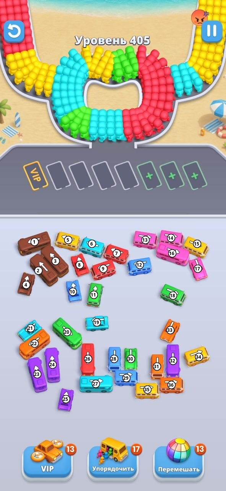

# Bus Fever Party — уровень 405 без бустеров

Разбор уровня 405 Android-игры **Bus Fever Party!** (Lumi Games, пакет `gridplus.busjam.carpuzzle`) — как пройти его логикой, без «VIP», «Упорядочить» и «Перемешать». Готовых прохождений 405-го в сети нет: сайты-прохождения обрываются на уровнях 329 и ниже, поэтому всё ниже — разбор по стартовому скриншоту.

## Правила, на которых строится решение

- **Машина едет только по стрелке.** Тап по машине — она выезжает с парковки, если путь по стрелке свободен до края поля. Если на пути другая машина — никуда не едет.
- **Выехавшая машина встаёт в слот у остановки.** Обычных слотов **4**. Слот **VIP** — это бустер, а три слота с «+» открываются за монеты или рекламу. Играем на четырёх.
- **Пассажиры не стоят в очереди, а ездят по кругу** вокруг островка (по часовой стрелке). Мимо выезда к стоянке проходит весь круг по очереди. Пассажир выходит, только если в слотах стоит машина его цвета. Заполненная машина уезжает и освобождает слот.
- **Круг подпитывают рукава**: сначала **левый**, пока он не кончится, потом **правый**. Новые пассажиры встают на круг только на освободившиеся места — если круг забит одним цветом, а машины этого цвета нет, подача встаёт.
- **Число под машиной в слоте** — сколько пассажиров ей ещё не хватает.
- **Проигрыш** («Нет места!») — все 4 слота заняты, а пассажиров их цветов на круге нет.
- Вместимость по размеру: маленькая машинка меньше всех, автобус больше, длинный автобус больше всех (в видео длинные брали по 40).

Отсюда главное правило уровня: **слот — это ресурс**. Машина «чужого» цвета — того, которого сейчас нет на круге, — занимает слот надолго. Две такие машины — и остаётся всего два рабочих слота.

## Стартовое поле

**Пассажиры.** На старте на круге и в рукавах только четыре цвета: **жёлтый, голубой, зелёный, красный**, причём красных очень много. Остальные пять цветов машин (**коричневый, розовый, фиолетовый, оранжевый, синий**) приходят позже из левого рукава. Пока их пассажиров на круге нет, машины этих цветов — «чужие».

**Порядок подачи** (по записи прохождения):

1. **Левый рукав:** красные и жёлтые → **оранжевые** → **коричневые** → голубые → **фиолетовые** → **розовые** → **синие** → **зелёные**.
2. **Правый рукав** (после левого): голубые, затем жёлтые.

**Машины** (36 штук, по 4 на цвет):

| Цвет | Номера | На круге на старте? |
| :--- | :--- | :--- |
| Жёлтый | 5, 15, 34, 35 | да |
| Голубой | 6, 19, 21, 27 | да |
| Зелёный | 11, 18, 20, 30 | да |
| Красный | 7, 8, 9, 26 | да |
| Коричневый | 1, 2, 3, 4 | нет |
| Розовый | 13, 14, 16, 17 | нет |
| Фиолетовый | 23, 24, 25, 32 | нет |
| Оранжевый | 22, 31, 33, 36 | нет |
| Синий | 10, 12, 28, 29 | нет |

## Кто свободен и кто кого блокирует

**Свободны сразу (8):**

- полезные: **15** и **34** (жёлтые), **18** (зелёный), **21** (голубой);
- «чужие»: **1** (коричневый), **17** (розовый), **22** и **36** (оранжевые).

**Что мешает каждой машине.** Блокировку считаем по **полной ширине кузова**: машина едет по стрелке полосой шириной с себя, и любой кузов, задевающий эту полосу хоть углом, её останавливает. Блокеру достаточно уехать с поля в слот — дожидаться, пока он наполнится, не нужно.

| Машина | Кто мешает (должен уехать с поля раньше) |
| :--- | :--- |
| 1 коричн. | — свободна |
| 2, 3 коричн. | 1 |
| 4 коричн. | 1 (возможно, и 2) |
| 5 жёлт. | 1 |
| 6 голуб. | 5 |
| 8 красн. | 5 и 6 |
| 7 красн. | 6 и 8 |
| 9 красн. | 8, **2 и 3** (наклонённые коричневые задевают полосу задними углами) |
| 10 синий | 8 (возможно, и угол 3) |
| 11 зел. | 9 |
| 12 синий | 7 и 9 |
| 15, 17, 18 | — свободны |
| 14 роз. | 15 |
| 16 роз. | 15 и 17 |
| 13 роз. | 14 и 16 |
| 21 голуб., 22 оранж., 34 жёлт., 36 оранж. | — свободны |
| 35 жёлт. | 36 |
| 31 оранж. | 35 и 36 |
| 32 фиол. | 36 |
| 33 оранж. | 32 (возможно, и 31) |
| **29 синий** | **31, 32, 35, 36** — кузов 29 задевает низ 31 и 32; проверено в игре: после ухода 36 и 35 машина 29 упирается в 31 |
| 27 голуб. | 29, 35, 36 |
| 26 красн. | 27 |
| 28 синий | 29 |
| 30 зел. | 29 (возможно, и 35) |
| 20 зел. (едет по диагонали ↘) | 26, 28, 29 — диагональная полоса проходит через всё нижнее поле |
| 19 голуб. | 20 и 21 |
| 23 фиол. | 21 и 22 |
| 24 фиол. | 22 и **20** |
| 25 фиол. | 20 (возможно, и 24) |

**Свободны сразу (8):**

- полезные: **15** и **34** (жёлтые), **18** (зелёный), **21** (голубой);
- «чужие»: **1** (коричневый), **17** (розовый), **22** и **36** (оранжевые).

## Разбор проигрыша (видео, 107 секунд)

Ходы игрока по слотам: коричневая 1 → жёлтая 5 → голубая 6 → красная 8 → зелёная 18 → голубая 21 → оранжевая 36 → красная 7 → фиолетовая 32 → жёлтая 35 → розовые 17 и 16.

Что пошло не так:

- **Круг забился красными.** Красных пассажиров на старте больше всего, а доступны только красные 7 и 8. После них красные копятся на круге, места для новых цветов из рукава всё меньше.
- **Четыре слота встали в ожидании:** коричневая 1 (не хватает 8), фиолетовая 32 (4), жёлтая 35 (8), розовая 16 (20). Коричневых и фиолетовых на круге уже нет, жёлтые остались в правом рукаве, а он не подаётся, пока не кончится левый. На круге в это время красные, голубые, синие — ни одной подходящей машины, «Нет места!».
- **Красные 26 и 9 так и не открыты.** Перед 26 должны уехать 36, 35, 31, 32, 29 и 27; во второй попытке после 36 и 35 синяя 29 упёрлась в оранжевую 31.

## Где ловушка

**Все четыре красные машины заперты за «чужими» цветами**, а красных пассажиров на круге больше всего:

- красные **7, 8** стоят за коричневой **1**: нужны 1 → 5 → 6 → 8 → 7;
- красная **9** — дополнительно за коричневыми **2 и 3** (см. выше): до прихода коричневых пассажиров она недоступна;
- красная **26** — за **шестью** машинами: 36 (оранж.), 35 (жёлт.), 31 (оранж.), 32 (фиол.), 29 (синий), 27 (голуб.).

Без бустера к красным не пройти, не пожертвовав слотом под «чужую» машину. Выгоднее всего пожертвовать **коричневой 1**:

- **одна** чужая машина открывает жёлтую 5, голубую 6 и **две красных** (7, 8);
- путь к красной 26 проходит через четыре чужих цвета, и часть из них (фиолетовая 32 на 40 мест, синяя 29) приходится ставить в слот задолго до их пассажиров.

Коричневая 1 потом сама уедет, когда на круг придут коричневые пассажиры (в видео — примерно на 40-й секунде, сразу за оранжевыми).

**Главный вывод из двух видео: красных пассажиров больше, чем вмещают доступные красные 7 и 8.** Без 26 или 9 круг забивается красными, но обе дороги дорогие:

- **к 9** — коричневые 2 и 3 в слоты (по 40 мест), а за первую волну коричневых приходит около 32 пассажиров — даже коричневая 1 не наполняется;
- **к 26** — шесть машин. По счётчикам из видео жёлтых до правого рукава хватает на 5 и часть 35 (35 недобирает 8), фиолетовых в первой волне — на 36 из 40 мест у 32. Значит, к моменту, когда открывается 29, в слотах уже стоят недобравшие коричневая 1, жёлтая 35 и, скорее всего, фиолетовая 32 — для 29 места нет.

## План ходов

Перед каждым тапом смотрите, какие цвета сейчас на круге, и считайте занятые слоты. Не выводите машину «про запас», если её цвет ещё далеко.

1. **На жёлтых, голубых и зелёных с круга — только свободные полезные машины:**
   - жёлтые **15**, **34**;
   - голубая **21**;
   - зелёная **18**.

   Выводите их по одной под цвета, которые сейчас на круге. Нужна вторая машина того же цвета — выводите, когда первая почти заполнена. Жёлтая **15** заодно открывает розовые на потом.

   **Жёлтых не больше одной в слотах.** Основная масса жёлтых пассажиров стоит в правом рукаве, а он начнёт подаваться только после того, как кончится левый — почти в самом конце уровня. Две жёлтые в слотах = два мёртвых слота: проверено, в этой ситуации красный блок обслужить уже нечем.
2. **Сразу, пока слоты пустые, запускайте цепочку верхнего левого угла:**
   1. **1** (коричневая, в жертву: занимает слот).
   2. **5** (жёлтая) и **6** (голубая) — на старте жёлтых и голубых на круге много, поэтому 5 и 6 быстро наполнятся и уедут. Не затягивайте: позже стартовые жёлтые кончатся, и 5 станет «мёртвым» слотом.
   3. **8**, затем **7** (красные) — под красный блок на круге.
3. **Красную 9 и зелёную 11 не трогать до коричневых пассажиров.** Красный 9 упирается в коричневые 2 и 3, а вывести их — ещё два мёртвых слота.
4. **Нижний правый угол (36 → 35 → 31 и 32 → 29 → 27 → 26)** — единственный путь к красному автобусу на 40 мест:
   1. **Оранжевая 36** — когда на круг пойдут оранжевые (первый новый цвет из левого рукава).
   2. **Жёлтая 35** — сразу после 36, пока на круге есть жёлтые.
   3. **Оранжевая 31** — на остаток оранжевой волны.
   4. **Фиолетовая 32** — на фиолетовую волну.
   5. **Синяя 29**, **голубая 27**, **красная 26**.

   По расчёту выше на четырёх слотах эта цепочка, скорее всего, не проходит: к шагу 29 три слота занимают недобравшие машины. Порядок ходов, который это обходит, по двум видео найти не удалось.
5. **Длинные чужие автобусы по 40 мест** (фиолетовая 32, розовая 16) **не выводить «на подходе»** — только когда на круге уже крупный блок их цвета. В видео фиолетовая 32 недобрала 4, а розовая 16 — 20, и обе стояли до проигрыша. Под первые порции фиолетовых и розовых берите машины поменьше: розовую машинку 17, фиолетовые 23 и 24 (их открывает оранжевая 22).
6. **Остальные чужие цвета** (оранжевый 22, синие 10, 12, 28) выводите строго под свой цвет на круге.

> [!warning] Сверка по ходу игры
> План проверен только до проигрышей из двух записей; полного прохождения на четырёх слотах пока нет. Правило на каждый ход: прежде чем занять четвёртый слот, убедитесь, что хотя бы одна машина в слотах сейчас наполняется с круга. Начать уровень заново (кнопка ↺ слева сверху) бесплатно.

## Общие приёмы для таких уровней

- **Сначала читаем поле, потом тапаем:** выписать свободные машины и цепочки блокировок, как выше.
- **Считаем «чужие» блокеры:** если массовый цвет на круге заперт, ищите путь, где жертвуется меньше слотов.
- **Держим хотя бы один слот пустым** до самого конца — это «запасной ход» на случай, если на круг придёт новый цвет.
- **Не дублировать цвет без нужды:** две машины одного цвета в слотах имеют смысл, только если пассажиров этого цвета на круге больше, чем влезает в одну.
- **Перед тапом ждём, пока посадка закончится** — пассажиры продолжают садиться и после последнего хода.

#Игры #Android #Головоломки #Bus_Fever_Party
